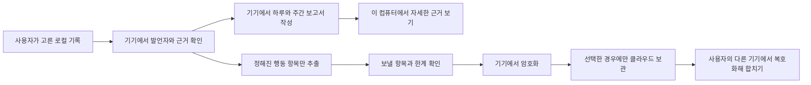

# Avatar의 로컬 분석과 선택형 동기화

2026-10-09 제안. 사용자는 Avatar를 먼저 자기 컴퓨터에서 쓰고, 원할 때만 여러 컴퓨터의 관찰을 합치고 싶어 합니다. 대화 원문과 업무 내용은 Avatar 운영 서버에 보내지 않습니다. 이 문서는 구현할 경계를 정하는 초안이며, 동기화 기능이 이미 있다는 뜻은 아닙니다.

## 지금 가능한 일과 빠진 일

- 현재 로컬 화면은 사용자가 Avatar에 직접 남긴 선택과 기준을 읽고, 선택을 [하루와 한 주](choice-timeline-results.md)로 묶습니다. 일반 AI 대화를 자동으로 읽거나 그 대화를 바탕으로 하루·주간 보고서를 만들지는 않습니다.
- 별도의 `--ai claude` 옵션을 켜고 보낼 기록을 확인하면 Claude에 그 기록을 전송합니다. 이것은 Avatar 클라우드 동기화와 다른 선택입니다. 이 경로를 오프라인 분석이라고 부르지 않습니다.
- `/journal.html`은 날짜가 있는 가상 인물의 화면 시안입니다. 여러 기기 동기화, 실제 평가, 다음 주 알림은 연결되지 않았습니다.

## 제품 원칙

1. 처음 실행하면 로컬 모드로 엽니다. 계정이나 네트워크 연결 없이 기록을 읽고 고칠 수 있어야 합니다.
2. 사용자가 동기화를 켤 때 목적, 보낼 항목, 서버가 볼 수 있는 정보, 삭제 방법을 먼저 보여줍니다. 첫 버전은 자료를 올릴 때마다 확인합니다. 다른 기기에서도 올리기 전에 따로 확인합니다. 항목이나 형식 버전이 바뀌면 다시 동의를 받습니다.
3. 분석은 해당 컴퓨터에서 합니다. Avatar 서버에는 대화 원문, 인용, 자유 문장, 프로젝트명, 파일 경로, URL, 정확한 시각·위치, 원문에서 만든 해시를 보내지 않습니다.
   로컬 모델이 만든 관찰은 후보로만 둡니다. 사람의 확인 없이 동기화 자료나 개인 규칙으로 바꾸지 않습니다.
4. 여러 기기에서 합칠 자료도 한 사람의 정보입니다. 항목을 줄인 뒤 기기에서 암호화하고, 사용자의 다른 기기에서만 풉니다. 운영자는 내용을 읽을 수 없어야 합니다. 계정과 접속 시각 등 서버 메타데이터는 별도로 줄여야 합니다.
5. ‘이 기기 연결 해제’와 ‘모든 기기 연결 해제 및 서버 자료 삭제’를 구별합니다. 전체 삭제 뒤에는 옛 기기가 자료를 다시 올리지 못하게 막습니다. 다른 기기에 이미 내려받은 사본과 서버 백업·로그의 삭제 조건은 구현 전에 정해 화면에 알립니다.
6. 광고는 공개 가상 이야기 화면에서만 별도로 검토합니다. 개인 관찰이나 동기화 자료로 광고 대상을 고르지 않습니다. 광고 화면과 로컬 기록 화면은 서로 다른 출처의 사이트에서 제공해야 합니다.
7. 오류 보고와 사용량 측정은 기본값으로 끕니다. 켠다면 별도 동의와 동일한 전송 검사를 적용합니다.

## 자료가 흐르는 경로

이 흐름에서 일반 대화를 읽어 `B`와 `C`를 수행할 분석기는 아직 없습니다. 분석에 외부 모델을 쓰면 그 모델로 나가는 자료를 별도로 설명하고 동의를 받아야 합니다. 기본 로컬 모드가 외부 모델을 몰래 부르면 안 됩니다.

## 동기화할 자료의 첫 초안

서버가 받는 것은 암호문과 동기화에 꼭 필요한 계정·기기 식별 정보입니다. 암호화하기 전의 내용도 자유 문장을 받지 않는 고정 형식으로 제한합니다.

| 기기에서 만든 항목 | 쓰는 까닭 | 제한 |
|---|---|---|
| 주 단위 기간 | 여러 기기의 관찰을 같은 주로 묶음 | 날짜·시각·위치 없음 |
| 관찰 종류 | 조건 제시, 근거 요청, 사용자 정정, AI의 조건 누락 등 대화 방식 구별 | 정해진 값만 허용. 주제·감정·성격 이름 금지 |
| 발언자와 확인 상태 | 사용자 행동과 AI 실패를 구별하고, 실제 결과를 모르면 모른다고 표시 | `user`·`assistant`, `observed`·`unknown`처럼 정해진 값만 허용 |
| 중복 확인용 내부 ID | 두 기기에서 같은 대화를 읽었을 때 이중 집계를 줄임 | 원문·프로젝트명·경로·공개 해시 금지. 암호문 안에만 보관 |

원문 인용, 대화 제목, 자유롭게 고친 해석, 하루 일기, 개인 규칙, 건강·감정 추정, 세밀한 타임라인, Claude가 쓴 해석은 동기화 대상에서 뺍니다. 주간 수치만 보내면 중복을 제거하기 어려우므로 기기에서 확인한 작은 관찰 단위로 합치는 안을 먼저 시험합니다. 이 단위도 민감할 수 있어 암호화와 항목 제한을 함께 적용합니다. 두 기기가 같은 대화를 독립적으로 가져왔는데 공통 ID가 없다면 중복을 확실히 가릴 수 없습니다. 그때는 합계를 정확하다고 표시하지 않습니다.

## 사용자가 보는 순서

1. 로컬에서 하루·주간 보고서를 봅니다. 근거는 원래 기록이 있는 기기에서 엽니다.
2. ‘여러 기기에서 함께 보기’를 고르면 전송 항목의 예시와 실제 이번 전송 건수를 봅니다. 기본값은 꺼짐입니다.
3. 사용자가 이번 전송을 확인하면 기기가 허용된 항목을 만들고 암호화해 올립니다. 다른 컴퓨터는 연결과 그 컴퓨터의 업로드를 따로 선택합니다.
4. 합친 보고서는 기기별 관찰 수와 중복·출처가 불확실한 수를 보여줍니다. 다른 기기의 원문을 이 컴퓨터에서 열 수 있다고 약속하지 않습니다.
5. 설정에서 이 기기만 끄거나, 모든 기기를 끄고 서버 자료를 지웁니다. 로컬 기록을 지우는 선택은 별도로 둡니다. 다른 기기에 이미 받은 사본은 원격에서 지울 수 있다고 약속하지 않습니다.

## 얻는 것과 잃는 것

여러 컴퓨터에서 대화 방식의 반복과 변화를 더 넓게 볼 수 있습니다. 하지만 다른 컴퓨터의 구체적인 대화를 다시 읽는 일은 할 수 없습니다. 원문을 보내지 않기 때문입니다. 실제로 어디서 문제가 생겼는지 보려면 그 기록이 남아 있는 기기에서 열어야 합니다. 기록을 충분히 읽지 못했거나 두 기기가 같은 대화를 중복해서 읽었다면 수치에 한계를 표시합니다.

사용자만 내용을 푸는 동기화라면 운영자는 개인별 관찰을 읽거나 그 자료로 광고를 겨냥할 수 없습니다. 운영자가 전체 이용자 통계를 원한다면 목적과 동의를 별도로 정해야 합니다. 이 초안에는 운영자 통계를 넣지 않았습니다.

## 구현 전 확인할 일

- 가상 대화에서 발언자, 조건, AI 누락, 사용자 정정, 검증 결과를 안정적으로 구별하는 로컬 분석기를 시험합니다. 모르면 `unknown`으로 남깁니다.
- 금지된 문자열이나 임의 필드가 들어 있는 가상 자료로 전송 전 검사를 돌립니다. 허용 목록에 없는 필드는 버리지 말고 전송을 중단합니다.
- 두 기기에서 같은 가상 대화를 본 경우와 다른 대화를 본 경우를 나눠 합칩니다. 중복을 확인할 공통 ID가 있는지 자료를 가져오는 경로부터 조사합니다. 같은 ID의 분석 결과가 다르면 한쪽을 임의로 채택하지 않고 충돌을 표시합니다.
- 사용자가 정한 시간대에서 주를 계산합니다. 옛 프로그램이 모르는 형식 버전을 받으면 합치지 않고 읽지 못한 건수를 알립니다.
- 계정 연결, 암호 키 전달·복구, 기기 분실, 서버 삭제, 오프라인 기기의 재접속을 설계하고 검증합니다. 키 복구 방법이 정해지기 전에는 클라우드 전송을 켜지 않습니다.
- 암호화 직전의 내용을 검사해 원문이 섞이지 않았는지 확인합니다. 네트워크 요청과 서버 로그는 계정, 접속 시각, 암호문 크기와 개수처럼 밖으로 드러나는 정보만 점검합니다. 이를 줄일 전송 주기, 파일 크기, 로그·백업 보존 기간은 서버를 정한 뒤 결정합니다.

## 독립 검토에서 고친 점

Claude CLI에 이 초안만 보내 검토했습니다. 저장소 코드나 실제 대화는 보내지 않았습니다. 검토는 각 기기의 동의, 계속 올리는 자료의 범위, 중복, 백업·로그, 광고 화면 분리, 암호화 직전 검사 누락을 짚었습니다. 위 조항에 반영했습니다. 원본 ID를 이용한 중복 제거 방식과 암호 키 복구는 자료를 가져오는 경로가 정해지지 않아 보류했습니다. 모델의 검토는 설계의 안전성을 입증하지 않습니다.

가상 자료만 쓰는 [전송 형식 실험](evidence/2026-10-09-sync/contract_probe.py)을 실행했습니다. 여섯 가지 검사가 통과했습니다. 정해지지 않은 필드와 원문처럼 보이는 문자열은 거절했습니다. 같은 ID와 같은 관찰은 한 번만 세고, 같은 ID의 내용이 다르면 합계에서 뺐습니다. 이 실험은 암호화·업로드·실제 대화 분석을 하지 않았습니다. 독립적으로 가져온 같은 대화에 서로 다른 ID가 붙는 문제도 풀지 못했습니다.

[로컬 모델 시험](offline-analysis-v2-results.md)에서는 가상 사례 여섯 개 중 두 개의 응답에 사용자 문장이 다시 나왔습니다. 모델에게 JSON 형식을 요청해도 일어났습니다. 이 결과 때문에 동기화 자료는 모델 응답을 그대로 가져오지 않고, 코드가 허용한 항목과 사람이 확인한 관찰에서만 만들어야 합니다. 앞의 전송 형식 실험은 자료 제한을 시험했을 뿐, 모델 해석의 정확도를 보장하지 않습니다.

## 근거와 한계

[NIST의 비식별화 연구](https://www.nist.gov/publications/de-identification-personal-information)는 식별자를 지운 자료도 다시 개인과 연결될 수 있음을 설명합니다. 그래서 ‘요약만 보내면 안전하다’고 보지 않습니다. [ICO의 자료 최소화 안내](https://ico.org.uk/for-organisations/uk-gdpr-guidance-and-resources/data-protection-principles/a-guide-to-the-data-protection-principles/data-minimisation/)는 목적에 필요한 정보만 모으도록 설명합니다. [OWASP의 클라이언트 암호화 설명](https://cheatsheetseries.owasp.org/cheatsheets/Secrets_Management_Cheat_Sheet.html#421-client-side-encryption-versus-server-side-encryption)은 서버 저장 암호화와 사용 기기에서 암호화하는 방식의 차이를 설명합니다. 이 근거들은 제품의 안전성이나 법적 적합성을 검증한 결과가 아닙니다.

적용 원칙: SSOT는 로컬 원문과 확인 이력을 그 기기의 Avatar에 둡니다. Honesty는 모델의 추측과 확인한 행동을 구별합니다. MECE는 사용자 행동, AI 행동, 확인되지 않은 결과를 따로 셉니다. AHA는 가상 두 기기의 중복과 누락을 먼저 시험한 뒤 전송 형식을 확정합니다.
