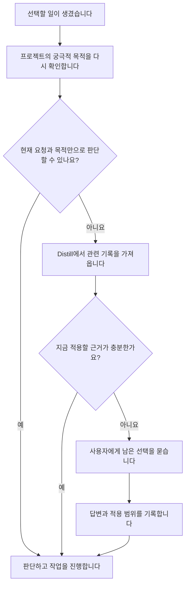

# 사람의 판단 기준을 모아 새로운 결정에 적용하는 아이디어

**상태: 2026-10-05에 사용자가 제안한 연구 후보입니다. 아직 구현하거나 효과를 시험하지 않았습니다.**

이후 사용자는 개인의 기준과 메타인지를 다룰 [Avatar / Clone을 별도 플러그인으로 구분](avatar.md)하자고 제안했습니다.
현재는 본래 연구와 구분해 기록하며, 새 플러그인의 구현은 보류합니다.

이후 사용자는 기존 Distill과의 중복을 지적하고, Distill의 처음 목적은 룰 생성이었다고 설명했습니다.
`novel-ai`의 Distill에는 수집·규칙 생성·검색 기능이 이미 있습니다.
[기존 구현과 대조한 결과](findings/2026-10-05-distill.md)를 바탕으로 후속 검증 범위를 정합니다.
이번 구상의 조건·우선순위·기준 변경까지 당초 목적과 같았다고 단정하지 않습니다.
위의 미구현·미검증 상태는 이번에 제안한 정책과 비교 실험을 가리킵니다.

사람이 어떤 기준으로 선택하는지 모으고, 그 기준을 Claude와 Codex가 새 상황에서 쓸 수 있게 하는 아이디어입니다.
제품의 목적은 **판단 기준이 쌓이면서 새로운 상황에서도 그 기준을 일관되게 적용하는 것**입니다.
기준과 예외를 어떻게 적용했는지 확인해야 합니다. 상황이 다른데 결론을 무조건 같게 만드는 것은 목적에 맞지 않습니다.
새 상황에 적용한 결과를 확인해 잘못 추정한 기준을 고치고, 사람이 바꾼 기준도 반영합니다.
앞선 여섯 시제품과 구별해 별도로 연구합니다.

## 사용자가 던진 생각

> 사람의 의사결정의 기준은 그렇게 쉽게 바뀌지 않죠.

> 의사결정의 기준들을 어딘가 모여있다면 그게 바로 사고하는 인간 자체가 되는건데요.

사용자는 기준을 어떻게 수집하고, 어떻게 동작하게 하며, 어떻게 개선할지 연구할 필요가 있다고 제안했습니다.
이 기록은 그 제안을 보존합니다. 사람의 기준이 항상 일정하다는 사실이나 인간의 사고 전체를 재현할 수 있다는 사실을 확인한 것은 아닙니다.

## 확인할 핵심 가설

1. 한 사람이 비슷한 상황에서 반복해서 쓰는 기준을 찾을 수 있습니다.
2. 그 기준을 상황·예외·우선순위와 함께 보관하면 새 요청을 처리할 때 다시 설명하는 수고가 줄어듭니다.
3. 이전 선택을 그대로 복사하는 것보다, 기준을 적용하는 편이 새로운 상황에서도 그 사람의 뜻에 더 잘 맞습니다.
4. 기준을 수집하고 확인하는 비용을 포함해도 장기적으로 재지시와 재작업이 줄어듭니다.

네 항목 모두 아직 검증하지 않은 가설입니다.
기준만으로 설명되지 않는 정보, 경험, 감정, 상황도 있을 수 있습니다.
‘그 사람의 사고를 재현한다’는 생각은 어느 범위에서 성립하는지부터 확인해야 합니다.

## 한 사람의 기준은 프로젝트를 넘어 이어집니다

사용자는 세 개선을 Stage에서 제공할 수 있다는 논의 뒤에도, 한 사람의 판단 기준을 프로젝트 밖에서 모으는 의미를 강조했습니다.
이 방향은 유지합니다. Stage에 기능을 연결한다는 이유로 개인의 기준을 한 프로젝트에 가두지 않습니다.

제안하는 역할은 다음과 같습니다.

- Stage는 현재 프로젝트의 목적, 결정과 작업 결과를 연결합니다.
- Avatar / Clone은 여러 경험에서 드러난 개인의 기준을 모으고, 언제 적용할지와 어떻게 바뀌었는지를 다루는 역할을 검토합니다.
- 현재 일을 수행하는 AI는 프로젝트 목적과 관련 기록을 확인하고, 부족할 때 개인의 기준을 찾아 적용합니다.

이 구분은 사용자가 별도 플러그인을 요청한 뒤 정리한 책임입니다. 기존 Distill이 이 정책을 모두 수행한다는 뜻은 아닙니다.
개인의 기준을 보관하는 곳은 Stage를 쓰지 않는 프로젝트에서도 이용할 수 있도록 검토합니다.
제품을 몇 개로 출시할지와 이 책임을 어디에 둘지는 따로 판단합니다.

예를 들어 ‘이 프로젝트에서는 Python을 쓴다’는 결정을 모든 프로젝트의 선호로 확대하지 않습니다.
‘도구를 고를 때 익숙함보다 장기 유지 비용을 우선한다’는 발언은 적용 범위에 따라 여러 프로젝트의 기준이 될 수 있습니다.
이는 설명용 예시이며 사용자의 실제 기준으로 기록하지 않습니다.
여러 프로젝트에서 같은 선택을 했어도 공통 제약 때문일 수 있으므로 반복만으로 개인의 기준을 확정하지 않습니다.

기대하는 쓰임새는 재설명을 줄이는 데서 더 나아갑니다.
사람이 어떤 상황에서 무엇을 우선했는지 돌아보고, 서로 충돌하는 기준이나 생각이 바뀐 이유를 살펴볼 수 있습니다.
AI나 프로젝트를 바꿔도 이 기록을 이어서 활용할 수 있습니다.
이 효과는 가설입니다. 기록에 맞추도록 사람을 고정하지 않고, 현재의 의도와 수정 내용을 반영해야 합니다.

검증할 때는 한 프로젝트의 사례에서 만든 기준을 다른 프로젝트의 별도 사례에 적용해 봅니다.
맞게 적용한 경우뿐 아니라 프로젝트별 예외를 놓친 경우도 셉니다.
기준을 참조하는 것과 원래 프로젝트 자료를 다른 곳에 전달하는 범위는 따로 정합니다.
이번 문서 변경으로 다른 프로젝트의 자료를 수집하거나 공유하지는 않았습니다.

## 어떻게 수집할까요

| 수집할 자료 | 알아낼 수 있는 것 | 함께 확인할 것 |
|---|---|---|
| 사람이 직접 말한 원칙과 선호 | 명시한 기준 | 언제 적용하는지, 예외가 있는지 |
| 선택지 중 무엇을 고르고 무엇을 버렸는지 | 실제 선택과 대안 | 당시 정보·제약·가능했던 선택지 |
| AI의 제안을 어떻게 고쳤는지 | 기대와 어긋난 부분 | 사실 오류 때문인지, 기준이 달라서인지 |
| 비슷한 조건에서 달리 선택한 사례 | 예외나 기준 변화의 후보 | 사람의 기준이 바뀐 것인지 상황이 달랐는지 |
| 결과를 본 뒤의 평가 | 처음 기대한 효과와 실제 결과의 차이 | 우연히 성공한 선택을 좋은 기준으로 굳히지 않았는지 |

선택 하나만 보고 기준을 확정하지 않습니다.
예산이나 권한 때문에 고른 차선책을 선호하는 방식으로 오해할 수 있습니다.
사람이 직접 밝힌 기준과 AI가 추정한 기준을 구별해 저장합니다.
사람이 확인했는지와 추정을 뒷받침하는 근거가 얼마나 있는지는 별도로 남깁니다.
근거가 더 쌓여도 사람이 확인한 기준으로 자동 분류하지 않습니다.

처음에는 이 프로젝트에서 사용자가 허용한 대화와 작업 기록처럼 범위가 분명한 자료를 사용합니다.
추가 서비스나 다른 사람의 기록을 수집하는 방식은 이번 제안에 포함하지 않습니다.

## 무엇을 보관할까요

기준 한 개마다 다음 항목을 검토합니다. 저장 형식은 아직 정하지 않았습니다.

- **기준:** 무엇을 더 중요하게 보는지 적습니다.
- **적용 상황:** 어느 일과 조건에서 쓰는지 적습니다.
- **근거:** 원래 발화와 실제 선택으로 돌아갈 수 있게 연결합니다.
- **예외:** 그 기준을 적용하지 않은 사례와 이유를 남깁니다.
- **우선순위:** 다른 기준과 충돌할 때 무엇을 먼저 따랐는지 남깁니다.
- **확인 상태:** 직접 말한 기준인지, 행동에서 추정했는지 구별합니다.
- **유효한 기간과 버전:** 바뀐 시점과 이전 내용을 보존합니다.
- **사용 범위:** 설명을 맞추는 데 쓸지, 행동을 제안하는 데 쓸지 정합니다.

기준을 알고 있다는 이유만으로 실행 권한까지 생기지는 않습니다.
그때의 사용자 요청과 허용한 범위도 함께 확인해야 합니다.

## 의사결정의 기준을 어떻게 만들어 갈까요

**목적을 이루기 위해 어떤 상황에서 무엇을 우선했는지 설명하고, 그 설명을 다른 사례에서도 확인합니다.**
아래는 사용자가 중요하다고 지적한 문제를 다루기 위한 설계 제안입니다. 효과를 검증한 방법은 아닙니다.

### 목적과 실제 선택을 함께 봅니다

프로젝트의 목적에서 먼저 지켜야 할 조건을 찾습니다.
목적이 곧바로 정해 주지 않는 우선순위는 실제 선택과 사용자의 설명에서 찾습니다.
예를 들어 어떤 도구를 여러 번 골랐어도, 좋아해서 골랐는지 다른 선택지가 없어서 골랐는지는 다를 수 있습니다.
기록에 이유가 없다면 미상으로 남깁니다. AI가 만든 설명은 별도의 추정으로 취급합니다.

| 남길 근거 | 이후 확인할 질문 |
|---|---|
| 당시의 목적과 현재 요청 | 무엇을 이루려던 선택이었나요? |
| 실제로 가능했던 선택지와 제약 | 선택할 수 없었던 대안을 선호하지 않는다고 오해하지 않았나요? |
| 고른 것과 버린 것 | 무엇을 얻으려고 어떤 대가를 받아들였나요? |
| 사용자가 밝힌 이유와 원문 위치 | 설명을 직접 들었나요, AI가 추정했나요? |
| 선택 뒤의 결과와 사용자 수정 | 기준 적용이 맞았나요, 사실이나 실행이 잘못됐나요? |

위 표는 시스템이 기록에서 확인할 항목입니다. 결정할 때마다 사람에게 전부 묻는 질문지가 아닙니다.
사용자가 이미 설명한 내용과 작업 중 관찰한 사실을 먼저 사용합니다.

### 관찰한 선택을 조건이 있는 기준으로 정리합니다

기준 후보는 다음 내용을 담도록 제안합니다.

> 이 목적을 이루려는 상황에서, 이 조건이 성립하면 A보다 B를 우선합니다.
> 그 이유는 이렇습니다. 다만 이 예외에는 적용하지 않습니다.

프로젝트 목적이나 선택지에 없는 우선순위를 임의로 채우지 않습니다.
모든 기준에 비교 대상이 필요한 것은 아닙니다. 반드시 지켜야 하는 제약은 별도로 표현합니다.
어떤 목적에도 연결되지 않는 선호는 개인 선호로 남기고 프로젝트의 필수 조건으로 올리지 않습니다.

사용자가 명확하게 말한 기준은 한 번의 발언만으로도 그 범위에서 적용할 수 있습니다.
행동에서 추정한 기준은 반복 횟수만으로 확정하지 않습니다.
같은 선택을 설명할 수 있는 다른 이유와 예외를 함께 검토합니다.

### 다른 사례에서 맞는지 확인합니다

후보를 만든 사례와 별도의 사례로 확인합니다.
조건이 비슷한데 사용자가 다르게 고른 사례, 조건이 달라 결론도 달라져야 하는 사례를 포함합니다.
과거 결론을 얼마나 자주 재현하는지와, 적용한 이유가 맞는지를 따로 봅니다.
이미 기록된 사용자 선택으로 비교할 수 있다면 새 질문을 추가하지 않습니다.

기준이 틀렸을 때는 내용을 무조건 보강하지 않습니다.
적용 범위가 너무 넓었는지, 예외가 빠졌는지, 이유를 잘못 추정했는지, 사용자가 생각을 바꿨는지 구별합니다.
한 번 성공한 결과도 기준이 옳다는 충분한 증거로 삼지 않습니다. 우연한 성공이나 실행 차이가 있을 수 있습니다.

### 이번 대화에서 기준을 만드는 예

사용자는 판단할 때마다 질문하면 작업 흐름이 끊긴다고 말했습니다.
이 말만으로 ‘질문을 전혀 하지 않는다’는 규칙을 만들면 사용자가 말한 범위를 넘습니다.
이후 사용자가 목적을 먼저 확인하고, 부족하면 Distill을 조회한 뒤, 그래도 답이 없으면 묻는 순서를 제안했습니다.
그 설명으로 질문을 줄일 조건과 질문이 필요한 조건이 구체화됐습니다.

현재 기록할 기준은 다음과 같습니다.

> 목적과 관련 기록으로 판단할 수 있으면 진행합니다.
> 둘을 확인해도 필요한 기준이 없으면 사용자에게 묻습니다.

이 기준은 사용자가 직접 제안한 절차에서 나왔습니다.
AI가 단순히 여러 번 관찰한 행동에서 추정한 기준과 같은 상태로 저장하지 않습니다.
다음 사례에서는 이 절차가 불필요한 질문과 근거 없는 결정을 함께 줄이는지 확인해야 합니다.

### Distill에 무엇이 남아야 하나요

선택 당시의 기록과 거기서 뽑은 기준을 연결합니다.
룰을 만들 때도 그 기준의 적용 조건과 예외를 보존합니다.
원래 근거를 남겨야 사용자가 기준을 고쳤을 때 어떤 규칙과 판단을 다시 볼지 알 수 있습니다.
AI가 해당 규칙을 여러 번 사용했다는 사실을 사용자 선호의 추가 증거로 세지 않습니다.

기준을 잘 만들었다고 평가하려면 새 상황에서의 판단, 목적 달성, 사용자 질문과 재작업을 함께 봐야 합니다.
사용자와 같은 선택을 했다는 사실만으로 목적에 맞는 결과까지 얻었다고 판단하지 않습니다.

## 어떤 순서로 판단할까요

사용자가 제안한 순서는 **프로젝트의 궁극적 목적 → Distill의 관련 기록 → 사용자 질문**입니다.
판단이 필요할 때 곧바로 사람에게 묻거나, 매번 Distill부터 조회하는 흐름을 수정합니다.

1. **프로젝트의 궁극적 목적을 다시 확인합니다.** 현재 선택이 무엇을 달성하려는지 연결합니다. 현재 요청과 제약까지 적용해 선택할 근거가 충분하면 진행합니다.
2. **그래도 결정하기 어렵다면 Distill을 조회합니다.** 같은 종류의 결정, 선택한 이유, 적용 조건과 예외를 가져옵니다. 현재 목적·상황과 맞고 여전히 유효한 근거라면 이를 적용해 판단합니다.
3. **Distill에서도 적용할 근거를 얻지 못했다면 사용자에게 묻습니다.** 목적만으로 결정하지 못한 이유와 남은 선택지를 짧게 제시합니다.
4. **사용자 답변을 다음 판단에 활용할 수 있게 남깁니다.** 답변에 담긴 선택·이유·적용 범위를 함께 기록합니다. 이번 작업의 예외를 전역 규칙으로 바꾸지 않습니다.

목적이 추상적이어서 여러 선택이 모두 맞을 수 있습니다. 이때 목적만으로 답이 나왔다고 우기지 않습니다.
Distill에 문장이 있다는 사실만으로 판단을 끝내지도 않습니다.
관련 기록이 없거나, 조건이 다르거나, 대체된 기준이거나, 충돌을 해결할 수 없다면 근거가 부족한 경우입니다.
조회 오류는 관련 지식이 없다는 뜻과 구별해 알립니다.

현재의 명시적 지시가 저장된 과거 선호와 다르면 현재 요청을 따릅니다.
사용자가 목적을 바꿨다면 새 목적을 반영합니다. 과거 습관을 근거로 현재 목적을 임의로 바꾸지 않습니다.
Distill은 판단 근거를 제공하고, 현재 작업을 수행하는 AI가 그 근거를 적용합니다.
AI가 스스로 고른 답을 사람이 확인한 기준으로 저장하지 않습니다.
근거가 부족한 추정은 확정된 기준처럼 적용하지 않습니다.

이 순서는 이번 연구의 설계 기준입니다. 현재 Stage와 Distill이 자동으로 이 순서를 보장한다는 뜻은 아닙니다.
명확한 검사는 코드가 맡고, 목적·상황·근거를 해석하는 일은 모델이 맡도록 제안합니다.
앞선 판단과 목적·상황·기준 버전이 같다면 이미 가져온 근거를 다시 사용할 수 있습니다.

## 기준이 바뀌면 어떻게 처리할까요

기준 자체가 바뀐 경우와 이번 작업의 예외를 구별합니다.
새로운 사실 때문에 선택이 달라졌거나 AI가 처음부터 기준을 잘못 추정한 경우도 따로 남깁니다.
명확한 변경 지시는 적용 범위와 시점을 기록해 반영합니다.
행동만 보고 변화를 추정했다면 확인할 후보로 남깁니다.

이전 버전은 당시 판단의 근거를 설명할 수 있게 보존합니다.
바뀐 기준에 의존한 판단은 다음에 사용하기 전에 다시 확인합니다.
아직 실행하지 않은 계획도 살피되, 과거에 끝낸 일을 자동으로 되돌리지는 않습니다.

## AI에게 언제 전달할까요

**새 요청을 처리하기 전에는 목적과 판단 순서를 전달합니다.**
Distill의 기록은 목적만으로 결정하기 어려울 때 조회합니다.
대화 시작 때만 전달하면 작업 도중 바뀐 목적·기준이나 새로 필요한 근거를 놓칠 수 있습니다.
아래는 플러그인으로 구현할 때의 제안이며 실제 통합 시험은 아직 하지 않았습니다.

| 시점 | 전달하거나 검사할 내용 | 연결할 방법 |
|---|---|---|
| 세션을 시작하거나 재개합니다. | 프로젝트의 목적과 제약, 판단 순서를 짧게 전달합니다. | `SessionStart` 훅을 사용합니다. |
| 새 사용자 요청을 처리하기 전입니다. | 현재 요청을 목적과 연결할 수 있게 목적의 위치와 변경된 내용을 전달합니다. Distill의 전체 기록을 매번 붙이지 않습니다. | `UserPromptSubmit` 훅을 사용합니다. |
| 목적만으로 새로운 선택을 정하기 어렵습니다. | 그 선택에 필요한 과거 판단과 기준을 Distill에서 조회합니다. | 스킬이 조회 도구를 부릅니다. 기존 Distill은 MCP 도구를 제공합니다. |
| 관리하는 도구가 실제 행동을 실행하기 전입니다. | 판단에 쓴 기준 버전이 여전히 유효한지 검사합니다. | 지원되는 `PreToolUse` 훅이나 실행기 내부에서 검사합니다. |
| 대화 내용을 압축한 뒤 계속합니다. | 목적, 판단 순서와 이미 적용 중인 기준 버전을 다시 전달합니다. | 호스트가 제공하는 압축 후 훅 경로를 확인해 연결합니다. |

두 호스트가 제공하는 문맥 추가와 도구 제어 계약은 [공식 훅 자료](sources.md#s29)를 근거로 삼았습니다.
Codex 문서는 압축 직후 `SessionStart`의 `compact` 경로에서도 다음 모델 요청 전에 문맥을 전달한다고 명시합니다.
세부 지원 범위와 설치된 버전의 동작은 [통합 시험 계획](integration-choice.md)에 따라 확인해야 합니다.

### 작업 도중 바뀐 기준은 언제 반영되나요

사용자가 새 메시지로 변경을 알리면, 모델이 그 메시지를 처리하는 시점에 반영하도록 합니다.
다른 세션이나 저장소에서 기준을 바꿨다면 다음 조회나 훅 실행에서 버전 차이를 확인합니다.
저장소를 바꿨다는 사실만으로 진행 중인 모델 계산에 새 기준이 즉시 들어간다고 가정하지 않습니다.

실행 직전 문맥을 추가하는 것만으로 이미 선택된 도구 호출이 취소되지는 않습니다.
실행할 행동에 영향을 주는 기준이 바뀌었다면, 관리하는 호출을 보류하고 새 기준으로 다시 판단하게 설계합니다.
사용자가 중단한 작업을 이 검사로 자동 재개하지 않습니다.

예를 들어 라이브러리를 고르는 중에 새 의존성을 허용하지 않기로 바뀌었다고 가정합니다.
다음 조회에서 새 기준을 전달하고, 설치 직전에도 관련 기준의 버전을 확인합니다.
이전 기준으로 세운 설치 계획이면 실행을 보류합니다.
이미 설치했다면 그 사실을 남기고 처리 방법을 다시 판단합니다.

### 전달할 내용과 비용은 어떻게 제한할까요

매 요청마다 모든 과거 기록을 붙이지 않습니다.
첫 시제품은 목적만으로 해결되지 않은 선택을 대상으로 프로젝트·작업 종류·상황에 맞는 기록을 조회합니다.
관련 기준을 놓친 사례를 모은 뒤 검색 방법을 넓힙니다.
매번 별도 모델을 불러 관련성을 판단하는 방식은 그 비용까지 비교한 뒤 선택합니다.

전달하는 내용에는 기준 본문, 적용 범위, 예외, 버전과 근거 위치를 포함합니다.
오래된 기준을 대체한다면 어느 버전을 더 이상 적용하지 않을지도 명시합니다.
기준을 전달했다는 기록과 실제로 그 기준을 따랐다는 평가는 구별합니다.
모델 내부의 모든 판단 순간에 개입하는 훅은 이번 조사에서 확인하지 못했습니다.
판단 직전에 반드시 검사해야 한다면, 우리가 관리하는 별도 판단 호출 앞에 검사를 둡니다.

## 질문 때문에 작업이 끊기지 않게 하려면

사용자는 판단할 때마다 질문하면 작업을 이어가는 데 방해가 된다고 지적했습니다.
**목적과 기존 기록으로 판단할 수 있는 일은 진행하고, 해결되지 않은 선택만 사용자에게 묻습니다.**
기준을 조회하고 버전을 검사하는 일은 사용자 질문과 구별합니다.
프로그램 안에서 다시 판단할 필요가 생겼다고 사람에게 반드시 물어야 하는 것은 아닙니다.

| 상황 | 질문 없이 할 일 | 사용자에게 물을 조건 |
|---|---|---|
| 목적과 현재 요청으로 선택할 수 있습니다. | 그 근거로 작업을 진행합니다. | Distill 조회나 사용자 질문을 추가하지 않습니다. |
| 목적만으로 부족하지만 Distill에서 적용할 근거를 찾았습니다. | 근거를 현재 상황에 적용하고 작업을 진행합니다. | 같은 기준을 다시 승인받지 않습니다. |
| 사용자가 기준을 명확하게 바꿨습니다. | 말한 범위에서 변경을 반영합니다. | 이미 명확한 지시를 재확인하지 않습니다. |
| 기준 변화를 행동에서 추정했습니다. | 새 기준 후보와 근거를 기록합니다. 기존 기준을 몰래 바꾸지 않습니다. | 현재 결정에 필요하고 목적·기존 기록으로도 답이 나오지 않을 때 묻습니다. |
| 목적과 Distill을 확인해도 선택할 근거가 부족합니다. | 선택지와 준비한 자료를 정리합니다. | 부족한 기준을 사용자에게 묻습니다. |

되돌릴 수 있다는 이유만으로 근거 없는 선호를 대신 정하지 않습니다.
앞서 제안한 ‘되돌리기 어려운 경우에만 질문한다’는 조건은 사용자가 제안한 판단 순서에 맞춰 수정했습니다.

질문해야 한다면 이미 끝낸 준비와 선택에 따른 차이를 함께 제시합니다.
답이 없어도 할 수 있는 다른 작업은 계속합니다.
법적·금전적 권한 등 별도의 실행 제한을 선호 추정으로 대신하지 않습니다.

기준은 사용자가 평소에 하는 선택과 수정에서도 수집합니다.
예를 들어 ‘이 설명은 너무 길어요’라는 수정은 해당 응답을 고치는 데 바로 사용합니다.
이 한 번의 수정을 모든 답변을 짧게 써야 한다는 전역 규칙으로 확대하지 않습니다.
범위를 넓힐 근거는 후속 사례에서 찾습니다.
AI가 스스로 만든 선택이나 사용자의 침묵을 사용자 확인으로 세지 않습니다.

확인 후보가 생길 때마다 알림을 띄우거나, 작업 끝에 후보 전체를 승인받게 만들지 않습니다.
사용자가 결과를 고치거나 기준 검토를 요청한 시점에 관련 후보를 함께 살핍니다.
이 방식은 질문을 줄이는 대신 잘못 추정한 기준을 늦게 발견할 수 있습니다.
후속 시험에서는 질문을 줄인 이득과 그로 인해 늘어난 재작업을 함께 비교해야 합니다.

자동 조회의 비용도 제한합니다.
목적만으로 결정하기 어려울 때 관련 기록을 가져오고, 같은 범위와 버전에서는 다시 사용합니다.
작업 대상이나 기준 버전이 바뀌면 갱신합니다.
모든 판단마다 별도 모델을 호출하는 방식을 기본으로 삼지 않습니다.

## 어떻게 개선할까요

실패를 모두 ‘기준을 더 저장해야 한다’로 처리하지 않습니다.
원인을 나눠야 같은 잘못을 반복하지 않습니다.

| 관찰한 문제 | 먼저 확인할 곳 |
|---|---|
| 원래 있던 기준을 가져오지 못했습니다. | 검색 범위와 기준의 적용 조건 |
| 가져온 기준이 지금 상황에 맞지 않습니다. | 상황 해석과 예외 |
| 기준 자체를 잘못 추정했습니다. | 수집한 근거와 확인 과정 |
| 기준끼리 충돌했습니다. | 우선순위와 사람에게 확인할 조건 |
| 사람이 생각을 바꿨습니다. | 새 기준의 버전과 이전 기준을 끝낼 범위 |
| 기준에 맞췄지만 사실을 잘못 알았습니다. | 정보의 정확도와 최신 상태 |

새 기준은 별도 사례에서 확인한 뒤 적용 범위를 넓히는 방식을 검토합니다.
좋아졌는지 확인하지 않고 기존 기준 전체를 덮어쓰지 않습니다.
사람이 내용을 고치거나 지우고, 이전 상태로 되돌릴 수 있어야 합니다.

## 첫 실험을 설계할 때

처음에는 한 분야를 고릅니다. 예를 들어 이 저장소에서 변경 범위와 검증 방법을 정하는 판단을 다룰 수 있습니다.
여러 성향을 한꺼번에 학습해 ‘그 사람을 재현했다’고 평가하지 않습니다.

세 조건을 비교할 수 있습니다.

1. 과거 기록을 주지 않고 현재 요청만 제공합니다.
2. 관련 과거 기록을 원문 그대로 제공합니다.
3. 원문에서 뽑고 확인한 기준을 적용 조건과 함께 제공합니다.

기준을 뽑는 데 쓴 사례와 평가할 사례를 나눕니다.
사람의 정답을 본 뒤 그 사례에 맞게 기준을 고치고 같은 사례의 개선율을 발표하지 않습니다.
현재 지시가 바뀐 사례, 과거 선택이 예외였던 사례, 기준이 충돌하는 사례도 포함합니다.

추가로 목적만으로 답이 나오는 경우에는 Distill이나 사용자에게 묻지 않는지 검사합니다.
목적만으로 부족한 경우에는 Distill을 먼저 조회하는지 확인합니다.
적용할 기록이 없거나 낡았을 때는 사용자에게 묻고, 그 답을 다음 같은 상황에서 활용하는지도 확인합니다.

다음 값을 따로 잽니다.

- 사람이 원하는 선택과 얼마나 맞는지
- 사용자가 다시 설명하거나 고치는 횟수
- 기준을 확인하려고 작업을 중단한 횟수와 사용자 응답을 기다린 시간
- 질문을 미뤄 발생한 재작업과 기준 후보를 관리하는 수고
- 현재 지시를 무시하고 과거 기준을 고집한 횟수
- 사실 오류와 허용한 범위를 벗어난 행동
- 기준 수집·확인·검색·갱신과 재작업까지 포함한 시간과 사용량

선택이 사람과 같아도 이유가 우연히 맞았을 수 있습니다.
선택 일치와 적용한 기준의 타당성을 따로 확인해야 합니다.

## 기존 연구와 연결할 곳

- [AI에게 필요한 기능](essential-work.md): 목적과 기준을 유지하는 기능을 더 깊게 다룹니다.
- [이전 판정 재사용 실험](experiments/review-reuse/README.md): 같은 입력의 결과를 다시 쓰는 실험입니다. 이 후보는 기준을 새 상황에 적용하는 문제까지 다룹니다.
- [기존 아이디어](ideas.md): 앞선 여섯 후보와의 관계를 확인합니다.

다음 연구에서는 관련 선행 연구와 기존 제품을 살펴보고, 기준 수집과 갱신을 어디까지 사람이 확인해야 할지 정해야 합니다.
현재 완료한 것은 아이디어와 연구 질문의 기록입니다.
