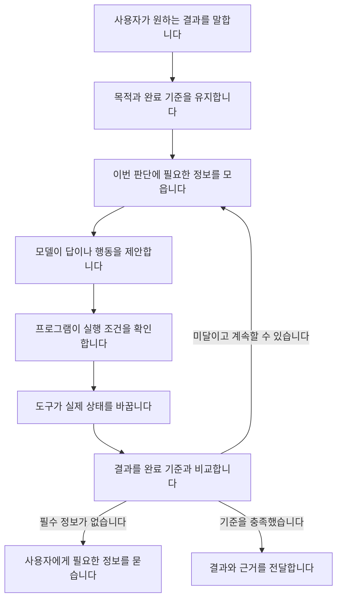

# LLM이 일하는 방식과 개선할 지점 — 초기 조사 보고서

이 문서는 초기 구조 조사와 탐색 실험의 결론입니다.
전체 연구의 현재 결론은 [연구 종합 정리](synthesis.md)에서 확인하실 수 있습니다.
이후 사용자가 요청한 후속 비교는 [업데이트 후 결과](findings/2026-10-05-stage-after-update.md)에 정리했습니다.
서버 오류로 밀렸던 비교는 모두 마쳤습니다. Stage 전체 운영 검증과 실무에서의 절감량 확인은 남아 있습니다.

## 결론

**우선 개선할 곳은 목적을 유지하는 방법, 필요한 정보를 넘기는 방법, 완료를 확인하는 방법입니다.**
모델의 지능이 충분하더라도 이 연결이 끊기면 작업은 실패합니다.
그 뒤에 조건이 명확한 판단을 코드로 처리할 가치가 있는지 검토하는 순서가 타당합니다.

**실제 실험과 개선은 사용자가 쓸 수 있는 Claude와 Codex에 집중합니다.**
이 두 환경에서 입력과 자료 전달, 작업 기록, 결과 확인 방식을 바꾸는 것이 적용 방향입니다.
다른 서비스의 조사는 설계를 참고하는 데 사용합니다. [사용 환경과 범위](purpose.md#available-ai)

초기 조사는 공개 자료, 두 SDK의 소스, 실제 대화, 통제한 실행을 함께 봤습니다.
2026-10-05에 초기 조사와 탐색 실험을 마쳤습니다. 다섯 회사의 공개 자료를 비교하고 출처 27개 항목을 정리했습니다.
Claude CLI 실험 280건과 모델을 쓰지 않는 검사 18개 항목을 마쳤습니다.
당시에는 Codex를 직접 시험하지 않았습니다. OpenAI Agents SDK 소스 분석과 구별합니다.
가설 6개 중 2개는 보류하고, 4개는 적용 범위를 제한한 개선 후보로 남겼습니다.
가설마다 얻은 근거가 다르므로 같은 확신으로 권고하지 않습니다.
정량 결과와 제한은 [반복 실험 보고서](findings/2026-10-05-followup.md)에, 가설별 판단은 [가설 목록](hypotheses.md)에 적었습니다.
연구 후 도출한 [개선 아이디어 여섯 가지](ideas.md)는 별도로 정리했습니다.
이후 여섯 가지를 시제품으로 만들고 로컬 테스트 54개와 Claude·Codex 비교 96번을 마쳤습니다.
기본 조건에서도 대부분 기대값과 일치해 일반적인 개선 효과는 입증하지 못했습니다.
구현 범위와 적용 권고는 [시제품 시험 보고서](findings/2026-10-05-ideas-lab.md)에 정리했습니다.
추가로 실제 과거 코드의 리뷰에서 같은 판정을 다시 써 호출을 줄였습니다.
반복 비율을 정한 조건의 효과이며, [후속 보고서](findings/2026-10-05-review-reuse.md)에 실무 적용의 한계를 남겼습니다.

## 1. AI가 일을 한다는 것은 무엇인가요

사용자가 보는 것은 요청과 결과입니다. 그 사이에는 서로 다른 일이 들어갑니다.

이 그림은 분석을 위한 구조입니다. 모든 회사가 같은 방식으로 구현했다고 주장하지 않습니다.
모델 한 번의 응답에 여러 판단이 함께 들어갈 수 있습니다.
반대로 사용자가 한 단계로 보는 일에 여러 모델 호출이 들어갈 수도 있습니다.
자세한 분해는 [64개 동작](work-map.md)과 [실행 구조](runtime.md)에 있습니다.

여기서 중요한 차이는 **말을 끝냈는지와 일을 끝냈는지**입니다.
전자는 응답이 종료됐는지로 확인할 수 있습니다.
후자는 사용자가 원하는 상태를 만들었는지 확인해야 합니다.
실제 연구 대화에서도 남은 일을 설명한 뒤 작업을 멈췄습니다. [관찰 기록](findings/2026-10-05-failures.md)

## 2. Jev의 사례에서 가져올 사고방식

Jev를 만든 사람의 모든 내적 동기는 알 수 없습니다.
공개 자료는 좁은 판단과 기억 관리 등을 별도 문제로 다루는 사례를 보여 줍니다. [출처](sources.md#s09)
우리가 가져올 질문은 다음과 같습니다.

1. 이 호출은 어떤 판단을 하나요?
2. 그 판단에는 어떤 정보가 반드시 필요한가요?
3. 결과가 맞는지 어떻게 확인하나요?
4. 규칙, 검색, 모델 중 어느 방식이 그 조건을 가장 잘 만족하나요?
5. 바꾼 뒤 전체 작업도 더 잘 끝나나요?

예를 들어 정해진 형식의 입력을 명시한 규칙으로 분류한다면, 매번 자연어 모델을 호출할 필요가 없는 경우가 있습니다.
하지만 사용자의 모호한 의도를 그 형식으로 바꾸는 일은 여전히 남습니다.
그 앞단을 무시하면 싸고 빠른 분류기를 붙여도 잘못 정리한 입력을 빠르게 처리할 뿐입니다.

**비용은 이 설계의 결과 중 하나입니다.**
판단을 나누면 검사하고 수정할 경계가 생깁니다.
동시에 전달 과정과 예외 처리가 늘어나므로, 무조건 잘게 나누는 것도 답은 아닙니다.

## 3. 어디를 고치면 어떻게 좋아질 수 있나요

| 우선순위 | 문제 | 개선할 것 | 기대하는 변화 | 대가와 적용 조건 |
|---|---|---|---|---|
| 1 | 응답을 끝낸 것을 작업 완료로 취급합니다. | 목적·완료 기준·남은 일을 별도로 보관하고 종료 전에 대조합니다. | 중간 보고 뒤 미완료 작업을 잊거나 끝내는 일을 줄일 수 있습니다. | 상태 갱신과 복구가 필요합니다. 실제 장기 작업에서의 효과는 아직 미측정입니다. |
| 1 | 성공 신호만 받아 실제 결과를 모릅니다. | 목표와 관련된 값을 다시 읽고 비교합니다. | 완료·실패·미확인을 구별할 수 있습니다. | 추가 읽기가 듭니다. 재조회가 허용되고 상태를 확인할 수 있어야 합니다. |
| 2 | 자료를 줄이면서 예외 조건을 잃습니다. | 결론과 함께 버전·예외·출처를 전달합니다. | 짧은 입력으로도 필요한 판단을 유지할 여지가 있습니다. | 잘못 추리면 답할 근거가 없어집니다. 자동 추출기의 품질은 별도로 검증해야 합니다. |
| 2 | 기억의 적용 범위를 모릅니다. | 출처·시점·버전을 기억에 붙이고 현재 조건과 비교합니다. | 낡은 기록을 그대로 적용할지 판단할 단서가 생깁니다. | 기록 작성·갱신 비용이 듭니다. 잘못된 출처를 붙이면 해결되지 않습니다. |
| 3 | 이미 정해진 규칙도 모델이 다시 해석합니다. | 형식이 검증된 입력만 코드로 처리하고 범위 밖은 돌려보냅니다. | 해당 구간의 모델 호출을 없앨 수 있습니다. | 규칙 유지와 예외 처리가 필요합니다. 전체 과정의 절감량은 따로 재야 합니다. |

이는 개선 후보의 우선순위입니다. 플러그인에 적용하거나 배포한 결과가 아닙니다.
근거가 더 약한 것은 '목적을 매번 적으면 좋아진다'와 '점검 문장을 늘리면 좋아진다'는 주장입니다.
이번 연구에서는 두 방법을 기본 정책으로 채택할 근거를 얻지 못했습니다.

## 4. RAG도 목적에서 시작해야 합니다

검색 결과를 많이 받는 것과 과제를 끝내는 것은 다릅니다.
검색된 자료가 질문에 답하는지, 적용 조건이 맞는지, 모델에게 전달됐는지 따로 확인해야 합니다.
이는 [검색 실패 연구](sources.md#s18)와 이번 문맥 시험에서 얻은 연구 방향입니다.

| 목적 | 검색 뒤 보존할 것 | 완료를 판단할 기준 |
|---|---|---|
| 사실 확인 | 근거 문장과 출처, 시점, 서로 다른 주장 | 질문에 답할 증거가 충분한가요? |
| 코드 수정 | 심볼, 호출 관계, 실제 버전, 검증할 테스트 | 바꾼 동작이 요구를 만족하고 기존 동작도 유지되나요? |
| 장기 개인화 | 사용자가 확인한 사실, 유효 기간, 변경·삭제 기록 | 현재 조건에 맞는 기억만 사용했나요? |
| 탐색 연구 | 대안, 반례, 모르는 부분과 조사 범위 | 중요한 설명들을 비교하고 한계를 밝혔나요? |

같은 검색 저장소를 쓸 수는 있습니다. 그러나 이 목적들은 다른 완료 기준을 요구합니다.
따라서 임베딩 모델이나 벡터 DB를 고르기 전에 어떤 증거를 찾고 언제 충분하다고 볼지 정해야 합니다.

## 5. 실제로 적용한다면 이렇게 평가합니다

처음에는 한 종류의 작업을 고릅니다. 예를 들면 '파일을 고치고 결과를 검증한다'입니다.
Claude와 Codex 각각에서 지금 방식의 실행 기록을 남긴 뒤 한 조건만 바꿉니다.
두 환경에서 같은 과제와 완료 기준을 쓰되, 개선 효과는 각 환경의 기존 방식과 비교합니다.
쓸 수 있는 설정과 관찰할 수 있는 기록은 실제 환경에서 확인합니다.

- 목적을 지켰는지, 실제 완료율, 잘못된 완료 보고, 사용자 재지시 횟수를 우선 봅니다.
- 시간과 비용은 실패·재시도·검증까지 포함합니다.
- 재조회로 정확해졌다면 재조회 비용도 개선 비용에 포함합니다.
- 규칙을 벗어난 입력을 더 자주 돌려보내면 그 뒤 처리 비용도 더합니다.
- 완료율이 떨어지거나 중요한 예외를 놓치면 적용을 중단합니다.

새 방식이 단계 하나에서 이겨도 전체 작업이 나빠지면 채택하지 않습니다.
이 기준은 제품화할 때의 권고이며 이번 연구에서 운영 환경에 적용한 규칙은 아닙니다.

## 6. 확인하지 못한 것

서비스의 비공개 내부 구조, 모델의 실제 내부 사고 경로, 모든 작업에 통하는 최적 설계는 확인하지 못했습니다.
다섯 회사의 성능 순위도 매기지 않았습니다. [서비스별 조사 범위](services.md)
Claude 사용량에 나타난 Haiku의 정확한 역할과, 실패·취소·인자 수정 경로의 전체 기록도 확인하지 못했습니다.
이 부분은 추측 대신 미확인으로 남깁니다.

합성 시험은 작은 판단을 비교했습니다. 실제 업무의 품질이나 한국어의 자연스러움을 보증하지 않습니다.
특히 목적 해석 문제 일부는 필요한 자료가 없어 질문하는 행동도 타당했습니다.
원래 점수를 보존하고 자료를 보완해 다시 실행했습니다. 보완 후 두 조건 모두 기준을 충족했습니다.
추가 지침의 이점은 확인하지 못했습니다. 명확한 요청에서 다음 행동을 고른 결과로 장기 작업의 완수 능력을 판단하지 않습니다.
보완 문제는 앞선 응답을 본 뒤 만들었으므로 독립된 최종 평가 자료가 아닙니다.

## 최종 판단

모델을 직접 설계하지 않아도 연구하고 개선할 범위는 충분합니다.
가장 먼저 볼 것은 **누가 무엇을 판단하고, 그 판단에 어떤 정보가 들어가며, 무엇으로 결과를 확인하는가**입니다.
그 경계를 밝혀야 불필요한 호출을 없애거나 특정 판단을 다른 방식으로 맡기는 선택도 근거를 갖습니다.

이번 연구의 산출물은 그 선택을 위한 조사, 실행 기록, 실험의 한계, 우선순위입니다.
구체적인 제품을 정하거나 기존 플러그인의 변경을 승인한 결과로 취급하지 않습니다.
