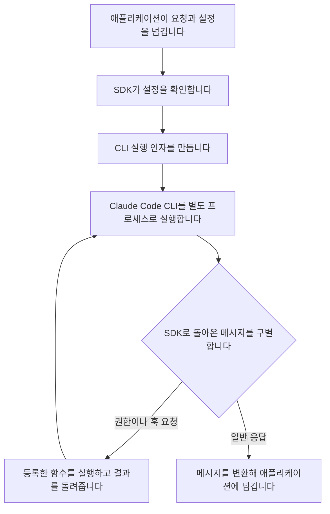

# Claude Agent SDK 소스에서 확인한 실행 구조

조사일: 2026-10-05

공개 Python SDK를 읽어 요청이 전달되고 결과가 돌아오는 경로를 추적했습니다.
**Python SDK는 CLI와 애플리케이션을 연결합니다. 모델의 판단 과정 전체가 이 저장소에 들어 있지는 않습니다.**
모델 간 비교 실험은 아직 실행하지 않았습니다.
이 문서는 소스를 읽은 시점의 기록입니다. 이후 확인한 실행 결과는 [예비 실험 보고서](2026-10-05-pilot.md)에 남겼습니다.

## 확인한 버전과 방법

- 저장소: [anthropics/claude-agent-sdk-python](https://github.com/anthropics/claude-agent-sdk-python)
- 확인한 커밋: `9c69ce7aced5cdf2aa1ac86fe62e877b4962de8b`
- SDK 소스의 버전: `0.2.163`
- 소스에 지정된 번들 CLI 버전: `2.1.289`
- 방법: 임시 폴더에 공개 저장소를 내려받아 소스와 일부 테스트를 읽었습니다.
- 이 분석의 범위: 코드를 읽어 확인했습니다. 작성 시점에는 패키지를 설치하거나 CLI를 실행하지 않았습니다. SDK 테스트도 실행하지 않았습니다.

앞선 웹 검색 결과에는 SDK `0.2.161`도 나타났습니다.
이번 분석은 위 커밋에 고정합니다. 번들 버전 선언은 해당 CLI를 실제로 실행했다는 증거가 아닙니다.

## 실제로 연결되는 경로

이 그림은 기본 subprocess 경로를 설명합니다.
SDK는 사용자 정의 transport도 받을 수 있습니다. 그 경로에 CLI 인자 적용을 그대로 가정하면 안 됩니다.

## 소스에서 확인한 동작

| 위치 | 코드에서 확인한 내용 | 연구에서 구별할 것 |
|---|---|---|
| [요청 진입점](https://github.com/anthropics/claude-agent-sdk-python/blob/9c69ce7aced5cdf2aa1ac86fe62e877b4962de8b/src/claude_agent_sdk/query.py#L11) | `query()`가 `InternalClient.process_query()`에 요청을 넘깁니다. | SDK 호출과 모델 호출을 같은 사건으로 세지 않습니다. |
| [내부 클라이언트](https://github.com/anthropics/claude-agent-sdk-python/blob/9c69ce7aced5cdf2aa1ac86fe62e877b4962de8b/src/claude_agent_sdk/_internal/client.py#L33) | transport를 연결하고 제어 프로토콜을 초기화합니다. 요청을 보내고 응답을 변환합니다. | 초기화, 요청 전달, 응답 수신을 나눕니다. |
| [실행 인자 구성](https://github.com/anthropics/claude-agent-sdk-python/blob/9c69ce7aced5cdf2aa1ac86fe62e877b4962de8b/src/claude_agent_sdk/_internal/transport/subprocess_cli.py#L570) | 시스템 프롬프트, 도구, 횟수·예산 등의 옵션을 CLI 인자로 바꿉니다. | 같은 모델이라도 설정이 다르면 다른 실행 조건입니다. |
| [프로세스 실행](https://github.com/anthropics/claude-agent-sdk-python/blob/9c69ce7aced5cdf2aa1ac86fe62e877b4962de8b/src/claude_agent_sdk/_internal/transport/subprocess_cli.py#L797) | CLI 위치와 버전을 확인하고 프로세스를 엽니다. 표준 입력과 출력으로 통신합니다. | SDK 시작 시간과 CLI 내부 처리 시간을 구별합니다. |
| [제어 요청 처리](https://github.com/anthropics/claude-agent-sdk-python/blob/9c69ce7aced5cdf2aa1ac86fe62e877b4962de8b/src/claude_agent_sdk/_internal/query.py#L577) | 권한 확인, 훅, SDK MCP 요청을 처리하고 결과나 오류를 돌려줍니다. | 모델이 제안한 행동과 외부에서 허용·수정한 행동을 구별합니다. |
| [도구 전후 입력 형식](https://github.com/anthropics/claude-agent-sdk-python/blob/9c69ce7aced5cdf2aa1ac86fe62e877b4962de8b/src/claude_agent_sdk/types.py#L333) | 도구 이름, 입력, 호출 ID를 정의합니다. 실행 뒤에는 도구 응답도 포함합니다. | 같은 호출의 전후 사건을 ID로 연결할 수 있는지 확인합니다. |
| [최종 결과 형식](https://github.com/anthropics/claude-agent-sdk-python/blob/9c69ce7aced5cdf2aa1ac86fe62e877b4962de8b/src/claude_agent_sdk/types.py#L1340) | 시간, 사용량, 비용, 종료 이유 등을 담을 필드가 있습니다. | 필드가 정의됐다고 실제 실행에서 모두 채워진다고 가정하지 않습니다. |

## 관찰할 위치를 잘못 고르면 기록이 빠질 수 있습니다

**코드와 설명에서 확인했습니다.** `can_use_tool`은 권한 규칙이 사용자 확인을 요구할 때 호출됩니다.
이미 허용된 도구 호출은 이 콜백을 거치지 않을 수 있습니다.
SDK는 일부 설정 조합에서 이를 알리는 경고도 만듭니다.
근거: [옵션 설명](https://github.com/anthropics/claude-agent-sdk-python/blob/9c69ce7aced5cdf2aa1ac86fe62e877b4962de8b/src/claude_agent_sdk/types.py#L2158),
[경고를 만드는 코드](https://github.com/anthropics/claude-agent-sdk-python/blob/9c69ce7aced5cdf2aa1ac86fe62e877b4962de8b/src/claude_agent_sdk/types.py#L1863).

**해석했습니다.** 이 콜백만 사용해 호출 횟수를 세면, 실제보다 적게 셀 수 있습니다.
그 결과를 보고 도구를 덜 사용한다고 결론 내리면 잘못된 비교가 됩니다.

**다음 실험의 조건:** SDK가 권고하는 `PreToolUse`와 실행 뒤 이벤트를 검토합니다.
고정한 테스트 도구를 호출해, 예상한 사건 수와 수집한 사건 수부터 비교합니다.
그 뒤에 모델 간 행동 차이를 측정합니다.
후속 실행에서는 성공한 읽기 호출 2건을 대조했습니다. 실패·취소 경로는 아직 검증하지 않았습니다.

## 요청한 인자와 실행한 인자가 다를 수 있습니다

**코드에서 확인했습니다.** 권한 콜백은 허용 결과와 함께 수정한 입력을 반환할 수 있습니다.
SDK는 `updatedInput`에 수정한 값 또는 원래 입력을 넣어 CLI로 보냅니다.
근거: [제어 요청 처리](https://github.com/anthropics/claude-agent-sdk-python/blob/9c69ce7aced5cdf2aa1ac86fe62e877b4962de8b/src/claude_agent_sdk/_internal/query.py#L610).

**해석했습니다.** 결과만 저장하면 모델의 선택과 외부 코드의 수정을 혼동할 수 있습니다.
도구 실행의 성공을 모델 혼자 만든 성과로 계산할 위험도 있습니다.

**다음 실험의 조건:** 요청한 인자, 외부에서 수정한 인자, 실제 실행한 인자를 각각 기록합니다.
실행한 인자를 직접 확인할 수 없다면 그 한계를 남깁니다.

## 입력 문자열만 같게 맞추면 충분한지 검토해야 합니다

**코드에서 확인했습니다.** SDK는 시스템 프롬프트, 도구와 각종 설정을 CLI에 전달합니다.
또한 사용자 입력을 그대로 전달하도록 표시하는 `verbatim_prompts` 옵션을 제공합니다.
관련 설명은 CLI의 파일 언급 확장과 명령 처리가 입력에 영향을 줄 수 있음을 밝힙니다.
근거: [옵션 설명](https://github.com/anthropics/claude-agent-sdk-python/blob/9c69ce7aced5cdf2aa1ac86fe62e877b4962de8b/src/claude_agent_sdk/types.py#L2219),
[입력 표시를 검사하는 테스트](https://github.com/anthropics/claude-agent-sdk-python/blob/9c69ce7aced5cdf2aa1ac86fe62e877b4962de8b/tests/test_verbatim_prompts.py#L109).

**한계:** 이번에는 표시를 전달하는 코드와 테스트를 읽었습니다.
CLI가 입력을 처리한 뒤 모델에게 보낸 전체 요청까지 관찰한 것은 아닙니다.

**다음 실험의 조건:** 입력 문자열 외에 SDK·CLI 버전, 프롬프트 설정, 도구, 로컬 설정을 고정합니다.
이 옵션은 문맥 구성도 바꿀 수 있으므로 모든 실험에 무조건 켜지 않습니다.

## 기존 동작 지도와 연결합니다

| 지도 항목 | 이번에 발견한 실제 연결 지점 |
|---|---|
| C05, C07, C08 | 요청·설정 전달, 초기화, 상태 유지 경로 |
| A02, A04 | 도구 입력과 권한 콜백, 입력 수정 |
| A05, A07 | 도구 전후 이벤트와 반환 메시지 |
| V07, V08 | 결과 메시지의 오류·종료 이유·사용량 |

지도 원문: [동작별 분석](../work-map.md).
내부에서 목적을 이해하거나 행동 후보를 비교하는 방식까지 이 코드로 확인했다고 주장하지 않습니다.

## 이번에 달라진 연구 방향

먼저 기록을 제대로 수집하는지 확인해야 한다는 점이 더 구체해졌습니다.
관찰하려는 모든 호출이 수집되는지, 외부 수정이 분리되는지, 실행 조건이 같은지 검사합니다.
이 검사가 끝난 뒤 목적 점검 같은 개선 가설을 비교합니다.

현재 결론은 소스 분석입니다. SDK 결함을 발견했다거나, 특정 방식이 더 효과적이라고 검증한 결과는 아닙니다.
