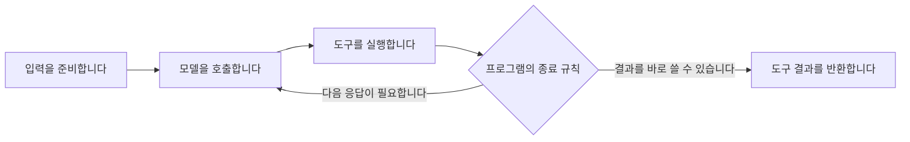

# 도구를 쓴 뒤 다시 생각할지는 프로그램도 결정합니다

**모델을 바꾸지 않아도, 언제 다시 호출하고 언제 끝낼지는 바꿀 수 있습니다.**
OpenAI Agents SDK의 공개 소스에서 이를 확인했습니다.
다만 단계를 줄이면 검토나 설명도 함께 사라질 수 있습니다.
이번에는 코드를 읽었습니다. API를 실행하거나 속도 개선을 측정하지 않았습니다.

## 확인한 범위

[S16](../sources.md#s16)의 커밋을 내려받아 읽었습니다.
이는 개발자가 에이전트를 만드는 SDK입니다.
ChatGPT나 Codex 서비스 내부가 이 코드와 같다고 주장하지 않습니다.

### 입력을 만든 뒤 모델을 부릅니다

[`run_single_turn`](https://github.com/openai/openai-agents-python/blob/d3304cff56f1be2325d00e0f172534d613697f88/src/agents/run_internal/run_loop.py#L2456)은
도구와 지침, 인계 대상, 출력 형식을 준비하고 응답을 요청합니다.
[`get_new_response`](https://github.com/openai/openai-agents-python/blob/d3304cff56f1be2325d00e0f172534d613697f88/src/agents/run_internal/run_loop.py#L2591)는
입력 필터를 적용한 뒤 중복 항목을 정리합니다.
그 뒤 `on_llm_start`에 지침과 입력을 전달하고 모델 어댑터를 호출합니다.

따라서 처음 받은 사용자 문장과 모델 호출 직전 입력을 구별할 수 있습니다.
단, 이 훅만으로 서버가 보는 모든 문맥을 확보하지는 못합니다.
같은 호출에서 도구 정의, 출력 형식, 대화 ID, 이전 응답 ID도 따로 전달합니다.
모델 어댑터가 요청을 직렬화하는 과정과 서버에 남은 상태는 추가로 살펴봐야 합니다.

### 도구 결과를 그대로 반환할 수도 있습니다

[`tool_use_behavior`](https://github.com/openai/openai-agents-python/blob/d3304cff56f1be2325d00e0f172534d613697f88/src/agents/agent.py#L396)와
[`check_for_final_output_from_tools`](https://github.com/openai/openai-agents-python/blob/d3304cff56f1be2325d00e0f172534d613697f88/src/agents/run_internal/turn_resolution.py#L760)에서
아래 경로를 확인했습니다.

| 설정 | 도구 실행 뒤 처리 |
|---|---|
| `run_llm_again` | 기본값입니다. 결과를 모델에 보내 다음 응답을 받습니다. |
| `stop_on_first_tool` | 첫 도구의 출력을 최종 결과로 반환합니다. |
| `StopAtTools` | 지정한 도구의 결과가 나오면 그 출력을 최종 결과로 삼습니다. |
| 직접 작성한 함수 | 도구 결과를 읽고 종료 여부와 최종 출력을 정합니다. |

이 설정은 FunctionTools에 적용됩니다.
SDK의 설명에 따르면 웹 검색 같은 hosted tools에는 같은 방식으로 적용하지 않습니다.
또한 도구 뒤에 곧바로 끝내는 설정은 도구 실행 전의 모델 호출까지 없앤다는 뜻이 아닙니다.

이는 도구를 실행한 뒤의 분기만 보여 줍니다. 모든 실행 경로를 나타내지는 않습니다.

## 무엇을 강화할 수 있을까요

아래는 소스에서 얻은 **후속 가설**입니다. 개선 효과는 아직 측정하지 않았습니다.

| 먼저 물어볼 것 | 바꿔 볼 방법 | 기대하는 이점 | 함께 확인할 대가 |
|---|---|---|---|
| 다음 호출이 새로운 판단을 하나요? | 완성된 도구 결과는 바로 반환합니다. | 불필요한 재서술과 대기를 줄일 수 있습니다. | 오류를 발견하거나 결과를 설명할 기회도 줄어듭니다. |
| 필요한 자료가 호출 직전에 빠지나요? | 필터 전후 자료와 출처를 대조합니다. | 검색 실패와 전달 실패를 구별할 수 있습니다. | 기록량이 늘고 민감한 자료를 관리해야 합니다. |
| 프로그램의 종료 조건이 사용자 목적과 같나요? | 실제 상태와 완료 기준을 검사합니다. | 실행 성공을 목적 달성으로 오해하는 일을 줄일 수 있습니다. | 추가 조회와 검사 비용이 듭니다. |

기존 [H04](../hypotheses.md#h04)와 [H06](../hypotheses.md#h06)을 구체화한 항목입니다.
새 모델을 선택하기 전에 현재 호출이 무슨 일을 하는지 밝혀야 합니다.

예를 들어 도구가 검증을 마친 집계표를 반환한다면 그대로 보여 줄 여지가 있습니다.
하지만 도구가 `success`만 반환한다면 그 신호를 바로 최종 답으로 쓰기 어렵습니다.
출력이 무엇을 보장하는지에 따라 같은 종료 설정의 가치가 달라집니다.

## 두 공개 SDK에서 어디까지 볼 수 있었나요

| 질문 | Claude Agent SDK Python | OpenAI Agents SDK Python |
|---|---|---|
| 이번에 읽은 소스는 무엇을 맡나요? | CLI 실행과 통신, 훅과 권한 요청을 처리합니다. | 입력 준비와 모델 호출, 도구 이후의 분기 등을 처리합니다. |
| 추가로 보지 못한 부분은 어디인가요? | CLI 내부와 모델 서버입니다. | 서버 내부와 hosted tools 내부입니다. 모델 어댑터도 전부 읽지는 않았습니다. |
| 실제 실행으로 확인했나요? | [예비 실험 10건](2026-10-05-pilot.md)을 수행했습니다. | 실행하지 않았습니다. |

같은 이름의 SDK라도 공개된 책임 범위가 다릅니다.
이 표는 서비스의 우열이나 개방 정도 전체를 평가하지 않습니다.
우리가 확보한 증거가 어느 구간을 설명하는지 나타냅니다.

## 다음에 구별할 세 가지 실패

1. 필요한 사실을 입력에 넣지 못했습니다.
2. 사실을 넣었지만 모델이 잘못 판단했습니다.
3. 판단은 맞았지만 실행이나 종료 규칙이 목적을 이루지 못했습니다.

세 경우 모두 사용자에게는 틀린 답으로 보일 수 있습니다.
그러나 첫 경우에는 자료 전달을, 둘째에는 판단 방법을, 셋째에는 실행과 검증을 먼저 살펴봐야 합니다.
현재 기록으로 원인을 구별할 수 없다면, 개선책을 고르기 전에 관찰할 지점을 늘립니다.
