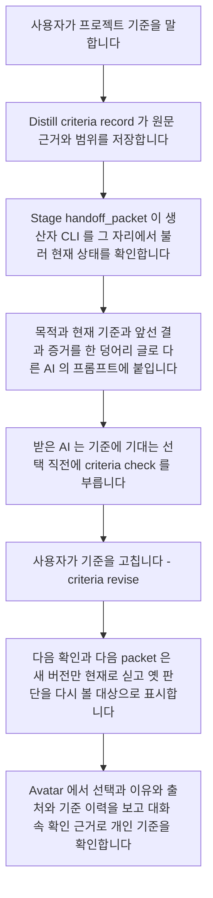
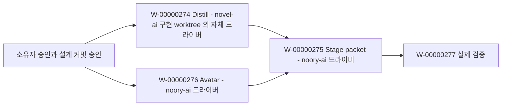

# Stage·Distill·Avatar 첫 연결 흐름 구현 설계

**상태: 2026-10-05에 작업 소유자 Codex가 독립 검토를 마치고 구현 설계로 채택했습니다. 2026-10-06에는 세 제품을 구현하고 연결 시험을 진행하고 있습니다. 실제 AI 간 인계 검증은 끝나지 않았습니다.** 결정 기록은 [DE-00000074](../../decisions/pending/DE-00000074.md)(`status: decided`)입니다.
작업은 [W-00000273](../../work/current/W-00000272/W-00000273/_story.md)이고, 구현 카드는 W-00000274(Distill), W-00000275(Stage), W-00000276(Avatar), W-00000277(실제 검증)입니다.
필드, 오류 코드, 명령 형식은 이 문서가 소유합니다. 결정 기록은 이 문서를 참조합니다.
**[제안]** 표시는 설계 당시의 제안 범위를 남긴 것입니다. 현재 구현과 검사 결과는 각 작업 카드에 기록합니다. 2절은 2026-10-05에 확인한 기준선입니다.

## 1. 첫 흐름



첫 구현은 이 흐름만 만듭니다. 판정 재사용, 자동 추출, 훅 변경, 드라이버 설정 변경은 넣지 않습니다.

## 2. 지금 있는 것 (확인한 코드와 실행)

Distill 소스는 novel-ai의 `codex/cross-host-plugin-support` 가지, HEAD `f186e0017af732caa7e4fbabeba4b7eb5f7429c6`에서 읽었습니다. 감독은 이 HEAD가 깨끗하다고 보고했습니다. 같은 HEAD에서 감독이 측정한 기준선은 pytest 343개 통과, mypy 오류 37개(13파일), ruff 오류 61개입니다. 앞선 연구가 적은 `369fa30e`는 이 HEAD와 다릅니다.

| 확인한 동작 | 위치 | 설계에 주는 영향 |
|---|---|---|
| `recall`은 `chunk_relations`를 읽지 않습니다. | `src/distill/tools/recall.py:50-99` | 기준이 현재 버전인지는 `recall`로 보장할 수 없습니다. |
| `recall`은 결과마다 `touch()`를 부릅니다. | `recall.py:66`, `store/metadata.py:227-234` | 읽기만 해도 기록이 바뀝니다. |
| `for_each_scope`는 모든 예외를 삼킵니다. | `tools/helpers.py:93-94` | 조회 실패와 결과 없음을 구별하지 못합니다. |
| `store` 도구는 `except Exception: pass`로 실패를 넘깁니다. | `tools/store.py:108-109` | 저장이 실패해도 알리지 않습니다. |
| promote는 chunk를 project → workspace → global로 옮깁니다. | `tools/memory.py:21`, `139-223` | 도구 호출 한 번으로 범위가 넓어집니다. |
| `move()`는 정해진 열만 다시 씁니다. | `store/metadata.py:245-272` | `knowledge` 표에 열을 더하면 옮길 때 그 열이 사라집니다. |
| chunk에는 원문, 발언 주체, 확인 여부, 조건, 버전이 없습니다. `supersedes` 관계는 crystallize가 모델 응답에서 만듭니다. | `store/types.py:31-73`, `extractor/crystallize.py:203-234` | 기존 관계는 AI 추정이라 사람이 바꾼 이력으로 쓸 수 없습니다. |
| Codex manifest에는 `enabled_tools` 허용 목록이 있습니다. Claude는 `./claude-skills/`를, Codex는 `./skills/`를 씁니다. | `.codex-plugin/plugin.json:25`, `.claude-plugin/plugin.json:20` | 새 MCP 도구는 Codex 허용 목록에 넣어야 보입니다. |
| CLI 하위 명령은 `init`, `ingest`, `recall`, `learn`, `crystallize` 다섯 개뿐입니다. | `src/distill/__main__.py:97-103` | 기준 명령은 새로 만듭니다. |

감독은 Distill 환경에서 읽기 전용 탐침 `primary/.stage/.runtime/project_scope_probe.py`를 실행했고 종료 코드는 0이었습니다. 감독이 보고한 출력은 다음과 같습니다. DB 경로 함수는 부르지 않았습니다.

| 시작 위치 | `detect_project_root` | `detect_workspace_root` |
|---|---|---|
| noory-ai 본 체크아웃 루트 | 본 체크아웃 루트 | 본 체크아웃 루트 |
| 이 설계 worktree 루트 | 이 worktree 루트 | 이 worktree 루트 |
| 본 체크아웃의 `stage/scripts` | 본 체크아웃의 `stage` | 본 체크아웃 루트 |

같은 프로젝트라도 표식 파일로 찾은 정체는 worktree마다 다르고, 하위 디렉터리로 내려가기도 합니다. `.noory/`는 git이 무시하므로(noory-ai `.gitignore:61`) 프로젝트 단계 DB도 체크아웃마다 따로 생깁니다. 그래서 기준의 범위는 경로로 정하지 않고, 사람이 정한 `project` 키로 정합니다.

| Stage에서 확인한 동작 | 위치 | 설계에 주는 영향 |
|---|---|---|
| 질문 도구를 처음 부르면 한 번 막고 목적과 원칙을 먼저 읽으라고 알립니다. | `stage/hooks/stage_guard.py:343-383` | 판단 순서의 첫 단계는 이미 있으므로 이번에는 바꾸지 않습니다. |
| `UserPromptSubmit` 훅이 없습니다. 드라이버 실행 지시문은 카드 경로를 줍니다. | `stage/hooks/hooks.json`, `.stage/settings.json:16-17` | 설정과 훅을 바꾸지 않으므로 기준은 넘김 글에 실어 보냅니다. |
| 위임 실행에서는 맡기는 창이 카드 본문을 넘깁니다. | `stage/skills/stage-handoff/SKILL.md:33-35` | 링크가 아니라 본문을 넘깁니다. 앞선 실험에서 링크는 한 번도 열리지 않았습니다. |

감독이 실행한 호스트 점검 결과입니다(`primary/.stage/research/llm-work/integration/host-loading.md`).
- Codex 0.160.0은 세션에만 쓰는 마켓플레이스 설정으로 현재 체크아웃의 Stage를 목록에 띄웠습니다.
- Claude 2.1.289에서 `claude plugin validate ./stage`는 종료 코드 0이었고, 루트 `CLAUDE.md`가 자동으로 실리지 않는다는 경고 하나가 나왔습니다.

스킬을 실제로 부르는 동작은 아직 확인하지 않았습니다. 이 점검을 플러그인 동작 검증으로 보지 않습니다.

## 3. 누가 무엇을 소유하나요

| 기록 | 소유자 | 다른 쪽이 가질 수 있는 것 |
|---|---|---|
| 프로젝트 목적, 작업 카드, 결정 원문, 카드에 남긴 실행 증거 | Stage (`.stage/`) | `stage:` 참조와 그 절의 sha256 |
| 프로젝트 기준 `CR-` | Distill | `distill:CR-…@N` 참조, 그리고 받은 시각이 붙은 읽기 전용 투영 |
| 개인 기준 `PC-`, 선택 `CH-`, 돌아보기, 첨부한 출처 투영 | Avatar | `avatar:PC-…@N` 참조와 읽기 전용 투영 |
| 대화에서 뽑은 지식 chunk | Distill (기존) | 바꾸지 않습니다 |

- 플러그인끼리 Python import도, 상대방 DB를 여는 일도 하지 않습니다. 서로 오가는 것은 공개 CLI의 JSON 출력뿐입니다.
- 받은 투영은 근거일 뿐입니다. 현재 원본이 아니며 고칠 수 없습니다. 원본을 고치려면 소유자의 명령을 씁니다.
- Distill 기준의 범위는 `project` 하나이고, Avatar 기준의 범위는 `personal` 하나입니다. Avatar는 Distill의 지식 저장과 검색을 다시 만들지 않습니다.
- 출력의 `scope`는 객체입니다. Distill은 `{"kind":"project","key":"<project key>"}`, Avatar는 `{"kind":"personal","key":"personal"}`을 씁니다.

## 4. 공통 계약 [제안]

### 참조와 세대

- 참조는 `<producer>:<id>@<version>` 형식입니다. 예: `distill:CR-7f3a9c21d0e4@2`. ID는 접두사 뒤에 uuid4 hex 앞 12자리를 붙이고, 바뀌지 않습니다.
- 생산자 저장소마다 `generation` 정수가 하나씩 있습니다. 기록, 수정, 철회, 확인이 일어날 때마다 1씩 오릅니다.

### 출처 `origin`

```json
{
  "kind": "user_statement",
  "source_ref": "session:claude/3f9e2a10-…/msg-0042",
  "quote": "이제부터 잘못된 입력은 예외 말고 None을 돌려주세요. 테스트 코드는 예외여도 됩니다.",
  "quote_sha256": "<64 hex>",
  "source_sha256": null,
  "actor": "user",
  "recorded_by": {"host": "claude", "session_id": "3f9e2a10-…", "via": "mcp"},
  "captured_at": "2026-10-05T11:58:00Z"
}
```

| `kind` | `source_ref` 형식 | `source_sha256` |
|---|---|---|
| `user_statement` | `session:<host>/<session_id>/<message id 또는 순번>` | `null`입니다. 첫 구현에서는 대화 원본을 자동으로 다시 읽지 않습니다. |
| `stage_card` | `stage:<project key>/<repo-relative path>#<H2 제목>` 예: `stage:noory-code/noory-ai/.stage/work/current/W-00000272/_epic.md#User value` | 기록할 때 그 절 본문의 sha256 |
| `stage_decision` | `stage:<project key>/<repo-relative path>#Chosen direction` | 같은 방식 |

- `quote`는 원문을 글자 그대로 담고 그 자체로 바뀌지 않는 근거입니다. 최대 2000자입니다.
- `actor`는 `user`(사람의 말) 또는 `ai`(AI의 추정)입니다.
- 도구 입력만으로는 사람이 실제로 그 말을 했는지 증명하지 못합니다. 그래서 `recorded_by`를 남기고, 증명했다고 주장하지 않습니다.
- 원본이 현재 유효한지는 그 원본의 소유자가 확인합니다. Stage packet은 `stage:` 출처의 절을 다시 읽어 `source_status`를 정합니다.
  - `matches`: 절이 기록할 때와 같습니다.
  - `changed`: 절 내용이 바뀌었습니다.
  - `missing`: 파일이나 절이 없습니다.
  - `not_checkable`: 대화처럼 다시 읽을 수 없는 출처입니다.
  - `rejected_ref`: 경로가 절대 경로입니다. 또는 `..`을 담거나, 심볼릭 링크를 풀면 프로젝트 루트 밖을 가리킵니다. 읽지 않습니다.
- `stage:` 출처를 판정하는 순서는 다음과 같습니다.
  1. `source_ref`의 project key가 packet의 `--project-key`와 다르면 `not_checkable`입니다. 현재 저장소에서 같은 경로를 찾지 않습니다.
  2. 경로 검사를 통과하면 파일을 엽니다. 파일이나 그 H2 제목이 없으면 `missing`입니다.
  3. 절 본문의 sha256이 `source_sha256`과 다르면 `changed`입니다. 같으면 `matches`입니다.
  4. `matches`는 "기록할 때와 같다"는 뜻일 뿐입니다. 출처가 옳다는 판정은 아닙니다.
- 출처가 `stage_card`·`stage_decision`인데 `source_status`가 `changed`, `missing`, `rejected_ref` 중 하나이면, 그 기준은 `unresolved`로 내려갑니다. 적용 가능한 현재 근거로 쓰지 않습니다.
  - 다시 쓰려면 사람이 새 원문으로 `revise`(Distill)나 `confirm`(Avatar)을 해야 합니다.
  - 기록과 원래 원문은 역사적 근거로 계속 보입니다.
- `user_statement` 출처는 원래 `not_checkable`입니다. 이때 `quote` 자체가 근거이므로 이 상태 때문에 적용에서 빠지지 않습니다.

### 확인 상태와 확신도

| 필드 | 값 | 규칙 |
|---|---|---|
| `confirmation` | `user_stated` | 사람이 기준을 직접 말했습니다. `actor: user`인 `origin`이 필요합니다. |
| | `user_confirmed` | AI가 제안한 기준을 사람이 대화에서 확인했습니다. 확인 발언의 `quote`와 `source_ref`가 필요합니다. |
| | `none` | AI의 추정입니다. 현재 기준으로 적용하지 않습니다. |
| `ai_confidence` | 0.0–1.0 또는 `null` | `confirmation`과 따로 저장합니다. 값이 얼마든 적용 여부를 바꾸지 않습니다. |

### 조건 `applies_when`·`exceptions`

```json
{"applies_when": [{"kind": "path", "any": ["app/"]}, {"kind": "work_kind", "any": ["development", "fix"]}],
 "exceptions":   [{"kind": "path", "any": ["app/vendor/"]}],
 "notes":        ["Only for user-facing config parsing."]}
```

- `applies_when`의 항목끼리는 AND이고, 한 항목의 `any` 값끼리는 OR입니다. `exceptions`는 하나라도 맞으면 그 대상을 뺍니다.
- `kind`는 `path`와 `work_kind` 두 가지입니다. 다른 값은 생산자가 `E_INVALID_CONDITION`으로 거부합니다. 소비자가 모르는 값을 받으면 그 기준은 `unresolved`가 됩니다.
- `path` 값은 repo 기준 상대 경로이며 디렉터리(`/`로 끝남)이거나 파일입니다. glob은 첫 구현에서 받지 않습니다.
- `notes`는 코드가 판정하지 않는 조건입니다. `notes`가 있는 기준은 `applies`가 아니라 `needs_judgment`가 됩니다.

Stage가 카드에 대해 판정하는 규칙입니다. 카드 `scope` 항목도 디렉터리나 파일입니다.

| 판정 | 조건 |
|---|---|
| `applies` | `work_kind`가 맞습니다. 모든 scope 항목이 **각** `path` 항목마다 그 `any` 값 중 하나와 같거나 그 아래에 있습니다. 여러 `path` 항목은 AND로 따로 판정하며, 하나의 OR로 합치지 않습니다. 어떤 예외 경로와도 겹치지 않고 `notes`도 없습니다. |
| `partial` | 일부 scope 항목만 `path` 안에 있습니다. 또는 `path` 값이 scope 디렉터리 아래의 더 좁은 경로입니다(예: 조건 `app/config.py`, scope `app/`). packet에는 "적용 대상: `app/config.py`만"처럼 좁힌 경로를 적고 넓히지 않습니다. |
| `needs_judgment` | 코드로 판정할 수 있는 조건은 맞지만 `notes`가 있습니다. 받은 AI가 판단하고 그 판단을 기록합니다. |
| `not_applicable` | `work_kind`가 다르거나, scope가 `path`와 겹치지 않거나, 예외가 scope 전체를 덮습니다. |
| `unresolved` | scope가 비었거나 `.`이거나 repo 밖 경로입니다. 모르는 조건 종류나 파일·디렉터리를 구별할 수 없는 경로도 여기에 해당합니다. `/` 없는 생산자 경로가 실제 디렉터리이거나 scope·다른 조건의 상위 경로이면 적용하지 않습니다. `/`를 붙인 생산자 경로가 실제 파일이어도 적용하지 않습니다. 디스크에 아직 없는 상위 경로도 같은 규칙을 따릅니다. |

`partial`과 `needs_judgment`는 아래 기록을 남긴 뒤에만, 그 기록이 가리키는 대상에 적용할 수 있습니다.

- **`partial`:** 받은 AI가 실제로 고칠 파일 하나의 경로로 판정을 다시 합니다. 같은 규칙으로 판정하므로 항목끼리는 AND, `any` 안에서는 OR, 예외는 제외입니다. 결과가 `applies`일 때만 그 파일에 적용합니다. 카드 `## Progress`에는 `Condition judgment: <ref> path=<파일> -> applies`로 남깁니다. 다른 파일로 넓히지 않습니다.
- **`needs_judgment`:** 코드가 판정하는 항목은 모두 맞아야 합니다. 그 위에서 받은 AI가 `notes`마다 판단하고 `Condition judgment: <ref> note="<원문>" -> met|not_met because <이유>`로 남깁니다. 모든 note가 `met`일 때만 적용합니다.
- **`unresolved`:** 어떤 기록으로도 적용할 수 없습니다. 모르는 조건 종류가 조용히 적용되는 일은 없습니다.

다음 packet은 이 `Condition judgment:` 줄을 `## Stale judgments`와 함께 싣습니다. 그래서 그 판단이 어느 버전에 기댔는지 다시 볼 수 있습니다.

### 같은 요청과 같은 기준

- 쓰는 명령(record, revise, revoke, confirm, choice add, source attach)은 모두 `idempotency_key`를 받아야 합니다. 권장 형식은 `<host>:<session_id>:<순번>`입니다.
- 생산자는 검증을 마친 요청 전체를 정규화한 JSON(키 정렬, 공백 없음, UTF-8)의 sha256을 `payload_digest`로 저장합니다. 고른 필드만 넣는 목록을 따로 두지 않습니다. 다음은 모두 digest에 들어갑니다.
  - 동작 이름(`record`, `revise`, `revoke`, `confirm`, `choice_add`, `source_attach` 등)
  - 대상 ID와 `base_version` 또는 `version`
  - payload의 모든 의미 필드. `origin` 전체(`recorded_by` 포함), 선택의 `question`·`options`·`chosen`·`reason_quote`·`context`·`source_refs`, `source attach`로 받은 본문 전체가 여기에 속합니다.
- digest에서 빼는 것은 전송에만 쓰는 값입니다. 같은 요청을 다시 보낼 때 달라질 수 있지만 기록의 뜻은 바꾸지 않습니다.
  - `idempotency_key`: digest를 찾는 열쇠이므로 뺍니다.
  - `--db`, `--home`: 저장 위치이므로 뺍니다.
  - 출력 형식 플래그: 출력 모양만 바꾸므로 뺍니다.
  - 생산자가 나중에 정하는 값(`id`, `generation`, `recorded_at`): 아직 요청에 없는 값이므로 뺍니다.
- 요청자가 `captured_at`을 직접 보냈다면 그것도 의미 필드로 digest에 넣습니다. 그래서 뜻이 바뀐 요청이 재전송으로 처리되어 사라지는 일은 없습니다.
  - 같은 키에 같은 digest가 오면 처음 결과를 그대로 돌려주고 `"replayed": true`를 붙입니다.
  - 같은 키에 다른 digest가 오면 `E_IDEMPOTENCY_CONFLICT`이고 아무것도 쓰지 않습니다.
- 기준의 동일성은 project, 정규화한 statement, 정렬한 조건·예외·`notes`의 묶음입니다.
  - 동일성이 같은 현재 기준이 이미 있으면 새로 만들지 않고 `E_DUPLICATE_CRITERION`과 함께 기존 참조를 돌려줍니다. 근거를 더하거나 바꾸려면 `revise`를 씁니다.
  - 조건이 하나라도 다르면 다른 기준입니다. 조용히 합치지 않습니다.
  - 같은 동일성의 기준이 철회돼 있으면 `record`는 새 ID를 만듭니다. 철회된 ID를 되살리지 않습니다.

### 충돌한 기준

- packet은 기준을 생산자별로 나눠 싣습니다. 싣는 순서는 권위가 아닙니다.
- 받은 AI가 실제 선택에서 두 기준이 서로 다른 행동을 요구한다고 보면, 아래 순서로 풉니다.
  1. 이 세션에서 사용자가 지금 명시한 지시를 따릅니다.
  2. 프로젝트 목적이 답을 정하면 목적을 따릅니다.
  3. 한 기준의 `overrides`에 다른 기준의 참조가 있으면 그 기준을 따릅니다. `overrides`는 사람의 `quote`가 있을 때만 기록할 수 있습니다.
  4. 셋 다 답을 정하지 못하면 풀리지 않은 충돌입니다.
     - 그 선택 없이 진행할 수 없으면 두 참조를 들어 사람에게 묻습니다.
     - 진행할 수 있으면 그 선택을 미루고 다른 일을 합니다.
- 푼 결과는 카드 `## Progress`에 `Resolved conflict: <이긴 ref> over <진 ref> by <instruction|purpose|override>` 한 줄로 남깁니다.

## 5. Distill (W-00000274) [제안]

### 저장

- 기존 전역 DB `~/.distill/knowledge/metadata.db`에 새 표를 둡니다. 표는 `criteria`, `criterion_versions`, `criterion_events`, `criteria_requests`(멱등 키), `criteria_meta`(`generation`) 다섯 개입니다.
- 이 표는 새 모듈 `src/distill/store/criteria.py`의 `CriteriaStore`만 다룹니다. 기존 `knowledge` 표와 recall·promote·move·crystallize 경로에는 기준 기능을 더하지 않으며, 이 경로들은 새 표를 읽지 않습니다. 기존 정적 검사를 통과시키는 수정은 허용하지만 동작은 보존합니다.
- CLI만 `--db <path>`를 받습니다. MCP 도구는 기본 경로를 씁니다.
- 기준 명령은 `fastembed`를 불러오지 않고 `touch()`도 부르지 않습니다.

### 명령

CLI는 `python -m distill criteria <action>`입니다. MCP 도구 `criteria_record`, `criteria_revise`, `criteria_revoke`, `criteria_current`, `criteria_check`, `criteria_history`는 같은 함수를 감쌉니다.
출력은 JSON 하나입니다. 종료 코드는 성공 0, 입력 오류 2, 저장소 오류 3입니다. 오류 출력은 `{"error": "<CODE>", "message": "…"}`입니다.

첫 명령과 출력:

```bash
python -m distill criteria record --db <demo-dir>/criteria.db --idempotency-key claude:S1:1 \
  --payload-file <demo-dir>/cr1.json
# cr1.json
# {"project": "test/demo-app",
#  "statement": "Invalid input raises ConfigError from app/errors.py.",
#  "applies_when": [{"kind": "path", "any": ["app/"]}], "exceptions": [], "notes": [],
#  "confirmation": "user_stated", "ai_confidence": null,
#  "origin": {"kind": "user_statement", "source_ref": "session:claude/S1/msg-3",
#             "quote": "잘못된 입력은 app/errors.py 의 ConfigError 로 알려 주세요.", "actor": "user",
#             "recorded_by": {"host": "claude", "session_id": "S1", "via": "cli"}}}
# -> {"ref": "distill:CR-7f3a9c21d0e4@1", "generation": 1, "replayed": false}
```

| 동작 | 입력 | 결과 | 오류 |
|---|---|---|---|
| `record` | 위 payload | 버전 1을 만들고 `generation`을 올립니다 | `E_SCOPE_REQUIRED`, `E_QUOTE_REQUIRED`, `E_INVALID_CONDITION`, `E_TOO_LONG`, `E_DUPLICATE_CRITERION`, `E_IDEMPOTENCY_CONFLICT`, `E_STORE_UNAVAILABLE` |
| `revise <id>` | `base_version`, 바꿀 필드, 새 `origin`(사람의 `quote`), `reason` | 새 버전을 만들고 앞 버전을 `superseded`로 바꿉니다. 빠진 조건은 이어받고 출력에 적습니다. `project`는 바꿀 수 없습니다. | `E_NOT_FOUND`, `E_VERSION_CONFLICT`, `E_SCOPE_IMMUTABLE`, `E_REVOKED`, `E_IDEMPOTENCY_CONFLICT` |
| `revoke <id>` | `base_version`, `origin`, `reason` | 현재 버전을 없애고 사건을 남깁니다 | `E_NOT_FOUND`, `E_VERSION_CONFLICT`, `E_REVOKED` |
| `current --project <key>` | — | `criteria-snapshot/1`(아래) | `E_SCOPE_REQUIRED`, `E_STORE_UNAVAILABLE` |
| `check --project <key> --refs <ref,…>` | 받은 AI가 적용하려는 참조 | `{"generation": 9, "checked_at": …, "results": [{"ref": "distill:CR-…@1", "status": "superseded", "current": "distill:CR-…@2"}]}`. `status` 값은 아래 표를 따릅니다 | `E_STORE_UNAVAILABLE` |
| `history <id>` | — | 모든 버전, `origin`, 사건, 그리고 사건 당시의 `generation` | `E_NOT_FOUND` |

`criteria-snapshot/1`의 형식은 다음과 같습니다.

```json
{"schema": "criteria-snapshot/1", "producer": "distill", "producer_version": "1.10.0",
 "generation": 9, "checked_at": "2026-10-05T12:00:00Z",
 "scope": {"kind": "project", "key": "test/demo-app"},
 "criteria": [{"ref": "distill:CR-7f3a9c21d0e4@2", "statement": "…", "applies_when": […],
               "exceptions": […], "notes": [], "overrides": [], "confirmation": "user_stated",
               "ai_confidence": null, "origin": {…}, "reason": "…",
               "supersedes": "distill:CR-7f3a9c21d0e4@1", "recorded_at": "…"}],
 "retired": [{"ref": "distill:CR-7f3a9c21d0e4@1", "status": "superseded",
              "by": "distill:CR-7f3a9c21d0e4@2"}]}
```

- 기록이 없으면 `criteria`는 `[]`입니다. DB 파일이 없으면 `"store": "absent"`를 함께 냅니다.
- DB를 열거나 읽지 못하면 빈 목록을 내지 않고 오류 3을 냅니다.
- `current`의 `criteria`에는 아래 표의 `eligible_current`인 버전만 들어갑니다.

`check`가 참조마다 돌려주는 `status`는 다음 중 하나입니다. Avatar `check`도 같은 표를 씁니다. 받는 쪽(Stage packet과 받은 AI)은 `eligible_current`가 아닌 상태를 모두 적용하지 않습니다.

| `status` | 뜻 |
|---|---|
| `eligible_current` | 이 버전이 지금 현재 버전입니다. `confirmation`이 `user_stated` 또는 `user_confirmed`이고, `--project`의 범위에 속합니다. |
| `superseded` | 더 새 버전이 있습니다. `current` 필드에 새 참조를 담습니다. |
| `revoked` | 철회됐습니다. |
| `unconfirmed` | 현재 버전이지만 `confirmation: none`(AI 추정)입니다. |
| `proposed` | Avatar에서 제안만 되고 아직 확인되지 않은 버전입니다. |
| `scope_mismatch` | 다른 project key의 기준입니다. Avatar에서는 `personal`이 아닌 참조입니다. |
| `unknown` | 그런 ID나 버전이 없습니다. |
- 첫 구현의 Distill은 `user_stated`와 `none`만 만듭니다. `user_confirmed`는 Avatar의 확인 동작에서만 생깁니다.
- 사람이 저장을 요청했을 때만 `record`합니다. 짧은 메모를 자동으로 추출하지 않습니다.

## 6. Stage (W-00000275) [제안]

### `stage/scripts/handoff_packet.py`

```bash
python3 stage/scripts/handoff_packet.py --project-root <demo-dir>/project W-00000003 \
  --project-key test/demo-app --producers <demo-dir>/producers.json
```

`producers.json`은 생산자마다 실행할 argv 배열을 JSON으로 담습니다. 첫 원소는 실행 파일의 절대 경로이고, 셸 활성화나 문자열 명령은 쓰지 않습니다. Windows 예시는 다음과 같습니다.

```json
{
  "distill": {"argv": ["C:\\Users\\me\\.local\\bin\\uv.exe", "run", "--directory",
                       "C:\\work\\novel ai\\plugins\\distill", "python", "-m", "distill"],
              "db": "C:\\Users\\me\\AppData\\Local\\Temp\\demo\\criteria.db"},
  "avatar":  {"argv": ["C:\\Program Files\\Python312\\python.exe",
                       "C:\\work\\noory-ai\\avatar\\scripts\\avatar.py"],
              "home": "C:\\Users\\me\\AppData\\Local\\Temp\\demo\\avatar"}
}
```

macOS와 Linux에서도 형식은 같고 경로만 다릅니다(예: `["/opt/homebrew/bin/uv", "run", …]`).

- 스크립트는 stdlib만 씁니다. 생산자 코드를 import하지 않고, 생산자의 DB도 열지 않습니다.
- packet을 만드는 순간에 생산자를 `subprocess.run(argv + 하위 인자, shell=False, timeout=30)`로 부릅니다. 문자열을 나누는 일은 하지 않습니다.
  - Distill 하위 인자: `["criteria", "current", "--project", <key>, "--db", <db>]`
  - Avatar 하위 인자: `["--home", <home>, "export"]`
- 기준을 담은 파일을 입력으로 받는 길은 두지 않습니다. 옛 파일을 현재 상태처럼 실을 수 없게 하기 위해서입니다.

**시점 보장.** packet이 보장하는 범위는 "생산자 명령이 돌려준 순간의 `generation`에서 이 기준들이 현재였다"는 것뿐입니다. 그 뒤로 계속 최신이라는 보장은 하지 않습니다. 그래서 packet은 `generation`과 `checked_at`을 적습니다. 또 받은 AI가 기준에 기대는 선택 직전마다 실행할 argv 배열을 생산자별로 완성해서 싣습니다. 받은 AI는 이 설계 문서를 다시 읽지 않고 그대로 실행합니다.

```text
## Check before each criterion-dependent choice
Run each array without a shell, e.g. python3 -c "import json,subprocess,sys; sys.exit(subprocess.run(json.loads(sys.argv[1])).returncode)" '<array>'
distill: ["C:\\Users\\me\\.local\\bin\\uv.exe", "run", "--directory", "C:\\work\\novel ai\\plugins\\distill", "python", "-m", "distill", "criteria", "check", "--project", "test/demo-app", "--refs", "distill:CR-7f3a9c21d0e4@2", "--db", "C:\\Users\\me\\AppData\\Local\\Temp\\demo\\criteria.db"]
avatar: ["C:\\Program Files\\Python312\\python.exe", "C:\\work\\noory-ai\\avatar\\scripts\\avatar.py", "--home", "C:\\Users\\me\\AppData\\Local\\Temp\\demo\\avatar", "check", "--refs", "avatar:PC-1b2c3d4e5f60@1"]
Apply a criterion only when its status is eligible_current. Any other status, non-zero exit, or timeout: do not apply it.
```

`--refs`에는 packet이 실은 참조 가운데 `applies`, `partial`, `needs_judgment`인 것만 넣습니다.
결과가 `eligible_current`가 아니거나 실행이 실패하면, 받은 AI는 그 기준을 적용하지 않습니다. 대신 새 packet을 요청하거나, 그 기준이 필요한 선택만 미룹니다.

출력은 stdout으로 내보내는 Markdown이며 다음 순서로 씁니다.

1. `## Purpose chain`: 조상 카드부터 이 카드까지의 `## Purpose`입니다.
2. `## Criteria as of check`: 생산자마다 `generation`과 `checked_at`을 적습니다. 그 아래 4절의 판정별로 기준을 나눕니다. `applies`, `partial`(좁힌 경로를 함께 적음), `needs_judgment`, `unresolved`, `not_applicable`입니다. 각 기준에는 참조, 본문, 조건, `confirmation`, `ai_confidence`, `quote`, `source_status`를 적습니다.
3. `## Prior result evidence`: 아래 증거 줄을 다시 확인한 결과입니다.
4. `## Stale judgments`: 카드 `## Progress`의 `Applied criteria:` 줄을 현재 상태와 비교합니다. 상태는 `superseded`, `revoked`, `unknown`이며, 줄이 없으면 "적용 기록 없음"으로 적습니다. 이미 한 일을 되돌리라고 하지 않고 다시 볼 대상으로만 적습니다.
5. `## Decision order`: 고정 문장입니다. "목적으로 정할 수 있으면 진행합니다. 부족하면 `applies`인 기준을 적용합니다. `partial`인 기준은 고칠 파일에 대한 `Condition judgment:`가 `applies`일 때, `needs_judgment`인 기준은 모든 note가 `met`일 때 적용합니다. 그 판단은 먼저 기록합니다. `unresolved`와 `not_applicable`은 적용하지 않습니다. 기준끼리 충돌하면 공통 계약의 순서로 풉니다. 둘로도 필요한 정보가 없을 때만 사람에게 묻고, 무엇이 없는지 밝힙니다. 기준에 기대는 선택 직전에 아래 check 명령을 부릅니다. 적용한 기준은 카드 `## Progress`에 `Applied criteria: <ref>, <ref>`로, 적용한 것이 없으면 `Applied criteria: none`으로 적습니다."
6. `## Remaining work`: 카드의 `## Success criteria`와 `## Next action`입니다.

### 앞선 결과의 증거

실행한 AI는 카드 `## Progress`에 한 줄에 하나씩 증거를 남깁니다.

```text
Evidence: {"kind": "file", "path": "app/config.py", "sha256": "<hex>", "observed_at": "2026-10-05T12:10:00Z"}
Evidence: {"kind": "check", "command": "python -m pytest -q", "exit": 0, "result": "3 passed", "observed_at": "2026-10-05T12:11:00Z"}
```

packet은 이 증거를 다음과 같이 다시 확인합니다.

- 파일 증거는 지금 sha256을 다시 계산합니다. 결과는 `matches`, `changed`, `missing` 중 하나입니다. `git status --porcelain -- <path>`로 커밋되지 않은 변경인지도 함께 적습니다.
- 실행 증거는 packet이 다시 돌리지 않습니다. 기록된 종료 코드와 시각을 싣고 "packet이 다시 실행하지 않음"이라고 적습니다.
- 증거 줄이 없으면 "증거 없음"으로 적고, 완료로 보지 않습니다.
- 이 절은 인수 검사나 독립 리뷰 판정이 아닙니다. 카드의 `acceptance` 명령과 리뷰는 따로 돕니다.

| 상황 | 동작 | 종료 코드 |
|---|---|---|
| `--producers`가 없거나 생산자 항목이 빠짐 | 그 생산자에 대해 2절에 "기준을 조회하지 않았습니다"라고 씁니다. 기준이 없다는 뜻과 구별합니다. | 0 |
| `producers.json`이 깨졌거나, `argv`가 문자열 배열이 아니거나, 첫 원소가 절대 경로가 아님 | 출력하지 않고 `E_PRODUCERS_INVALID`를 냅니다. | 2 |
| 생산자 명령이 실패함(종료 코드 ≠ 0), 시간이 넘음, JSON이 깨짐 | 2절에 "<생산자> 기준을 확인하지 못했습니다. 어떤 이전 기준도 현재로 쓰지 마십시오"라고 쓰고, 그 생산자의 기준은 싣지 않습니다. | 0 |
| snapshot의 `scope.key`가 `--project-key`와 다름 | 출력하지 않고 `E_SCOPE_MISMATCH`를 냅니다. | 2 |
| snapshot 안에 같은 `id`가 두 번 있음 | 출력하지 않고 `E_VERSION_CONFLICT`를 냅니다. | 2 |

받은 AI가 실제로 기준을 읽고 적용했는지는 세 가지로 봅니다. 결과에 남은 `Applied criteria:` 참조, 미리 정해 둔 파일 검사, 대조 실행입니다(10절).

드라이버 설정과 훅은 바꾸지 않습니다. 따라서 무인 드라이버가 만드는 실행 지시문에는 packet이 실리지 않습니다. 이 한계는 `stage-handoff` 스킬에 적습니다.

## 7. Avatar (W-00000276) [제안]

- `avatar/`에 둡니다. stdlib Python 3.9+로 만들며 uv를 쓰지 않습니다.
- 기존 두 manifest 형식(`.claude-plugin/plugin.json`, `.codex-plugin/plugin.json`)과 스킬을 그대로 따릅니다. 훅과 MCP는 없습니다.
- 저장소는 `~/.avatar/avatar.db`(SQLite)입니다. `--home` 또는 `AVATAR_HOME`으로 위치를 바꿀 수 있습니다. 사건은 추가만 합니다.
- 기록은 명령을 부를 때만 생깁니다. 대화 기록 수집, 사람에 대한 분석, 외부 행동은 하지 않습니다.

```bash
python3 avatar/scripts/avatar.py --home <demo-dir>/avatar choice add --idempotency-key claude:S2:1 \
  --payload-file <demo-dir>/ch1.json
# ch1.json
# {"question": "Config parse failure: raise or return None?", "options": ["raise", "return-none"],
#  "chosen": "return-none", "reason_quote": "호출하는 쪽이 이미 None 을 분기해서요",
#  "context": {"project_key": "test/demo-app", "conditions": [{"kind": "path", "any": ["app/"]}]},
#  "origin": {"kind": "user_statement", "source_ref": "session:claude/S2/msg-7", "quote": "…",
#             "actor": "user", "recorded_by": {"host": "claude", "session_id": "S2", "via": "cli"}},
#  "source_refs": ["distill:CR-7f3a9c21d0e4@2"]}
# -> {"id": "CH-…", "replayed": false}
```

| 명령 | 입력 | 규칙 | 오류 |
|---|---|---|---|
| `choice add` | 위 payload | 4절의 멱등 규칙을 따릅니다. 시간 창으로 중복을 추정하지 않습니다. | `E_QUOTE_REQUIRED`, `E_IDEMPOTENCY_CONFLICT` |
| `criterion propose` | statement, 조건, `ai_confidence`, `from_choices` | 버전 1을 `proposed`·`confirmation: none`으로 만듭니다 | `E_INVALID_CONDITION` |
| `criterion confirm <id> --version N` | 사용자의 확인 발언 `origin`(`quote`, `source_ref`, `actor: user`) | N의 내용은 보존하고 확인 근거를 담은 N+1을 만듭니다. N+1이 `user_confirmed`·현재가 되고 N은 `superseded`가 됩니다. 반환한 새 참조를 사용합니다. 어느 호스트에서든 같은 동작입니다. | `E_QUOTE_REQUIRED`, `E_VERSION_CONFLICT`, `E_IDEMPOTENCY_CONFLICT` |
| `criterion revise <id>` | `base_version`, 바꿀 필드, `reason` | 새 버전을 `proposed`로 만듭니다 | `E_VERSION_CONFLICT` |
| `criterion revoke <id>` | `base_version`, 사용자의 `origin`, `reason` | 현재 버전을 없앱니다 | `E_QUOTE_REQUIRED`, `E_VERSION_CONFLICT` |
| `source attach` | `--file`: Distill `criteria history` 출력 JSON | 아래 투영 규칙을 따릅니다 | `E_SOURCE_INVALID`, `E_PROJECTION_CONFLICT` |
| `show [--choice|--criterion] [--json]` | — | 선택, 이유 원문, 출처 투영, 기준의 모든 버전과 변경 이유, 확인 근거를 보여 줍니다 | `E_NOT_FOUND` |
| `export` | — | `criteria-snapshot/1`(`scope: {"kind":"personal","key":"personal"}`, `user_confirmed`인 현재 버전과 `retired`)을 출력합니다 | `E_STORE_UNAVAILABLE` |
| `check --refs` | 참조 목록 | Distill `check`와 같은 형식입니다 | `E_STORE_UNAVAILABLE` |

`confirm`은 사람을 인증하지 않습니다. 남는 것은 "이 호스트·세션에서 이 원문을 사용자 확인으로 기록했다"는 출처뿐입니다. `ai_confidence`가 높다고 확인이 되지는 않습니다. 대화 밖에서 사람이 따로 할 일은 없습니다.

2026-10-06: 독립 리뷰에서 지적한 모호한 표현을 바로잡았습니다. 확인할 때 N+1을 만드는 것은 버전 내용을 바꾸지 않는 공통 계약을 지키기 위해서입니다. `scope`의 객체 모양도 두 구현과 맞춰 명시했습니다. **SSOT·Honesty**에 따라 이 문서가 계약을 소유하며, 구현 전 검토본의 sha256(`0697c2d609637de0f868819a0452c74f7befcf97bab143fd062f6344b21e9f5b`)과 이번 수정본을 구별합니다.

**출처 투영.** `source attach`는 Distill `criteria history` 출력을 바꾸지 않고 저장합니다. 이때 digest를 두 가지로 나눕니다.

- **버전 digest:** 버전마다 따로 계산합니다. 그 버전의 내용(statement, 조건, 예외, notes, overrides, confirmation, ai_confidence, origin, reason, supersedes, recorded_at)을 정규화한 JSON의 sha256입니다. 한 번 기록된 버전의 내용은 바뀌지 않습니다.
- **봉투 digest:** 받은 출력 전체(`generation`, 사건 목록, 각 버전의 상태 포함)의 sha256입니다. 사건이 늘면 바뀝니다. `fetched_at`은 Avatar가 붙이는 값이라 넣지 않습니다.

| 들어온 투영 | 동작 |
|---|---|
| 봉투 digest가 이미 저장된 것과 같음 | 새로 저장하지 않고 `"duplicate": true`를 돌려줍니다 |
| 같은 참조·버전인데 버전 digest가 다름 | `E_PROJECTION_CONFLICT`로 거부합니다. 버전 내용이 바뀌었다는 뜻이므로 받지 않습니다 |
| 더 높은 `generation`이고, 이미 저장된 사건 목록이 새 사건 목록의 앞부분과 같음 | 새 봉투로 더합니다. 새 사건(새 버전, 철회 포함)이 이력에 보입니다 |
| 더 높은 `generation`인데 저장된 사건 일부가 빠지거나 바뀜(예: 철회 사건이 사라짐) | `E_PROJECTION_CONFLICT`로 거부합니다. 이력은 추가만 되므로 철회가 되살아날 수 없습니다 |
| 같은 `generation`인데 봉투 digest가 다름 | `E_PROJECTION_CONFLICT`로 거부합니다. 같은 세대에 이력이 둘일 수 없습니다 |
| 더 낮은 `generation`이고 위와 충돌하지 않음 | 역사적 봉투로 저장하고 "더 새로운 투영이 있음"으로 표시합니다. 현재 표시는 가장 높은 `generation`의 봉투를 따르므로 철회 표시를 덮지 못합니다 |
- `show`는 투영마다 "`<fetched_at>` 기준, 현재 상태 미확인"이라고 적습니다. Distill을 쓸 수 없어도 저장한 투영은 역사적 근거로 보입니다. 현재라고 주장하지는 않습니다.
- Distill이 없으면 Avatar는 직접 입력한 선택과 원문만으로 동작합니다.

**조건이 다른 선택.** `show`는 같은 기준을 참조했는데 고른 것이 다른 선택들을 "다시 볼 후보"로 나란히 보여 줍니다. `context.conditions`가 다르면 "조건이 다름"으로 표시합니다. 어느 경우에도 모순으로 확정하지 않습니다. 프로젝트 기준을 개인 기준으로 자동으로 올리지 않습니다.

## 8. 원천 상태별 동작

| 상태 | 생산자 (`current`/`check`) | Stage packet | Avatar `show` |
|---|---|---|---|
| 기준 없음 | `criteria: []` | "현재 기준이 없습니다" | 빈 목록 |
| 저장소 없음 | `criteria: []`, `store: absent` | 위와 같고 `store: absent`를 적음 | 빈 목록 |
| 조회 실패 | 종료 코드 3 | 해당 생산자 "확인하지 못함", 이전 기준 사용 금지 | 투영은 역사적 근거로만 표시 |
| 대체됨 | `retired`, `check`는 `superseded` | 현재로 싣지 않음, 앞선 판단을 낡음으로 표시 | 이력에 표시 |
| 철회됨 | `retired`, `check`는 `revoked` | 위와 같음 | 철회 표시. 낮은 세대 투영이 덮지 못함 |
| 범위 불명·다름 | `E_SCOPE_REQUIRED` | `E_SCOPE_MISMATCH` | 해당 없음 |
| 출처 파일 변경·삭제·거부된 경로 | 기록은 그대로 | `source_status: changed/missing/rejected_ref`를 표시하고, 그 기준은 `unresolved`로 처리 | 투영 그대로 두고, 현재 유효하다고 주장하지 않음 |
| 확인 안 됨·제안만 됨 | `current`에서 빠짐, `check`는 `unconfirmed`/`proposed` | 적용하지 않음 | `proposed`로 표시 |

## 9. 첫 구현에 넣지 않는 것

- **판정 재사용.** 질문, 근거 sha256, 적용 참조와 `generation`, 관련 파일 sha256이 모두 같을 때만 재사용 후보가 됩니다. 독립 리뷰는 언제나 새로 돌립니다. 이번에는 계약만 적고 만들지 않습니다.
- **`recall`의 대체 표시.** W-00000274의 위험 항목으로 남습니다. AI가 추정한 관계로 결과를 숨겨도 되는지는 따로 결정합니다. 그때까지 `recall` 결과는 현재 기준이 아닙니다.
- 훅, 드라이버 설정, 질문 게이트 변경은 하지 않습니다. `novel-ai/gemini-extension.json` 허용 목록과 Distill의 Avatar 들여오기도 넣지 않습니다.

## 10. 시험

### RED → GREEN

| 카드 | 시험 | 증명하는 것 | 증명하지 않는 것 |
|---|---|---|---|
| 274 | record → revise 뒤 `current`에는 v2만 있고 v1은 `retired`에 있으며, v1 `check`는 `superseded`입니다 | 바꾼 기준을 현재로 돌려주지 않습니다 | 모델이 그 결과를 따른다는 것 |
| 274 | 같은 키·같은 payload는 `replayed`입니다. 같은 키로 `origin.recorded_by`나 `notes`만 바꾸거나, `revise`의 대상 버전만 바꿔 보내면 `E_IDEMPOTENCY_CONFLICT`입니다. `--db` 경로만 바꾸면 `replayed`입니다 | 뜻이 바뀐 요청은 재전송으로 처리되어 사라지지 않고, 전송 값은 digest에 영향을 주지 않습니다 | — |
| 274 | `check`가 `confirmation: none` 버전에는 `unconfirmed`, 다른 project의 참조에는 `scope_mismatch`, 없는 버전에는 `unknown`을 냅니다 | 적용 대상이 아닌 기록을 현재 기준으로 내지 않습니다 | — |
| 274 | statement는 같고 `exceptions`만 다른 두 record가 서로 다른 ID를 받습니다 | 조건이 다른 규칙을 합치지 않습니다 | — |
| 274 | 동일성이 같은 두 번째 record는 `E_DUPLICATE_CRITERION`입니다. 철회한 뒤 record하면 새 ID를 받습니다 | 중복을 막고 철회를 되살리지 않습니다 | — |
| 274 | `confirmation: none`이면 `ai_confidence` 0.99여도 `current`에 없습니다 | 확신도가 확인을 대신하지 않습니다 | — |
| 274 | `revise --base-version 1`을 두 번 하면 두 번째가 `E_VERSION_CONFLICT`입니다 | 동시 수정이 조용히 덮이지 않습니다 | 부하 상황 |
| 274 | 읽을 수 없는 DB에서 `current`·`check`가 종료 코드 3을 냅니다 | 실패가 빈 결과로 보이지 않습니다 | — |
| 274 | 기준 명령을 실행한 프로세스에 `fastembed`가 로드되지 않습니다 | 조회가 모델 내려받기에 기대지 않습니다 | — |
| 274 | `test_r8_independence.py`와 전체 pytest가 통과합니다 | 형제 import가 없고 기존 동작이 유지됩니다 | — |
| 275 | 시험용 가짜 생산자 스크립트가 v2를 내면 `Applied …@1` 카드에서 `superseded`가 나옵니다 | 앞선 판단이 낡았음을 드러냅니다 | AI가 다시 본다는 것 |
| 275 | 가짜 생산자가 종료 코드 3을 내면 기준을 하나도 싣지 않고 "확인하지 못함"이 나옵니다 | 옛 상태를 현재로 쓰지 않습니다 | — |
| 275 | 조건 판정 표 다섯 가지를 각각 재현합니다. 예: 조건 `app/config.py`, scope `app/`이면 `partial`이고 경로를 좁혀 적습니다. `notes`가 있으면 `needs_judgment`입니다 | 범위를 넓히지 않고, 판정할 수 없는 조건을 적용으로 보지 않습니다 | — |
| 275 | 파일 증거를 기록한 뒤 파일을 바꾸면 `changed`, 지우면 `missing`, 증거 줄이 없으면 "증거 없음"입니다 | 기록과 지금 상태의 차이를 드러냅니다 | 실행 결과가 지금도 같다는 것 |
| 275 | `stage:` 출처의 절을 바꾸면 `changed`, H2를 지우면 `missing`이 되고 그 기준은 `unresolved`로 내려갑니다. 다른 project key의 출처는 `not_checkable`이고 현재 저장소를 읽지 않습니다. 절대 경로, `..`, 루트 밖을 가리키는 심볼릭 링크는 `rejected_ref`입니다 | 출처 변경을 숨기지 않고, 바뀐 결정 출처를 현재 근거로 쓰지 않으며, 저장소 밖을 읽지 않습니다 | 출처가 옳다는 것 |
| 275 | 공백과 역슬래시가 든 경로를 `producers.json` argv로 주면 가짜 생산자가 그 인자를 그대로 받습니다. packet의 check 배열은 `json.loads`로 읽혀 같은 argv가 됩니다 | 시험한 환경에서 인자가 그대로 전달됩니다 | Windows에서의 실제 실행은 미검증입니다. 이 시험이 그 실행까지 증명하지는 않습니다. |
| 275 | 조건 `path any [app/]` AND `path any [app/api/]`가 scope `app/`에 대해 `partial`이 됩니다(OR로 합쳐 `applies`가 되지 않음). `Condition judgment:`가 `app/api/x.py -> applies`인 기록이 있으면 다음 packet이 그 판단을 싣습니다 | AND/OR가 납작해지지 않고, 좁힌 판단이 남습니다 | AI가 판단을 옳게 했다는 것 |
| 275 | 생산자 플래그 없이 기존 hooks·scripts 전체 시험이 통과합니다(기준선 376/637) | Stage가 단독으로 동작합니다 | — |
| 276 | 사용자 `quote` 없는 `confirm`은 `E_QUOTE_REQUIRED`이고, 있으면 `user_confirmed`가 되며 `recorded_by`가 남습니다 | 추정과 확인을 구별하고 출처를 남깁니다 | 사람을 인증한다는 것 |
| 276 | 같은 봉투는 `duplicate`입니다. 같은 버전의 내용이 바뀌면 `E_PROJECTION_CONFLICT`입니다. 철회 사건이 더해진 높은 세대는 받습니다. 철회 사건이 빠진 높은 세대는 `E_PROJECTION_CONFLICT`입니다. 철회 뒤 낮은 세대는 "더 새로운 투영이 있음"으로 표시되고 철회를 덮지 못합니다 | 남의 기록을 원본으로 바꾸지 않으면서, 정당한 이력 증가는 받습니다 | — |
| 276 | `check`가 `proposed` 버전에는 `proposed`, `personal`이 아닌 참조에는 `scope_mismatch`를 냅니다 | 확인되지 않은 개인 기준을 현재로 내지 않습니다 | — |
| 276 | `choice add`를 같은 키로 보내되 `options`나 `source_refs`만 바꾸면 `E_IDEMPOTENCY_CONFLICT`입니다 | 다른 선택이 합쳐지지 않습니다 | — |
| 276 | 조건이 다른 두 선택에 "조건이 다름"이 붙고 "모순"은 나오지 않습니다 | 조건 차이를 모순으로 확정하지 않습니다 | — |
| 276 | 실제 `export` 출력이 Stage의 가짜 생산자 fixture로 쓰여 통과합니다 | 파일 계약만으로 연결됩니다 | — |
| 276 | 루트 계약 시험이 통과하고, `claude --plugin-dir avatar`로 세션에서만 불러옵니다 | 설치 구성이 맞습니다 | 마켓플레이스 배포 |

### 실제 Claude·Codex 검증 (W-00000277)

1. **실행 전에 고정합니다.** 과제와 기대 결과를 `.stage/research/llm-work/integration/`에 먼저 적습니다. 결과를 본 뒤에는 과제를 바꾸지 않습니다.
   - 과제 P: `parse_port`를 만듭니다. 과제 H: `parse_host`를 만듭니다.
   - v1의 기대: 잘못된 입력에 `ConfigError`를 던집니다. v2의 기대: 잘못된 입력에 `None`을 돌려줍니다.
   - 임시 프로젝트는 `<demo-dir>/project`, 키는 `test/demo-app`입니다. 사용자의 실제 `~/.distill`과 `~/.avatar`는 쓰지 않습니다.
2. **조건은 셋입니다.** 기준 없음(C0), v1(C1), v2(C2)를 과제 H에 각각 실행합니다. 방향은 Claude가 만들고 Codex가 받는 경우와, Codex가 만들고 Claude가 받는 경우 둘 다 돌립니다.
3. **v1에서 v2로 바꾸는 흐름.** 앞 세션이 C1으로 과제 P를 끝내고 `Applied criteria: …@1`과 증거 줄을 남깁니다. 그 뒤 `revise`로 v2를 만들고, 받은 세션이 과제 H를 C2로 합니다. 받은 세션의 packet에는 P의 판단이 `superseded`로 보여야 합니다.
4. **판정은 실행자가 아닌 검사기가 합니다.** 검사기는 `parse_host("bad")`의 실제 반환값, `parse_port`가 바뀌지 않았는지, 적은 참조, 낡은 판단을 보고했는지를 봅니다.
5. **모든 결과를 남깁니다.** C0과 C2가 같게 나와도 남기고, 그 짝은 "기준 적용을 가르지 못함"으로 적습니다. 틀린 결과나 바뀌지 않은 결과도 그대로 적습니다. 차이가 반드시 난다고 주장하지 않습니다.
6. **Avatar 단계.** 받은 세션의 대화에서 사용자가 확인한 말을 원문으로 넣어 `confirm`하고, `show`로 이력과 출처 투영을 봅니다.
7. **환경을 기록합니다.** CLI 버전, 모델, Distill의 Claude 자동 추출 훅이 켜져 있었는지(켜져 있었다면 오염 가능), 각 명령의 종료 코드와 원본 응답입니다.

이 시험이 증명하는 것은 이 사례들에서 관측한 결과까지입니다. 일반적인 성공률, 재지시나 시간의 감소, 무인 드라이버 경로는 증명하지 않습니다.

## 11. 구현 순서와 저장소별 경계

**2026-10-06 실행 경로 변경.** 아래는 승인 당시의 계획입니다. 이후 준비물을 `59b00ff0`과 `32964c6c`로 커밋하고 드라이버를 실행했습니다. Codex CLI의 사용량 오류로 실행기가 멈췄습니다. 사용자가 "이 세션에서 직접 구현을 이어가세요"라고 답해 감독 세션이 구현을 이어받았습니다. 검사는 각 제품 worktree에서 직접 실행하고 Claude CLI로 독립 리뷰를 받았습니다. 이제 결과를 드라이버가 검증했다고 적지 않습니다. 제품 커밋과 푸시는 별도 승인 전까지 진행하지 않습니다. **Honesty·User intent**를 적용합니다.



모든 codex 카드는 Stage 드라이버로 실행합니다. 드라이버를 쓰려면 작업 트리가 깨끗해야 합니다. 이 설계 파일들은 아직 커밋하지 않았고, 지금까지 승인된 커밋은 등록 커밋 `43ab3615` 하나입니다. 그래서 실행 전에 따로 승인받은 설계 커밋이 필요합니다.

### W-00000274: novel-ai 구현 worktree

1. **준비(감독이 했다고 보고함).** 아래는 감독이 보고한 내용입니다. 작성자는 이 worktree를 만들거나 확인하지 않았고, 고치지도 않습니다.
   - worktree는 `/Users/woogis/Workspace/repo/novel-ai-stage-worktrees/W-00000274-distill`이고, 가지는 `codex/criteria-distill`, 기점은 `f186e0017af732caa7e4fbabeba4b7eb5f7429c6`입니다. noory-ai 안의 체크아웃이 아닙니다.
   - 그 worktree에만 영어(`--language en`) 표준 Stage 하네스와 로컬 W-00000274 카드가 있습니다. 실행자·reaper·venue 정책은 복사했고, 독립 Claude 판정자를 연결했습니다.
   - 제품 코드와 커밋은 아직 없습니다. 하네스는 그 가지의 실행 준비물이며, novel-ai 저장소 전체에 하네스를 들이는 일이 아닙니다.
2. **남은 승인.** 드라이버는 깨끗한 트리를 요구합니다.
   - 하네스 파일을 그 가지에 커밋하려면 따로 승인이 필요합니다.
   - 그 커밋을 novel-ai 기본 가지에 합칠지 뺄지는 소유자가 정합니다.
   - 실제 드라이버 실행도 아직 하지 않았습니다.
   - 저는 우회나 정책 변경을 승인할 수 없습니다.
3. **실행과 관측.** 그 worktree의 `drive.py`가 실행하고 실제 변경을 관측합니다. 플래그는 실행 시점의 `--help`를 따릅니다.
4. **novel-ai 규칙.**
   - `pyproject.toml`, 두 manifest, 스킬 `metadata.version`을 1.9.1에서 1.10.0으로 함께 올립니다.
   - 날짜를 붙인 `CHANGELOG.md` 절을 더합니다.
   - Codex `enabled_tools`에 새 도구 여섯 개를 더합니다.
   - 형제 패키지를 import하지 않습니다.
5. **완료 조건이 되는 검사.** 선언된 검사를 전부 통과해야 합니다.
   - 검사 명령은 Distill 패키지의 `CONTRIBUTING.md`를 따릅니다. 이 문서가 루트 `CLAUDE.md`의 일반 경로 자리를 구체화하므로, mypy 대상은 `src/`이고 `tests/`를 저절로 더하지 않습니다.
   - `uv run pytest`가 통과해야 합니다. 기준선은 343개 통과입니다.
   - `uv run mypy src/`가 오류 0개여야 합니다. 기준선은 오류 37개(13파일)입니다.
   - `uv run ruff check src/ tests/`가 오류 0개여야 합니다. 기준선은 오류 61개입니다.
   - `uv run ruff format --check src/ tests/`가 통과해야 합니다. 기준선은 36파일을 다시 써야 하고 27파일은 그대로입니다.
   - 기준선의 실패는 실제로 있는 기존 실패이며 O-00000049가 추적합니다. 면제하지 않습니다. W-00000274 안에서 동작을 바꾸지 않는 수정으로 먼저 없애거나, 따로 등록한 정리 작업이 먼저 끝나야 합니다. 네 검사 가운데 하나라도 실패하면 W-00000274는 완료가 아닙니다.
   - 보고에는 기준선 수와 변경 뒤 수를 둘 다 적습니다.
6. **연결.** noory-ai W-00000274 카드의 `## Verification`에 다음을 적습니다.
   - novel-ai worktree 경로, 가지, 기점 SHA, 로컬 카드 ID, 결과 SHA, 그 드라이버의 로그 경로, 판정자의 판정, 위 검사의 출력
   - 이 결과를 관측한 주체가 novel-ai worktree의 드라이버라는 사실. noory-ai 드라이버가 검증했다고 적지 않습니다.
   - novel-ai 커밋과 push에는 따로 승인이 필요합니다.

### W-00000275: noory-ai `stage/`

- 바꾸는 곳은 `stage/scripts/handoff_packet.py`, `stage/scripts/tests/test_handoff_packet.py`(가짜 생산자 스크립트 포함), `stage-handoff` 스킬의 위임 절, `stage/CHANGELOG.md`의 `## Unreleased`입니다.
- `stage/hooks/`, `audit_stage.py` 규칙, `.stage/settings.json`은 바꾸지 않습니다.
- 검사는 좁은 시험 다음에 `python3 -m unittest discover -s stage/hooks/tests -q`, `python3 -m unittest discover -s stage/scripts/tests -q`, `python3 stage/scripts/audit_stage.py --project-root .` 순서로 돌립니다.

### W-00000276: noory-ai `avatar/`

- `avatar/` 안에는 `scripts/avatar.py`, `tests/`, 두 manifest, `skills/`, `README.md`, `CHANGELOG.md`를 둡니다.
- 아래는 카드 범위를 넘는 자리이며, 실행자가 넘었다고 보고해야 합니다.
  - `.claude-plugin/marketplace.json`
  - `.agents/plugins/marketplace.json`
  - `tests/test_plugin_contracts.py`
  - 루트 `CLAUDE.md`의 구조 설명과 "uv가 아닌 패키지" 문장
  - 루트 `README.md`
  - `.github/workflows/`의 계약 작업
- 검사는 `python3 -m unittest discover -s avatar/tests -q`와 `python3 -m unittest tests.test_plugin_contracts -q`입니다.
