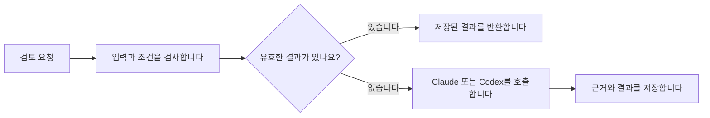

# 플러그인과 MCP 중 무엇이 필요한가요

**결론: 세 후보 모두 MCP 없이 시작할 수 있습니다.**
첫 번째와 두 번째는 스킬·로컬 스크립트를 묶은 플러그인으로 구현할 수 있습니다.
세 번째도 기록과 수동 재개는 같은 형태로 가능합니다.
앱이나 프로세스가 종료된 뒤 자동으로 이어가려면, 다음 실행을 시작할 프로그램이 추가로 필요합니다.
MCP를 붙이는 것만으로 이 역할이 생기지는 않습니다.

이 결론은 2026-10-05에 공식 문서와 저장소 코드를 확인한 뒤 내린 설계 판단입니다.
새 플러그인을 설치하거나 두 호스트에서 통합 시험을 마쳤다는 뜻은 아닙니다.
후보의 목적은 [제품 후보](essential-work.md), 구체적인 동작은 [구현 제안](product-design.md)을 따릅니다.

이후 사용자가 기존 Distill과의 중복을 지적하고, 처음 목적은 룰 생성이었다고 설명했습니다.
[Distill 코드 대조](findings/2026-10-05-distill.md)에서 저장·검색·규칙 생성과 MCP 서버를 확인했습니다.
첫 번째 후보는 기존 구조를 재사용하는 방향을 우선 검토합니다.
MCP 없이도 가능하다는 설명을 기존 MCP를 제거해야 한다는 제안으로 해석하지 않습니다.
호출 시점은 [사용자가 제안한 판단 순서](decision-criteria.md#decision-order)를 따릅니다.
목적만으로 결정할 수 없을 때 Distill을 조회하도록 스킬과 실행 흐름을 연결합니다.
MCP는 조회 통로이며, 이 순서를 스스로 보장하지는 않습니다.

## 플러그인 안에 MCP를 넣을 수 있습니다

플러그인은 스킬·훅·스크립트·MCP 설정 등을 설치할 수 있게 묶습니다.
스킬은 AI에게 절차를 알려 주고, 훅은 세션 시작이나 도구 실행 같은 사건에 맞춰 동작합니다.
MCP는 AI가 프로그램의 기능을 정해진 입력 형식으로 호출하게 해 줍니다.
따라서 플러그인에 MCP 서버를 포함하거나, MCP 없이 스크립트만 포함할 수 있습니다.
[공식 패키징 문서에서 확인한 범위](sources.md#s28)

이 문서에서 ‘MCP 없는 플러그인’은 설명문만 있는 플러그인을 뜻하지 않습니다.
파일이나 SQLite에 기록을 저장하는 코드도 포함할 수 있습니다.
저장한 데이터는 설치 캐시와 분리해야 업데이트 뒤에도 유지할 수 있습니다.

## 세 후보별 권고

| 후보 | MCP 없이 만들 수 있는 범위 | MCP를 붙일 이유가 생기는 조건 | 첫 구현 제안 |
|---|---|---|---|
| 판단 기준을 모아 적용합니다. | 허용한 기록에서 기준 후보를 뽑고, 출처·예외·버전을 저장합니다. 관련 기준을 스킬이나 훅으로 전달합니다. | 여러 호스트에서 동일한 검색·수정 도구를 쓰거나, 원격 저장소를 함께 써야 합니다. | 이미 MCP를 사용하는 Distill의 저장·검색·규칙 생성 흐름부터 검증합니다. |
| 유효한 판단을 다시 씁니다. | Python 함수나 CLI가 입력과 조건을 검사하고, 기존 결과가 있으면 새 판단 호출을 생략합니다. | 여러 도구나 앱이 같은 판단 저장소를 조회하고 갱신해야 합니다. | 새 모델 호출 직전에 검사하는 공통 코드를 먼저 만듭니다. 스킬은 이 경로를 사용하게 안내합니다. |
| 실제 결과를 확인하고 이어갑니다. | 실행 전후 상태를 저장하고, 재개 명령을 받으면 현재 결과를 확인합니다. 살아 있는 세션에서는 훅으로 계속 진행하도록 요청할 수 있습니다. | 다른 호스트에서 작업을 시작하거나 상태를 조회하는 공통 도구가 필요합니다. | 실행과 결과 확인을 맡는 로컬 프로그램을 만듭니다. 프로세스 종료 뒤 자동 재개까지 원한다면 별도 실행기를 둡니다. |

Claude와 Codex를 함께 쓴다는 이유만으로 MCP가 필수는 아닙니다.
같은 로컬 프로그램과 저장 경로를 두 환경에서 호출할 수도 있습니다.
MCP는 공통 도구를 제공하는 선택지이며, 파일 공유와 동시 쓰기 문제를 대신 해결하지는 않습니다.

## 두 번째 후보에서 비용이 줄어드는 위치

재사용을 안내하는 스킬을 읽을 때는 이미 모델 호출이 시작됐을 수 있습니다.
모델이 MCP 도구를 호출해 옛 판단을 가져와도, 그 도구를 고르고 답을 작성하는 비용은 남습니다.
따라서 MCP를 설치하면 대화의 모든 중복 추론이 사라진다고 설명하면 안 됩니다.

확실히 생략할 수 있는 범위는 우리가 호출 경로를 관리하는 판단입니다.
예를 들어 ‘이 자료를 검토한다’는 프로그램이 다음 순서로 동작하도록 만듭니다.

이 프로그램을 CLI로 부를 수도 있고 MCP 도구로 부를 수도 있습니다.
판단을 재사용하는 코드는 두 경우에 공통으로 둡니다.
현재 대화 모델의 내부 추론 전체를 가로채거나 대체하는 기능은 이번 설계에 포함하지 않습니다.

기존 [코드 리뷰 비교](findings/2026-10-05-review-reuse.md)는 이처럼 모델을 부르기 전에 캐시를 검사했습니다.
MCP 연결 속도를 비교한 실험이 아닙니다.
입력이 완전히 같은 경우에 얻은 결과를 유사한 질문의 재사용 효과로 확대하지 않습니다.

## 세 번째 후보에서 훅이 할 수 있는 일

정상적으로 응답을 끝내려는 시점과 프로세스가 죽은 시점은 다릅니다.
두 호스트의 공식 문서는 `Stop` 훅이 정상 응답 종료를 막고 계속 진행하도록 요청할 수 있다고 설명합니다.
현재 Stage의 `Stop` 처리에서는 요약을 저장합니다. 이 사실과 호스트가 제공하는 전체 기능을 구별합니다.
[호스트별 훅 계약](sources.md#s29), [Stage의 처리 코드](../../../stage/hooks/stage_guard.py)

| 상황 | 제안하는 처리 |
|---|---|
| 세션이 살아 있고 완료되지 않은 일이 남았습니다. | `Stop` 훅에서 남은 일을 확인하고 계속 진행하도록 요청할 수 있습니다. 반복 횟수와 중단 조건도 둡니다. |
| 사용자가 중단했습니다. | 현재 상태를 남기고 명시적인 재개를 기다립니다. 자동 재시도로 중단 의사를 무시하지 않습니다. |
| 앱이나 CLI 프로세스가 종료됐습니다. | 사람이 다시 시작하거나, 허용된 별도 실행기가 새 프로세스를 시작합니다. 다시 실행하기 전에 실제 결과를 확인합니다. |
| MCP 연결만 끊겼습니다. | 도구가 실제로 처리했는지 조회합니다. 결과를 확인하지 못하면 중복 실행 가능성을 남깁니다. |

별도 실행기는 플러그인에 함께 배포할 수도 있습니다. 별도의 제품으로 출시해야 한다는 뜻은 아닙니다.
MCP 서버에 작업 실행 코드를 넣는 설계도 가능하지만, 계속 살아 있을 프로세스와 영구 기록은 여전히 필요합니다.
특히 호스트가 시작하는 로컬 MCP 프로세스를 호스트 종료 뒤에도 유지되는 실행기로 가정하지 않습니다.

## 두 호스트에서 같은 부분과 다른 부분

확인한 로컬 CLI 버전은 Claude Code `2.1.289`, Codex CLI `0.146.0`입니다.
아래는 조사일의 공식 문서가 설명하는 기능입니다. 설치된 버전에서 모든 항목을 시험한 결과는 아닙니다.

| 항목 | 확인한 내용 | 설계에 반영할 점 |
|---|---|---|
| 플러그인 구성 | 두 환경 모두 스킬과 MCP 연결을 묶을 수 있습니다. Codex 문서는 기존 `.codex-plugin/plugin.json`도 지원한다고 밝힙니다. | 이번 연구에서 저장소 manifest를 바꿀 이유는 없습니다. 호스트별 선언만 맞춥니다. |
| 로컬 MCP | 두 환경 모두 로컬 프로세스로 연결하는 stdio 방식을 문서화했습니다. | MCP를 쓴다고 클라우드 서버나 새 모델 API가 반드시 필요한 것은 아닙니다. |
| 훅 | 두 환경 모두 세션·도구 호출 관련 훅을 제공합니다. 지원하는 입력과 반환값에는 차이가 있습니다. | 기록을 처리하는 코드는 공유하고, 호스트별 이벤트 변환은 따로 둡니다. |
| 모델이 판단하는 훅 | Claude는 prompt·agent 방식도 제공합니다. Codex 문서는 이 방식들을 실행하지 않는다고 명시합니다. | 공통 기능은 명령으로 실행하는 훅을 기준으로 설계합니다. |
| 도구 출력 교체 | Claude는 `updatedToolOutput`을 설명합니다. Codex는 `updatedMCPToolOutput`을 아직 지원하지 않는다고 명시합니다. | 사후 훅으로 결과를 교체하는 방식을 공통 캐시 경로로 삼지 않습니다. 이미 실행된 비용도 되돌릴 수 없습니다. |

[패키징](sources.md#s28), [훅](sources.md#s29), [MCP 연결](sources.md#s30)의 원문을 확인했습니다.
로컬 Codex 플러그인과 ChatGPT 웹용 공개 제출 절차는 구분합니다.
공개 제출에서 요구하는 원격 서버 조건을 이번 로컬 구현의 필수 조건으로 가져오지 않습니다.

## 저장소에서 확인한 실제 사례

| 사례 | 확인한 구성 | 이번 판단에 주는 근거 |
|---|---|---|
| Stage | [두 호스트의 manifest](../../../stage/.codex-plugin/plugin.json)에 스킬을 선언하고 [훅](../../../stage/hooks/hooks.json)과 [드라이버](../../../stage/scripts/drive.py)를 제공합니다. MCP 서버 선언은 없습니다. | 기록·검사·작업 실행을 MCP 없이 플러그인으로 제공할 수 있습니다. |
| RAG | [Claude용 MCP 설정](../../../rag/.mcp.json)과 [Codex manifest](../../../rag/.codex-plugin/plugin.json)가 같은 서버를 시작합니다. 프로젝트 경로를 전달하는 방식은 다릅니다. | MCP로 핵심 기능을 공유해도 호스트별 설정은 필요합니다. |
| Evonest | [개발 지침](../../../evonest/CLAUDE.md)은 핵심 코드와 MCP 도구를 분리하고, CLI와 MCP 경로를 설명합니다. | 핵심 기능을 먼저 만들고 호출 방식만 여러 개 붙이는 구조가 가능합니다. |

이 표는 선언과 코드를 읽고 정리했습니다. 기존 플러그인의 설치·실행 성공률을 새로 측정한 결과는 아닙니다.

## MCP를 붙일 때 얻는 것과 드는 비용

MCP를 쓰면 기능별 입력 형식을 선언하고, 여러 호스트에 같은 도구를 제공할 수 있습니다.
매번 쉘 명령을 조립하도록 안내하는 수고도 줄일 수 있습니다.
서버 프로세스·연결·시간 제한·오류 처리와 호스트별 호환성 검사는 추가됩니다.
원격 서버로 운영한다면 배포와 인증도 맡아야 합니다.
로컬 스크립트보다 빠르거나 사용량이 적다는 효과는 아직 측정하지 않았습니다.

**새 기능은 공통 Python 코드와 얇은 플러그인으로 제안합니다. 첫 번째 후보는 기존 Distill부터 검증합니다.**
세 번째의 실행기는 재개를 책임지며, MCP는 그 프로그램을 호출하는 선택지로 둡니다.
여러 곳에서 같은 기능을 도구로 호출해야 한다는 요구가 확인되면 MCP 연결을 추가합니다.

구현 뒤에는 다음 항목을 실제 Claude와 Codex에서 확인해야 합니다.

- 플러그인을 불러오고 스크립트 경로를 찾는지 확인합니다.
- 명시적으로 스킬을 호출했을 때와 자동으로 선택됐을 때를 나눠 검사합니다.
- 필요한 훅이 실제로 실행되고, 호스트별 입력을 같은 기록으로 바꾸는지 확인합니다.
- 두 환경이 같은 기준 버전을 읽고, 동시에 수정해도 기록을 잃지 않는지 확인합니다.
- 새 판단 전에 캐시를 검사했는지, 조건이 바뀌면 새로 호출했는지 확인합니다.
- 정상 종료·사용자 중단·프로세스 종료를 구분해 세 번째 후보를 시험합니다.

이 항목들은 후속 통합 시험 계획입니다. 이번 조사에서 통과했다고 보고하지 않습니다.
