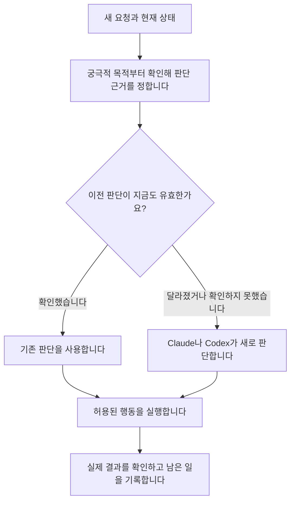

# 세 가지 개선을 Stage에 연결하는 방법

**후속 상태: 사용자가 Stage·Distill·Avatar의 첫 연결 흐름 구현에 동의해 [작업 묶음](../../work/current/W-00000272/_epic.md)을 등록했습니다. 아래는 앞선 연구 단계의 제안입니다.**

**상태: 2026-10-05에 정리한 설계 제안입니다. 제품 구현이나 시장 수요 검증을 마친 결과가 아닙니다.**

사용자의 최신 요청에 따라 이번에는 논의 내용을 기록하며, 새 플러그인 구현은 보류합니다.
프로젝트를 넘어 개인의 기준과 메타인지를 다루는 [Avatar / Clone 아이디어](avatar.md)는 따로 구분합니다.

현재 연구 방향은 세 가지 개선을 Stage가 제공할 능력으로 함께 검토하는 것입니다.
사용자는 Stage가 AI가 뛰어놀 수 있는 무대라는 목적을 다시 강조했습니다.
세 가지 모두 그 목적 안에 들어갈 수 있습니다. 지금 Stage가 세 기능을 모두 충족한다는 뜻은 아닙니다.
후보의 목적과 확인한 범위는 [현재 제품 후보](essential-work.md)가 소유합니다.
이 문서는 Stage에서의 역할, 기존 기능과 연결하는 방법, 효과를 확인할 조건을 제안합니다.

## Stage의 목적에서 출발합니다

[Stage 철학](../../../stage/docs/PHILOSOPHY.md)은 실행은 자유롭게 두되 목적을 놓치지 않도록 한다고 설명합니다.
여러 AI가 참여하거나 세션이 바뀌어도 그 목적을 이루도록 돕는 것이 이번 개선의 방향입니다.
앞서 Stage를 주로 실행·복구 기능으로 설명한 것은 그 목적을 너무 좁게 본 해석이었습니다.

| 개선 | Stage에서 AI가 할 수 있게 되는 일 | 확인해야 할 효과 |
|---|---|---|
| 판단 기준을 만들고 적용합니다. | 목적과 과거 결정의 이유를 살펴보고, 확인된 기준을 다음 선택에 사용합니다. | 같은 설명을 되묻는 횟수와 근거 없는 판단이 함께 줄어드는지 |
| 여전히 유효한 판단을 다시 씁니다. | 조건이 유지되는지 확인하고 이미 해결한 문제의 판단을 재사용합니다. | 확인에 든 비용까지 합쳐도 반복 작업이 줄어드는지 |
| 세션이 바뀌어도 일을 이어갑니다. | 관련 결정과 실제 결과를 읽고 남은 일을 맡습니다. | 완료한 일을 반복하거나 최신 조건을 놓치는 일이 줄어드는지 |

기능을 추가할 때마다 새 질문이나 승인 단계를 만들지는 않습니다.
판단 근거를 찾는 순서는 [궁극적 목적 → Distill → 사용자](decision-criteria.md#decision-order)를 따릅니다.
독립 리뷰가 필요한 자리에서는 이전 판정을 돌려주는 것으로 새 검토를 대신하지 않습니다.

사용자는 Stage에서 이 기능들을 함께 쓸 수 있습니다.
동시에 [개인의 기준을 프로젝트 밖에서 모으는 역할](decision-criteria.md#person-across-projects)은 별도 Avatar / Clone 구상으로 유지합니다.
Stage는 현재 목적에 맞는 기준을 가져다 쓸 수 있고, 개인의 기준은 다른 프로젝트와 AI에서도 이어서 사용할 수 있도록 제안합니다.
내부에서 Distill의 수집·검색을 재사용할지, Stage 자체 기능을 보완할지는 실제 계약과 시험 결과로 정합니다.
Stage의 결정 원문을 다른 곳에 복제해 두 벌로 관리할 필요는 없습니다.
통합은 모든 대화를 한 번에 읽히는 일이 아닙니다. [필요한 기록을 골라 전달하는 방식](session-continuity.md)을 검증합니다.

이 방향은 연구 설계에 반영했습니다. 플러그인 통합이나 코드 이전을 실행한 것은 아닙니다.

## 별도 제품은 언제 검토할까요

아래는 앞서 검토한 독립 사용 가능성입니다. 현재 우선 방향은 Stage 안에서 효과를 확인하는 것입니다.

각각 하나만 썼을 때도 사용자의 문제가 해결되는지 확인해야 합니다.
아래 쓰임새는 검증할 가설입니다. 실제 고객이나 구매 의사를 확인한 것은 아닙니다.

| 후보 | 하나만 쓴다면 | 다른 후보 없이 가능한 이유 | 별도 제품으로 만들 근거 |
|---|---|---|---|
| 판단 기준을 모아 적용합니다. | 새로운 제안이 내 기준에 맞는지 검토합니다. | 매번 새로 판단해도 쓸 수 있고, 실행까지 맡길 필요도 없습니다. | 과거 판단을 재사용하거나 작업을 자동 실행하지 않아도 재설명과 수정이 줄어듭니다. |
| 이전 판단을 다시 씁니다. | 조건이 같은 요청에 기존 결과를 돌려줍니다. | 기준은 사람이 직접 정하거나 다른 시스템에서 받아도 됩니다. | 기준 수집 기능 없이도 반복 판단에 드는 전체 비용이 줄어듭니다. |
| 실제 결과를 확인하며 작업을 이어갑니다. | 정해진 절차가 중단되면 완료한 부분을 확인하고 나머지를 처리합니다. | 순서와 조건이 정해져 있으면 새 판단 없이도 동작할 수 있습니다. | 기준 학습이나 판단 재사용 없이도 중복 실행과 복구 수고가 줄어듭니다. |

하나로 묶을 근거도 따로 확인해야 합니다.
같은 사용자가 한 업무에서 세 기능을 계속 함께 쓰고, 연결해 쓰는 수고가 크다면 통합할 이유가 생깁니다.
반대로 각각 다른 업무에서 쓰이고 연결할 필요가 적다면 독립 제품으로 제공할 수 있습니다.

**Stage에 함께 연결해도 각 기능의 효과는 따로 시험할 수 있어야 합니다.**
처음부터 설치·화면·요금제까지 세 벌로 만들 필요는 없습니다.
코드를 나누는 일과 제품을 나누는 일은 별도로 결정합니다.

## 어떻게 연결되나요

세 기능을 함께 쓴다면 다음 흐름을 생각할 수 있습니다.
각 기능을 단독으로 쓰는 경우에는 해당 단계만 사용합니다.
판단할 기준을 찾는 순서는 [궁극적 목적 → Distill → 사용자](decision-criteria.md#decision-order)를 따릅니다.
목적만으로 선택할 수 있다면 Distill 조회와 사용자 질문은 생략합니다.

이전 판단을 재사용해도 그 행동을 지금 실행할 권한이 생기는 것은 아닙니다.
실행 여부는 현재 요청과 상태에서 다시 확인합니다.
기준을 바꾸면 그 기준에 의존한 판단을 다시 확인하고, 바뀐 판단이 실행 계획에 미치는 영향도 살핍니다.

## 첫 번째는 어떻게 만들까요

사용자는 기존 Distill의 처음 목적이 룰 생성이었다고 설명했습니다.
[현재 Distill 코드](findings/2026-10-05-distill.md)에 수집·규칙 생성·검색 흐름이 있습니다.
아래 정책을 검증할 때는 기존 구현과 비교하고, 추가 동작이 필요한 부분을 확인한 뒤 변경 범위를 정합니다.

사람이 직접 말한 기준과 행동에서 추정한 기준을 구별해 저장합니다.
원래 발언, 적용 상황, 예외, 버전을 함께 남깁니다.
자세한 수집·갱신 정책은 [판단 기준 연구](decision-criteria.md)를 따릅니다.
기준은 [목적과 실제 선택에서 만들고 다른 사례로 확인하는 과정](decision-criteria.md#forming-criteria)을 제안합니다.
선택을 요약한 문장만으로 적용 범위와 우선순위를 확정하지 않습니다.

첫 시제품은 사용자가 허용한 프로젝트 기록에서 시작할 수 있습니다.
Claude나 Codex가 기준 후보를 뽑으면 사람이 내용을 고칠 수 있게 보여줍니다.
추정한 기준을 사람이 확인한 기준으로 자동 승격하지 않습니다.

새 선택이 필요하면 프로젝트의 궁극적 목적부터 확인합니다.
목적만으로 결정할 수 없을 때 Distill을 조회하고, 적용할 기록도 없으면 사용자에게 묻습니다.
모델은 어떤 목적과 기준을 적용했는지 결과에 연결합니다.
현재 요청이 과거 기준을 바꾸면 이번 요청을 우선합니다.

프로그램은 버전·출처·적용 범위를 관리합니다.
모델은 자유로운 문장에서 기준을 찾고, 새로운 상황에 어떻게 적용할지 해석합니다.
첫 비교에서는 과거 기록을 그대로 주는 방식보다 수정 횟수와 총비용이 줄어드는지 확인합니다.

## 두 번째는 어떻게 만들까요

판단 결과를 질문, 근거, 기준 버전, 실행 설정과 함께 저장합니다.
새 요청이 들어오면 판단에 영향을 주는 조건이 그대로인지 먼저 검사합니다.
처음에는 입력과 선언한 조건이 정확히 같은 경우만 다룹니다.

다음 조건을 모두 만족할 때만 저장된 판단을 돌려주도록 설계합니다.

- 질문의 목적과 판단에 쓴 자료가 같습니다.
- 기준과 모델 호출 설정이 같습니다.
- 시간이나 외부 상태에 의존한다면 해당 조건도 확인했습니다.
- 사용자가 독립적인 재검토를 요구하지 않았습니다.
- 기존 판단을 폐기하거나 수정했다는 기록이 없습니다.

조건이 다르거나 확인할 수 없으면 새로 판단합니다.
관련 파일을 빠뜨린 상태에서 해시만 같다고 재사용하면 잘못된 답을 되풀이할 수 있습니다.
무엇에 의존하는지 선언하고 확인하는 비용이 핵심입니다.

첫 번째 기능이 없어도 사람이 정한 기준을 입력받으면 동작할 수 있습니다.
문서 분류나 요구사항 검토에도 적용할 수 있다는 가설이 있습니다.
현재 실험 근거는 [같은 코드 리뷰를 다시 처리한 결과](findings/2026-10-05-review-reuse.md)까지입니다.
실무에서 같은 판단이 얼마나 반복되는지부터 관측해야 합니다.

## 세 번째는 어떻게 만들까요

여러 AI 세션에서 이어가는 경우에는 목적·결정 이유·현재 결과·남은 일을 함께 전달해야 합니다.
현재 Stage와 대조한 [세션 간 작업 인계 설계](session-continuity.md)에서 그 범위와 검증 방법을 다룹니다.
아래 파일 복구 예시는 그중 실행 중단을 확인하는 좁은 시험입니다.

실행 전에 하려는 행동과 기대 결과를 남깁니다.
실행 뒤에는 실제 결과를 읽어 완료 여부를 기록합니다.
중단됐다면 기록과 현재 상태를 대조하고 다음 행동을 정합니다.

첫 시제품은 전용 임시 디렉터리에 정해진 내용을 쓰는 작업으로 좁힐 수 있습니다.
파일마다 실행 전 내용과 저장할 내용을 미리 남깁니다.

| 재개할 때 확인한 상태 | 동작 |
|---|---|
| 파일이 저장하려던 내용과 같습니다. | 원하는 결과가 존재한다고 기록하고 다음 파일로 넘어갑니다. |
| 파일이 실행 전 내용과 같고 실행 조건도 유지됩니다. | 아직 필요한 쓰기를 수행합니다. |
| 둘 중 어느 내용과도 다릅니다. | 덮어쓰지 않고 바뀐 내용을 확인하도록 알립니다. |
| 파일을 읽을 수 없습니다. | 완료 여부를 미확인으로 남깁니다. |

핵심 시험은 파일을 쓴 직후, 완료 기록을 남기기 전에 프로세스를 강제로 종료하는 것입니다.
다시 실행했을 때 끝난 쓰기를 반복하지 않고 남은 파일만 처리하는지 봅니다.
여러 프로그램이 동시에 파일을 바꾸는 경우는 별도 시험이 필요합니다.
결과가 같다는 사실만으로 누가 실행했는지까지 입증했다고 기록하지 않습니다.

이 방식으로 모든 도구를 복구할 수 있는 것은 아닙니다.
외부 서비스에서는 결과 조회나 중복 요청 방지 기능을 도구별로 연결해야 합니다.
성공 여부를 확인할 수 없다면 무조건 다시 호출하지 않습니다.

### Stage와 어디가 다를 수 있나요

Stage는 이미 작업을 실행하고 검증하며 독립 리뷰를 수행합니다.
결정의 선택지·원칙·이유·적용 범위도 남기고 작업에 연결합니다.
따라서 판단 기준 연구와도 겹치며, 실행 전용으로 역할을 제한하지 않습니다.
완료한 단계의 체크포인트를 남기고, 저장소 상태가 같을 때 다음 단계로 재개하는 기능도 있습니다.
[Stage 재개 계약](../../../stage/skills/stage-drive/SKILL.md)

별도 후보에서는 도구 호출 하나가 끝났는지, 그 결과를 어떻게 재확인할지에 집중할 수 있습니다.
Stage가 다루는 작업 전체의 목적·완료 기준과 연결할 수 있지만, Stage 없이 정해진 절차를 실행하도록 만들 수도 있습니다.
차별점은 실제 부분 실행과 복구 시험에서 확인해야 합니다.
단순히 ‘계속 일한다’는 설명만으로 기존 Stage와 구분하지 않습니다.

## 처음에는 어떤 형태로 만들까요

새로 필요한 기능은 로컬 프로그램으로 제안합니다. Python과 SQLite를 사용할 수 있습니다.
첫 번째 후보는 Distill의 기존 저장소와 MCP 구조를 재사용하는 방향부터 검토합니다.
이는 구현 선택지이며 확정한 기술 규격은 아닙니다.
기준·판단·실행 기록은 역할별로 구분하고 서로의 ID와 버전을 참조합니다.
각 기능을 따로 실행할 수 있게 만들어 단독 효과부터 비교합니다.

Claude와 Codex에는 스킬과 로컬 스크립트를 플러그인으로 제공할 수 있습니다.
MCP 서버도 플러그인에 함께 넣을 수 있습니다. 세 후보의 첫 구현에 MCP가 필수는 아닙니다.
살아 있는 세션의 정상 종료는 훅으로 제어할 수 있습니다.
앱이나 프로세스가 종료된 뒤 자동으로 재개하려면 다음 실행을 시작할 주체가 필요합니다.
각 후보의 권고와 호스트별 차이는 [플러그인·MCP 검토](integration-choice.md)에 정리했습니다.

도구 호출별 복구를 제공하려면 그 호출을 실행기가 관리해야 합니다.
제한 없이 도구를 쓰는 CLI 전체를 감싸는 것만으로 각 호출의 결과까지 보장할 수는 없습니다.
처음에는 실행기가 직접 수행하고 결과를 확인할 수 있는 동작만 연결합니다.

## 다음에 무엇을 확인하면 되나요

| 후보 | 먼저 확인할 질문 | 좋아졌다고 판단할 근거 |
|---|---|---|
| 판단 기준 적용 | 처음 보는 상황에서도 사용자가 원하는 기준을 적용하나요? | 별도 평가 사례에서 재지시·수정이 줄고, 현재 지시를 무시하지 않습니다. |
| 판단 재사용 | 실제 업무에서 재사용할 수 있는 요청이 충분히 나오나요? | 기록·검사·잘못된 재사용의 비용까지 합쳐도 시간과 사용량이 줄어듭니다. |
| 실행 확인과 복구 | 실제 결과와 기록 사이에서 중단돼도 복구하나요? | 완료·미실행·충돌·미확인을 구별하고 중복 실행과 누락이 줄어듭니다. |

세 시험의 결과를 보고 제품 구성을 정합니다.
각각 단독 효과가 크면 별도 제품으로 발전시킬 근거가 됩니다.
함께 쓸 때에만 이점이 크다면 하나의 제품 안에서 연결하는 쪽을 검토합니다.
