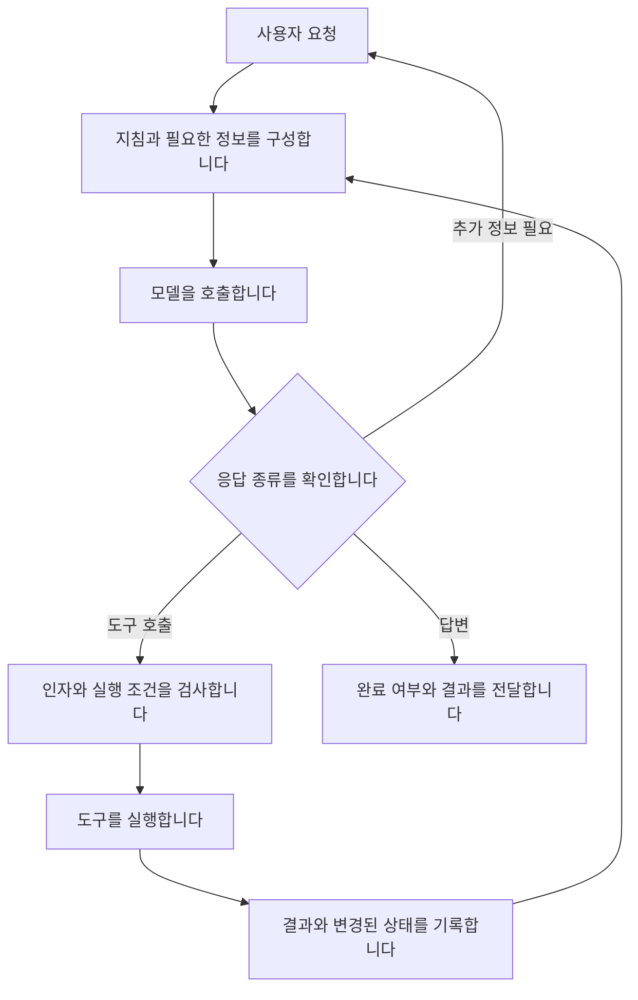

# 모델과 프로그램이 실제로 수행하는 일을 구별합니다

## 서로 다른 세 가지 관점

| 관점 | 살펴볼 대상 | 알 수 있는 범위 |
|---|---|---|
| 작업 | 목적 해석, 증거 판단, 행동 선택 | 분석을 위해 나눈 동작; 내부 모듈이라고 단정하지 않습니다. |
| 프로그램 | 입력 구성, 모델 호출, 도구 실행, 결과 전달 | 코드를 읽거나 실행 기록을 남기면 직접 확인할 수 있습니다. |
| 모델 계산 | 입력 처리, 다음 토큰 생성, 캐시 재사용 | 공개 구조와 노출된 측정값으로 확인합니다. 상용 서비스 내부는 일부만 보입니다. |

이 구분은 본 연구의 분석 틀입니다.
작업의 한 동작이 몇 번의 호출을 쓰는지, 한 호출이 몇 가지 동작을 수행하는지 따로 표시합니다.

## 프로그램이 반복하는 과정

다음은 공개된 에이전트 문서를 바탕으로 그린 일반적인 구조입니다.
각 회사의 소비자용 앱 전체를 복원한 그림은 아닙니다.
근거는 [OpenAI](sources.md#s01), [Anthropic](sources.md#s02), [xAI](sources.md#s07)입니다.

프로그램이 수행할 검사를 모델에게 부탁하는 구조도 만들 수 있습니다.
그 경우 해당 검사는 별도의 모델 호출이거나 기존 호출에 포함된 작업이 됩니다.
모든 서비스가 위의 검사를 모두 수행한다고 가정하지 않습니다.

## 한 번의 호출 주변에서 확인할 항목

| 위치 | 확인할 항목 | 측정 한계 |
|---|---|---|
| 호출 전 | 모델 이름, 지침, 자료, 도구 정의, 입력 길이 | 호스트가 숨긴 지침은 수집할 수 없을 수 있습니다. |
| 전송과 대기 | 요청 시각, 첫 응답 시각, 종료 시각 | 클라이언트 지연만으로 서버 대기와 추론 시간을 분리할 수 없습니다. |
| 응답 | 답변, 도구 호출, 토큰 사용량, 종료 사유 | 제공자가 내놓는 항목만 기록합니다. 없는 값은 `null`입니다. |
| 도구 실행 | 인자, 시작·종료, 오류, 외부 상태 변화 | 반환 코드와 목적 달성은 따로 확인합니다. |
| 다음 호출 | 추가·제거·요약한 자료, 이전 응답 식별자 | 문맥 변화가 모델 변화처럼 보이지 않도록 남깁니다. |

병렬 호출이 있으면 전체 시간은 개별 시간의 단순 합이 아닙니다.
사용자가 요청한 시각부터 최종 결과까지 걸린 시간과, 각 호출 시간을 모두 기록합니다.
반복된 입력의 토큰 수만 보고 실제 계산량이나 청구액을 추정하지 않습니다.

## 모델 계산을 볼 때 주의할 점

일반적인 자기회귀 모델은 앞선 문맥을 바탕으로 다음 토큰을 생성합니다.
KV 캐시는 이전 토큰에서 계산한 일부 값을 재사용합니다.
이 캐시와 사용자의 취향을 저장한 외부 기억은 목적과 수명이 다릅니다.
자세한 근거는 [캐시 문서](sources.md#s05)에 있습니다.

다음 세 가지는 따로 기록합니다.

- **의미상 반복:** 같은 내용을 다시 판단하거나 요약합니다.
- **입력상 반복:** 같은 자료를 다시 전달합니다.
- **계산상 반복:** 이전 계산을 재사용하지 않고 다시 수행합니다.

첫 두 가지를 관찰했다고 세 번째까지 증명한 것은 아닙니다.
반대로 캐시를 사용하더라도 같은 사실에 대해 서로 다른 판단을 내릴 수 있습니다.

## 서비스별로 확인한 경계

| 대상 | 공개 자료에서 확인한 범위 | 아직 확인하지 않은 범위 |
|---|---|---|
| OpenAI | SDK가 모델 호출과 도구 실행을 반복합니다. [S01](sources.md#s01) | 이 대화가 사용하는 앱의 모든 내부 호출과 모델 배정 |
| Anthropic | 도구·검색·문맥 관리 패턴을 설명합니다. [S02](sources.md#s02), [S03](sources.md#s03) | 현재 Claude 소비자 앱의 전체 실행 구조 |
| Gemini | 지정된 API의 다단계 호출에서 이전 응답의 서명을 보존해야 합니다. [S06](sources.md#s06) | 소비자 앱이 실제로 어떤 모델과 상태 저장소를 쓰는지 |
| Grok | 사용자 정의 도구의 실행과 모델의 호출 요청을 구별합니다. [S07](sources.md#s07) | Grok 앱의 전체 검색·기억·검증 방식 |
| Meta Muse | 사용자가 메타라고 확인했습니다. VM, 행동 제안과 허용 판단을 나눈 구조를 설명합니다. [S23](sources.md#s23), [S24](sources.md#s24) | 비공개 모델 배치, 서비스 전체 소스와 실제 보호 효과 |

Gemini의 서명은 내부 사고를 읽을 수 있는 설명문이 아닙니다.
이 사례는 대화를 문자열로만 다시 조립하면 필요한 상태를 빠뜨릴 수 있음을 보여줍니다.
이를 모든 제공자의 동일한 요구사항으로 일반화하지 않습니다.
현재 Gemini Interactions API와 다른 서비스의 후속 조사는 [서비스별 확인 범위](services.md)에 정리했습니다.

## 무엇을 관찰할 수 있나요

2026-10-05에 [Claude Agent SDK의 소스](findings/2026-10-05-claude-sdk.md)를 추가로 검토했습니다.
공개 Python 코드에서 요청 전달과 콜백 처리를 확인했습니다.
권한 확인 콜백이 모든 도구 호출을 포괄하지 않는다는 점도 확인했습니다.
연구용 로그는 실제 사건을 빠짐없이 담는지 먼저 검증해야 합니다.

요청, 실제 입력, 출력, 도구 인자와 결과, 파일 변화는 수집 범위 안에서 관찰할 수 있습니다.
모델이 나중에 말한 이유는 자기 설명으로 표시합니다.
그 설명이 실제 계산 경로였다고 확정하지 않습니다. [관련 연구](sources.md#s04)

입력을 바꾼 비교 실험은 행동이 달라지는 조건을 찾는 데 도움이 됩니다.
그 결과만으로 내부 신경망의 원인을 완전히 설명했다고 주장하지 않습니다.
