# Stage 도면

이 문서는 Stage 가 어떤 층으로 이루어져 있는지를 소유한다. Stage 의 코드를 고치기 전에 이 문서를 먼저 읽는다.

도면은 네 층이다. 위 두 층과 코드가 말해 주지 않는 것은 이 문서에 직접 적는다. 아래 두 층은 그 내용을 가진
문서와 코드로 가는 링크만 둔다.

| 층 | 무엇을 말하는가 | 어디에 있는가 |
|---|---|---|
| 목표 | Stage 가 무엇을 위한 물건인가 | [목표](#목표) |
| 레이어 | 코드가 어떤 책임으로 나뉘는가 | [레이어](#레이어) |
| 컴포넌트 | 레이어마다 어떤 파일이 있는가 | [컴포넌트로 가는 길](#컴포넌트로-가는-길) |
| 컴포넌트 설계 | 각 파일이 왜 그렇게 동작하는가 | 결정 기록과 코드 |

## 목표

실행은 자유롭게 두고 목적은 엄격하게 지킨다. Stage 는 일하는 방법을 정하지 않는다. 일이 목적에 매달려 있는지,
그 목적에 닿았는지를 만든 쪽이 아닌 쪽이 판정하는지만 지킨다.

목표의 본문은 [PHILOSOPHY.md](PHILOSOPHY.md)가 소유한다. 이 문서는 그 목표를 다시 적지 않는다.

## 레이어

Stage 의 코드는 일곱 레이어로 나뉜다. 각 레이어는 한 가지 질문에 답한다.

| 레이어 | 답하는 질문 | 코드 | 계약을 가진 문서 |
|---|---|---|---|
| 기록 | 무엇을 어디에 적는가 | `templates/`, 프로젝트의 `.stage/` | [SCHEMA_V5.md](SCHEMA_V5.md), [artifacts.md](../operations/artifacts.md) |
| 경로와 규칙 | 기록이 어디에 있고 어떤 값이 허용되는가 | `hooks/stage_topology.py`, `hooks/stage_paths.py`, `hooks/stage_record_paths.py`, `hooks/stage_work.py`, `hooks/stage_roadmap.py`, `hooks/stage_roadmap_closure.py`, `hooks/stage_model_tiers.py`, `hooks/stage_process.py`, `scripts/lifecycle_paths.py`, `scripts/stage_record_ids.py`, `scripts/stage_id_blocks.py` | [SCHEMA_V5.md](SCHEMA_V5.md) |
| 관문 | 지금 이 쓰기와 커밋을 허용하는가 | `hooks/hooks.json`, `hooks/stage_guard.py`, `hooks/stage_shell.py`, `hooks/stage_git.py`, `hooks/stage_runtime.py`, `hooks/stage_context.py`, `hooks/stage_memory_index.py`, `hooks/stage_roadmap_gate.py`, `hooks/stage_agent_tier.py` | [hooks/README.md](../hooks/README.md) |
| 절차 | 기록을 한 상태에서 다음 상태로 어떻게 옮기는가 | `skills/`, `scripts/start_work.py`, `scripts/promote_intent.py`, `scripts/close_record.py`, `scripts/escalate_work.py`, `scripts/init_stage.py`, `scripts/migrate_stage.py`, `scripts/stage_schema_v*_migration.py`, `scripts/refresh_guidance.py`, `scripts/guidance_docs.py`, `scripts/refresh_decision_index.py`, `scripts/refresh_index_titles.py`, `scripts/handoff_*.py`, `scripts/subsession_brief.py`, `scripts/started_cards.py` | 각 스킬의 `SKILL.md`, [operations/](../operations/) |
| 검증 | 일이 목적에 닿았는가 | `skills/stage-retrospective/close_work.py`, `skills/stage-retrospective/worktree_guard.py`, `skills/stage-retrospective/review_material.py`, `skills/stage-retrospective/review_containment.py`, `scripts/run_review.py`, `scripts/claude_review_companion.py`, `scripts/codex_companion.py`, `scripts/work_load.py` | [review.md](../operations/review.md), [verification.md](../operations/verification.md) |
| 드라이버 | 등록된 일을 사람 대신 누가 실행하는가 | `scripts/drive.py`, `scripts/drive_parallel.py`, `scripts/driver_*.py`, `scripts/land_run.py`, `scripts/import_executor_report.py` | `skills/stage-drive/SKILL.md` |
| 점검 | 기록이 계약대로 적혀 있는가 | `scripts/audit_stage.py`, `scripts/audit_model_tier.py`, `scripts/audit_close_evidence.py`, `scripts/stage_records.py` | `skills/stage-audit/SKILL.md` |

검증과 점검은 다른 레이어다. 검증은 카드 한 장의 결과를 보고 그 일이 목적에 닿았는지 판정한다. 점검은 기록
전체를 읽고 형식과 연결이 계약대로인지 본다. 점검을 통과한 카드가 목적에 닿지 않았을 수 있고, 그 반대도 있다.

레이어는 책임을 나눈 것이다. 가져다 쓰는 방향을 한쪽으로 묶은 것은 아니다. 굵은 흐름은 아래 그림과 같다.
모든 레이어가 경로와 규칙을 가져다 쓰고, 드라이버는 검증을 거쳐 카드를 닫고, 검증은 닫기 전에 점검을 실행한다.

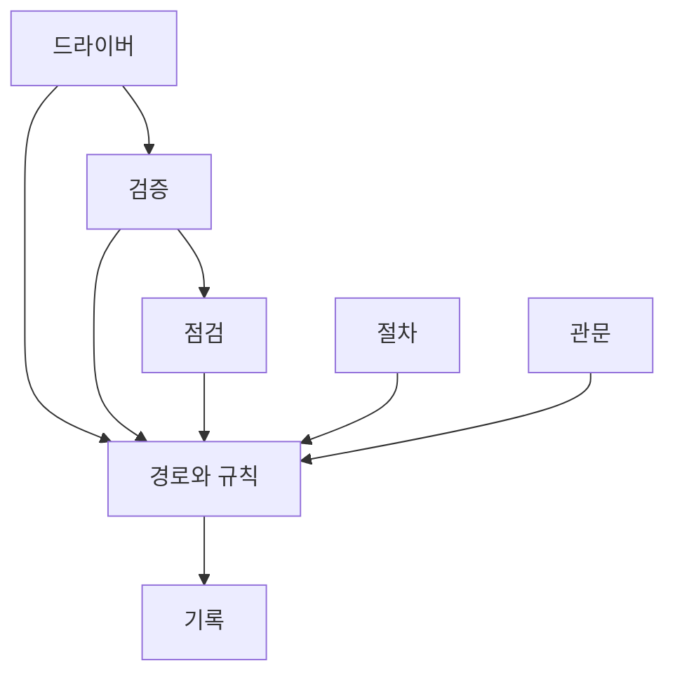

그림에 없는 방향으로 가져다 쓰는 곳은 아래와 같다.

| 가져다 쓰는 쪽 | 가져오는 모듈 |
|---|---|
| 검증 `close_work.py` | 드라이버 `driver_repository.py`, `driver_environment.py`, `driver_model_fallback.py`, `driver_lifecycle.py` |
| 검증 `close_work.py` | 절차 `archive_work.py` |
| 점검 `audit_stage.py`, `stage_records.py` | 관문 `stage_guard.py` |
| 점검 `audit_stage.py` | 절차 `close_record.py` |
| 드라이버 `land_run.py` | 점검 `stage_records.py` |
| 절차 `archive_work.py` | 관문 `stage_runtime.py` |
| 절차 `handoff_packet.py` | 드라이버 `driver_subtree.py` |
| 경로와 규칙 `stage_work.py` | 관문 `stage_git.py` |

## 코드가 말해 주지 않는 것

### 공용 모듈은 `hooks/` 에 있다

경로와 규칙 레이어의 모듈 대부분이 `hooks/` 에 있고, `scripts/` 와 `skills/` 의 스크립트가 `sys.path` 에
`hooks/` 를 넣어 가져다 쓴다. 반대 방향은 없다. `hooks/` 의 모듈은 `scripts/` 와 `skills/` 의 코드를 가져다
쓰지 않는다.

이유는 관문이 혼자 실행되어야 하기 때문이다. 호스트는 도구를 부를 때마다 `hooks/stage_guard.py` 를 직접
실행한다. 그래서 관문이 쓰는 규칙은 `hooks/` 안에서 표준 라이브러리만으로 닫혀 있어야 한다. 같은 규칙을
스크립트도 써야 하므로, 규칙을 두 번 적지 않고 관문 옆의 정의를 스크립트가 가져다 쓴다.

이 모듈들은 `stage_guard.py` 한 파일을 책임별로 나누면서 생겼고, 나눈 자리에 그대로 있다. 나눈 기록은
[IMPLEMENTATION_AUDIT.md](IMPLEMENTATION_AUDIT.md)의 P33 이다. 공용 모듈을 `hooks/` 밖의 다른 폴더로
옮길지를 정한 결정 기록은 없다.

스크립트만 쓰는 규칙은 `scripts/` 에 있다(`lifecycle_paths.py`, `stage_record_ids.py`).

`stage_record_ids.py` 는 네트워크에 간다. 번호를 고른 뒤 원격에
`refs/stage-ids/<번호>` 를 만들어 번호를 잡는다(DE-00000092). `register_work.py` 와 `manage_roadmap.py` 도
이 모듈로 번호를 잡는다. 원격이 없거나 닿지 못하거나 push 를 거절하면 이 체크아웃과 받아 온 브랜치만 세어
번호를 고르고, 잡지 못했다고 한 줄 출력한다. 관문(훅)은 이 모듈을 쓰지 않는다.

이미 쓰인 번호를 세는 함수는 `stage_record_ids.used_numbers()` 하나다. 이 체크아웃의 기록, 카드가
`reserved_ids:` 로 잡아 둔 번호, 받아 온 브랜치의 기록, 원격에 잡힌 번호를 합친다. 이 체크아웃의 기록은
`id:` 줄, 제목 줄, 파일 이름 어디에 번호가 있어도 세고, 파일 이름은 옛 구조의 짧은 번호(`W-012.md`)도 센다.
카운터를 같이 쓰는 접두어(`DE` 와 옛 `D`)는 함께 센다. 새 번호를 고르는 곳(`stage_record_ids.py`,
`stage_id_blocks.py`, `register_work.py`, `manage_roadmap.py`, `escalate_work.py`, `migrate_stage.py`)은 모두 이
집합에서 시작하고, 기록 폴더를 따로 읽지 않는다.

### `close_work.py` 와 드라이버는 서로를 가져다 쓴다

카드를 닫는 일은 `close_work.py` 한 곳이 소유한다. 드라이버는 카드의 상태를 직접 고치지 않고 `close_work.py`
를 실행해서 닫는다. 그래서 드라이버의 모듈들이 `close_work.py` 에서 작업 로그, 리뷰 판정, 검사 실행 함수를
가져다 쓴다. 여기까지는 위 그림과 같은 방향이다.

반대 방향이 네 군데 있다. `close_work.py` 가 드라이버 쪽 모듈에서 아래 넷을 가져다 쓴다.

| `close_work.py` 가 가져다 쓰는 것 | 있는 곳 | 쓰는 이유 |
|---|---|---|
| 저장소의 변경 경로 스냅샷 | `scripts/driver_repository.py` | 리뷰 명령이 판정 파일 말고 다른 파일을 고쳤는지 리뷰 앞뒤로 비교한다. |
| 카드 등급의 모델과 노력 환경 변수 | `scripts/driver_environment.py` | 닫을 때의 리뷰에 리뷰어 쪽 등급의 값을 넘긴다. |
| 사용량 한도에 걸린 모델을 다음 모델로 바꿔 다시 실행 | `scripts/driver_model_fallback.py` | 닫을 때의 리뷰도 드라이버의 리뷰와 같은 순서로 다음 모델로 넘어간다. |
| 회고 번호 예약 | `scripts/driver_lifecycle.py` | 회고 번호를 세지 않고 카드 번호에서 얻는다. |

넷 모두 드라이버 쪽에 있는 도구를 `close_work.py` 가 다시 만들지 않고 쓰는 것이다. 앞의 세 모듈은
`close_work.py` 를 가져다 쓰지 않고, `close_work.py` 는 셋을 파일 맨 위에서 가져온다. `driver_lifecycle.py` 는
`close_work.py` 를 가져다 쓰고, `close_work.py` 는 회고 번호를 예약하는 함수 안에서만 `driver_lifecycle.py` 를
가져온다.

네 도구를 드라이버 밖의 공용 모듈로 옮길지를 정한 결정 기록은 없다.

### 스크립트는 두 폴더에 있다

스킬 하나의 절차만 실행하는 스크립트는 그 스킬 폴더에 있다(`skills/stage-work/register_work.py`,
`skills/stage-retrospective/close_work.py`, `skills/stage-archive/archive_work.py`,
`skills/stage-roadmap/manage_roadmap.py`). 여러 절차가 함께 쓰는 스크립트는 `scripts/` 에 있다. 스킬 폴더의
스크립트도 `scripts/` 와 `hooks/` 를 `sys.path` 에 넣어 가져다 쓴다.

`scripts/release_plugin.py` 는 Stage 의 레이어에 들지 않는다. 이 저장소의 플러그인을 릴리스하는 도구다.

### 시간 제한은 프로세스 그룹 전체를 끝낸다

검사, 리뷰, 드라이버 실행처럼 시간 제한을 거는 명령은 `hooks/stage_process.py` 의 `run_bounded()` 로 띄운다. 명령을
제 프로세스 그룹에서 시작하고, 시간이 넘으면 그 그룹을 통째로 끝낸다(Windows 는 `taskkill /T /F`, 그 밖은 `killpg`).
`subprocess.run` 의 timeout 은 Windows 에서 `cmd.exe` 만 끝내고 파이프를 쥔 손자 프로세스를 기다렸다(W-00000381).
이 파일이 경로와 규칙 레이어에 있는 것은 여러 레이어(검증, 드라이버)가 함께 가져다 쓰기 때문이다.

새 프로세스 그룹은 POSIX 에서 새 세션이라서, 그렇게 띄운 명령에는 제어 터미널이 없다. 지금의 리뷰어와 검사 명령은
터미널을 읽지 않고 출력도 모두 붙잡히므로 이것을 받아들인다(사용자가 2026-11-22 에 정했다). `/dev/tty` 를 읽는 리뷰어는
이 길로 띄우면 실패한다.

### 드라이버는 `git ls-files -t` 에 기댄다

드라이버가 저장소 상태를 볼 때 `driver_repository.py` 는 `git ls-files -t --cached --stage --others` 한 번으로 추적
파일과 추적하지 않는 파일을 함께 읽는다(W-00000382). git 문서는 `-t` 를 "semi-deprecated" 라고 적는다. git 프로세스가
세 개에서 하나로 줄고, 추적하지 않는 파일 이름에 탭이 있어도 `? ` 표시로 가를 수 있어서 이것을 받아들인다(사용자가
2026-11-22 에 정했다). git 이 `-t` 의 출력을 바꾸면 `scripts/tests/test_driver_repository.py` 가 실패한다.

### Stage 의 코드는 표준 라이브러리만 쓴다

`hooks/`, `scripts/`, `skills/` 의 코드는 패키지를 설치하지 않고 호스트의 `python3` 로 실행된다. 실행 조건은
[hooks/README.md](../hooks/README.md)의 Portability 가 소유한다.

### 세션의 역할은 코드가 아니라 첫 메시지와 스킬이 정한다

Stage 의 코드에는 "오케스트레이터", "작업 세션", "검증 세션"이라는 상태가 없다. 세션을 띄우고 목록을 읽는 것은
플랫폼의 일이고, Stage 는 그 세션이 무엇을 하는지만 글로 준다(DE-00000099).

- 오케스트레이터는 `skills/stage-orchestrate/SKILL.md` 로 역할을 받는다. 진행 상태를 적는 파일은 없다. 진행 중인
  카드는 `.stage/work/current/` 가, 진행 중인 세션은 플랫폼의 세션 목록이 답한다.
- 오케스트레이터가 아닌 세션은 모두 `scripts/subsession_brief.py` 가 기록에서 만든 브리핑으로 역할을 받는다.
  역할 이름은 카드의 `## Sessions` 줄에 적는 이름과 같다(`work`, `verify`, `discussion`, `planning`,
  `consolidation`). 브리핑은 두 길로 전해진다. `--first-message` 는 브리핑 대신 짧은 첫 메시지를 내고, 그 메시지는
  같은 명령을 담아서 세션이 자기 체크아웃에서 브리핑을 스스로 내어 읽는다. 브리핑과 색인을 합치면 상한(10,000자)에
  닿아 첫 메시지로 옮기기에 길기 때문이다. 세션의 호스트에 이 스크립트가 없을 때만 오케스트레이터가 출력을 그대로
  붙여 보낸다. `--role work`
  는 카드가 에픽이면 그 아래 스토리를 세션 안의 서브에이전트에게 맡기고 스토리마다 커밋을 하나씩 남기게 한다.
  `--role verify` 는 `--criterion` 으로 넘긴 기준, 곧 온전한 세션이 해 봐야만 볼 수 있는 기준만 관찰해서
  보고하게 한다. 그 기준이 없으면 브리핑을 만들지 않는다. 검증 세션은 닫기의 관문이 아니다(DE-00000101):
  오케스트레이터가 관찰을 카드의 `## Verification` 에 옮겨 적고, 판정은 닫기 리뷰어가 하며 판정 파일도
  닫기 리뷰어만 쓴다.
- 닫기 리뷰어는 실행해서 판정한다(DE-00000101). 판정 파일은 기준마다 판정 방법(`ran`, `read`, `unable`)을
  담고, 그 검사는 `close_work.py` 의 `normalize_review_verdict` 한 곳에 있어 드라이버도 같은 규칙을 쓴다.
  대역 리뷰어(`scripts/claude_review_companion.py`)는 셸 명령을 무엇이든 실행할 수 있고, 파일 편집 도구로는
  판정 파일만 쓸 수 있다. 리뷰가 저장소 파일을 바꿨는지는 권한이 아니라 리뷰 앞뒤의 비교
  (`reject_review_writes`)가 잡는다. 닫을 때의 비교(`review_containment.py`)는 세 가지를 더 본다(W-00000416).
  고쳤다가 되돌린 파일은 내용이 같아도 파일의 시각과 번호가 달라져 있어 리뷰가 실패한다. git 이 무시하는 파일에
  쓴 것과, 세션 기록 폴더(`~/.claude`)나 GitHub 를 가리키는 리뷰어의 명령은 리뷰를 실패시키지 않고 닫는
  사람에게 알리고 카드에 한 줄로 남긴다. 캐시에 쓰는 것과 폴더 이름만 적은 명령이 진짜와 구별되지 않아서다.
  명령은 대역 리뷰어가 남기는 도구 호출 기록에서 읽으므로 그 기록을 남기지 않는 리뷰어 명령(codex)에서는 볼 수 없다.
  저장소 밖의 변경은 여전히 잡지 못한다. 막은 것과 못 막는 것의 목록은
  [review.md](../operations/review.md) 의 "What the close sees of the reviewer" 에 있다.
- `subsession_brief.py` 는 카드를 읽기만 한다. 세션을 만들지 않고 카드나 런타임 상태를 고치지 않는다.
- 규칙 후보를 모으는 정리 세션은 `--role consolidation` 브리핑으로 역할을 받는다. 오케스트레이터가 마일스톤을
  닫기 전과 새 회고가 20건 쌓였을 때 띄우고, 그 세션은 `.stage/state/rule-candidates.md` 만 쓴다. 회고, 결정,
  규칙 문서는 고치지 않고 규칙으로 올리자는 제안까지만 한다(DE-00000100).
- 토론 세션(`--role discussion`)과 계획 세션(`--role planning`)은 `--topic` 으로 주제를 받고, 카드 없이도 브리핑이
  나온다. 두 세션은 기록을 쓰지 않는다. 사용자가 고른 것과 제안하는 카드를 보고하고, 결정 기록과 카드는
  오케스트레이터가 그 보고에서 만든다. 클라우드 세션은 번호를 원격에 잡지 못하고(DE-00000094) 카드는 한 세션만
  등록하기 때문이다.

### 세션이 처음 받는 글은 규칙 문장과 기록에서 만든 색인이다

세션이 시작할 때 받는 글은 두 부분이다. 앞은 매번 같은 규칙 문장이고, 뒤는 그때 기록에서 만든 색인이다
(DE-00000100). 색인의 한 줄은 기록 하나를 가리키고 본문은 싣지 않는다. 세션은 줄을 보고 그 기록이 있다는 것을
알고, 본문은 스스로 연다.

| 색인의 조각 | 한 줄 | 만드는 곳 |
|---|---|---|
| 지금 하는 일 | 진행 중 마일스톤, 진행 중 카드, 열린 관측, 답을 기다리는 질문, 고른 계획 카드. 카드는 표(Active work, Review candidates)에 한 번 실린다. 부모와 자식이 있는 카드만 트리에 번호와 상태로 다시 나온다 | `hooks/stage_context.py` |
| 결정 | 번호와 제목, 새 것부터. 대기 중 결정과 공식 결정이고 닫힌 결정 보관함은 뺀다 | `hooks/stage_memory_index.py` |
| 규칙이 사는 자리 | 프로젝트 지시 파일과 `.stage/operations/` 파일의 경로 | `hooks/stage_context.py` |
| 규칙 후보 | `.stage/state/rule-candidates.md` 의 후보 한 줄씩, 그리고 그 목록보다 새 회고가 몇 건인지 | `hooks/stage_memory_index.py` |
| 찾는 법 | 결정 본문과 회고가 있는 자리 | `hooks/stage_memory_index.py` |

- 색인을 만드는 함수는 `stage_context.session_index()` 하나다. SessionStart 훅은 규칙 문장 뒤에 이것을 붙이고,
  `scripts/subsession_brief.py` 는 브리핑 뒤에 붙인다. 클라우드 세션에서는 훅이 돌지 않으므로 브리핑이 그 세션이
  색인을 받는 유일한 길이다.
- 색인은 파일로 두지 않는다. 읽을 때마다 기록에서 만들어서 기록이 바뀌어도 낡은 복사본이 남지 않는다.
- 전체 상한은 10,000자다(`SESSION_CONTEXT_CHAR_LIMIT`). 훅에서는 규칙 문장과 색인을 합친 길이이고, 브리핑에서는
  브리핑과 색인을 합친 길이다. 넘으면 `fit_blocks()` 가 정해진 순서로 줄을 덜어낸다: 규칙 후보, 오래된 결정 제목,
  지난 세션의 인계문, 프로젝트 지시 파일 목록, `.stage/operations/` 파일 목록. 규칙 후보는 `proposed: promote` 인
  것을 앞에, `proposed: hold` 인 것을 뒤에 싣고 뒤에서부터 덜어내므로 hold 후보가 먼저 빠진다. 후보를 결정보다 먼저
  덜어내는 까닭은 결정은 일을 묶고 후보는 아직 규칙이 아니기 때문이다. 후보가 39건일 때 후보 36건이 실리고 결정
  제목은 한 건도 실리지 않았다(W-00000413). 지금 하는 일과 규칙 문장은 덜어내지
  않는다. 덜어낸 조각은 몇 건을 덜어냈고 어디서 읽는지를 한 줄로 남긴다. 덜어낼 것이 없는데도 넘으면 끝을 자르고
  마지막 줄에 그렇다고 적는다.
- 10,000자는 잰 값이 아니다. 정할 때의 크기(6,484자)에서 역산한 처음 값이다. 규칙 문장과 색인이 한 상한을
  나눠 쓰므로 규칙 문장의 한 글자는 색인이 못 싣는 한 글자다. 그래서 규칙 문장은 세션이 첫 도구 호출 전에 알아야
  하는 것만 한 줄씩 싣고(`standing_rule_lines()`), 훅의 거부 문구나 스킬이나 운영 문서가 이미 말하는 것은 그 자리를
  가리키기만 한다. 3,400자쯤이던 것을 1,400자쯤으로 줄였고(W-00000417), 결정이 더 늘면 다시 오래된 제목부터 빠진다.
- 결정 색인 파일에도 제목 칸이 있다. `scripts/refresh_decision_index.py` 가 대기 중 결정 색인을 통째로 만들고,
  손으로 쓰는 공식 결정 색인에서는 제목 칸만 기록의 제목으로 채운다. 감사의 `DECISION005` 가 제목이 없거나 기록과
  다른 공식 색인을 잡는다. 작업 보관 색인의 줄은 `archive_work.py` 가 보관할 때 제목을 끝 칸에 적는다.
- 앞선 판의 Stage 로 만든 프로젝트는 두 색인에 제목이 없다. `scripts/refresh_index_titles.py` 한 번이 대기 중 결정
  색인, 공식 결정 색인의 제목, 작업 보관 색인의 제목을 채운다. 작업 보관 색인에서는 제목이 없는 줄만 채우고 이미
  적힌 제목은 바꾸지 않는다. 감사의 `DECISION005` 와 `ARCHIVE005` 가 이 명령을 알려 준다.
- 세션이 실린 줄을 실제로 썼는지를 재는 장치는 없다. 작업 세션이 색인을 보고 연 기록의 번호를 보고에 적고,
  오케스트레이터가 그것을 카드의 `## Sessions` 에 세션 번호와 함께 옮겨 적는다. 세션이 스스로 말한 것이다.
- 새 오케스트레이터는 `scripts/started_cards.py` 한 번으로 진행 중인 카드를 얻는다. 가져온 브랜치 가운데 기본
  브랜치에 머지되지 않은 것만 읽고, 기본 브랜치가 이미 보관한 카드는 뺀다. squash 로 머지된 브랜치는 git 이
  머지되지 않았다고 보기 때문이다. 같은 카드가 여러 브랜치에 있으면 카드 기록을 마지막으로 고친 브랜치를 읽는다.
  카드를 시작한 뒤에 카드 기록을 고치는 것은 오케스트레이터뿐이라서다. `start_work.py` 가 다른 브랜치에서 시작된
  카드를 찾을 때도 이 파일의 브랜치 읽기를 쓴다.
- 이전 오케스트레이터는 세션 목록의 태그로 찾고, 태그가 없으면 `started_cards.py` 가 내는 "카드 기록을 커밋한
  세션" 목록으로 찾는다(W-00000406). 카드를 등록하고 시작하고 닫고 보관하는 커밋은 오케스트레이터가 만들기
  때문이다. 이 목록은 호스트가 커밋 메시지에 세션 id 를 적을 때만 채워진다(Claude Code 클라우드 세션의
  `Claude-Session:` 줄). Stage 는 세션 id 를 스스로 기록하지 않는다. 같은 출력이 열린 관측도 낸다. 카드가 되지
  않은 후속 후보가 관측에 있기 때문이다.

## 컴포넌트로 가는 길

| 알고 싶은 것 | 읽을 곳 |
|---|---|
| 기록의 종류와 자리 | [artifacts.md](../operations/artifacts.md), 이 문서의 [기록 레이어의 그림](#기록-레이어의-그림) |
| 일감 계층의 계약 | [SCHEMA_V5.md](SCHEMA_V5.md) |
| 관문 하나하나가 막는 것 | [hooks/README.md](../hooks/README.md) |
| 스킬과 명령 | [README.md](../README.md), 각 스킬의 `SKILL.md` |
| 어떤 동작을 왜 그렇게 정했는가 | 프로젝트의 `official/decisions/index.md` |

## 기록 레이어의 그림

아래 그림들은 기록 레이어의 구조를 Mermaid 로 그린다.

### 1. 전체 지도

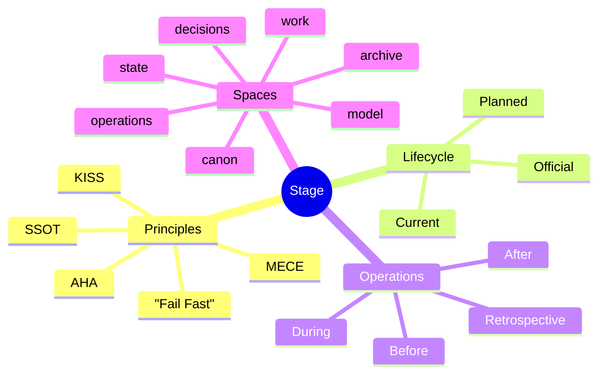

### 2. 큰 시간축

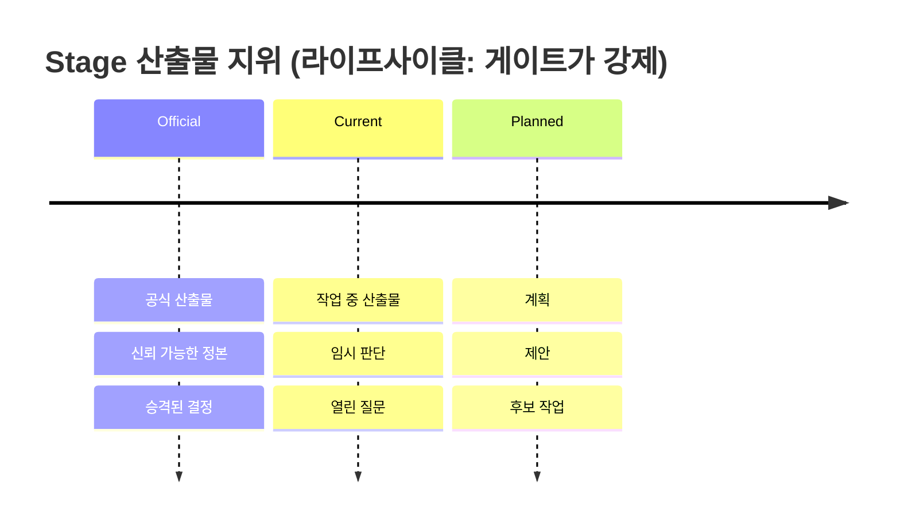

### 3. 개별 시간축

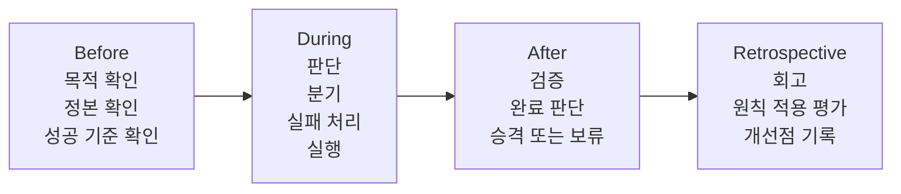

### 4. 공간축

```mermaid
flowchart TB
  Stage[".stage/"]

  Stage --> Official["official\n공식 지위 (승격된 정본)"]
  Stage --> Work["work\n작업 카드 라이프사이클"]
  Stage --> DecisionsF["decisions\npending 결정"]
  Stage --> State["state\n작업 중 상태"]
  Stage --> Proposals["proposals\n제안"]
  Stage --> Roadmap["roadmap\n테마 / 마일스톤"]
  Stage --> Operations["operations\n행위 규칙"]
  Stage --> Settings["settings.json\n거버넌스 범위\n광역 기본 + 제외 목록"]

  Official --> Canon["canon\n원칙 / 용어 / 불변 조건"]
  Official --> Model["model\n구조 / 경계 / 인터페이스"]
  Official --> Decisions["decisions\n승격된 결정 + 다 쓴 허가"]
  Official --> Archive["work/archive\n보관된 작업 기록 + 회고"]
  Official --> ProposalArchive["proposals/archive\n실린 / 접힌 / 절반 제안"]
  Official --> StateArchive["state/archive\n닫힌 관측 / 답한 질문"]

  Canon --> CanonRecords["*/\n개별 원칙 / 용어 / 불변 조건"]
  Model --> ModelRecords["components / boundaries / interfaces"]
  Decisions --> DecisionRecords["records\n개별 결정 SSOT (DE- id 유지)"]
  Decisions --> DecisionArchive["archive\n효력이 끝난 일회성 허가"]
  Archive --> ArchiveRecords["items / retrospectives\n보관 작업 기록과 회고"]

  Work --> Planned["planned\n계획 카드 + views (planned 보조 뷰)"]
  Work --> Current["current\nactive / review 카드"]
  Work --> Retros["retrospectives\n회고 기록"]

  DecisionsF --> Pending["pending\n작업 중 결정 (DE-)"]

  State --> StateRecords["observations / questions / assumptions / risks\nwork_items로 작업 연결"]

  Roadmap --> RoadmapThemes["themes\nTH- 테마 (체인에서 상태 계산)"]
  Roadmap --> RoadmapMilestones["milestones\nM- 마일스톤 (닫기 시 기저 동결)"]
  Proposals --> ProposalRecords["P-\n개별 제안"]

  Operations --> BeforeOps["before"]
  Operations --> DuringOps["during"]
  Operations --> AfterOps["after"]
  Operations --> RetrospectiveOps["retrospective"]
  Operations --> OutputOps["output"]
  Operations --> ArtifactOps["artifacts"]
  Operations --> DocOps["documentation"]
  Operations --> VerifyOps["verification"]
  Operations --> BacklogOps["backlog"]
  Operations --> HookOps["hooks"]
```

### 5. 세 축의 결합

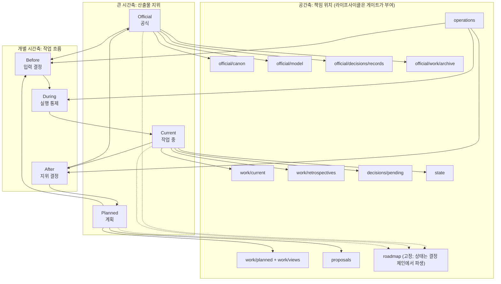

### 6. 작업 항목 상태 전이

작업 항목 상태 enum의 SSOT는 `operations/artifacts.md`다. `work/current/README.md`는 같은 값을 참조한다.

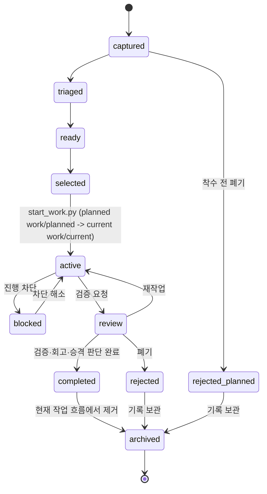

계획 단계(`captured`/`triaged`/`ready`/`selected`)는 `work/planned/`에 있고, `start_work.py`가
`work/current/`의 `active`로 이동시킨다. 착수 전 폐기(`rejected`)는 계획 카드에서도 일어난다.

`archived` 이동은 승격과 다르다. `official/work/archive/` 대상은 archive intent로 보관하며, rejected 작업도 보관할 수 있다.

### 7. 요청 처리 흐름

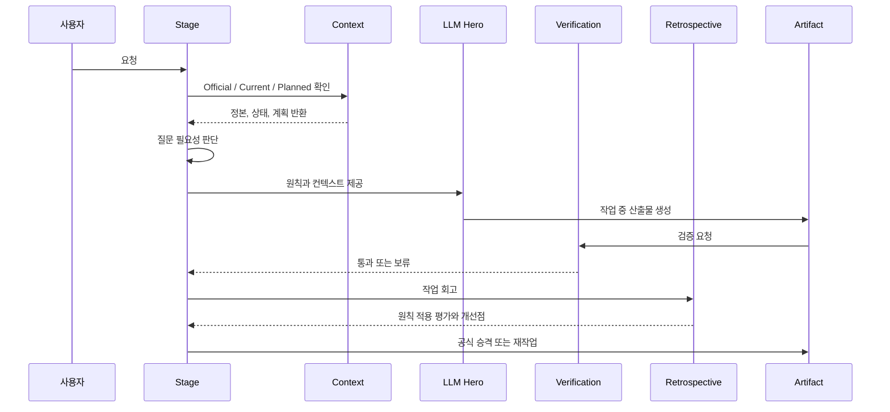

### 8. 원칙 적용 위치

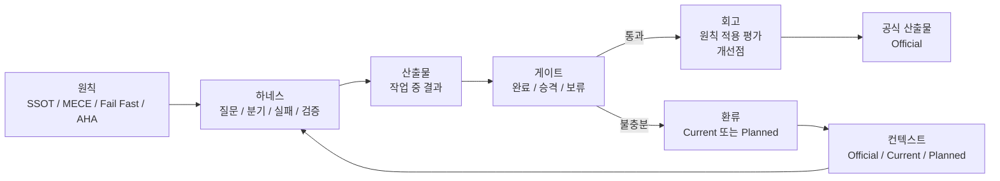

### 9. 의사결정 통제

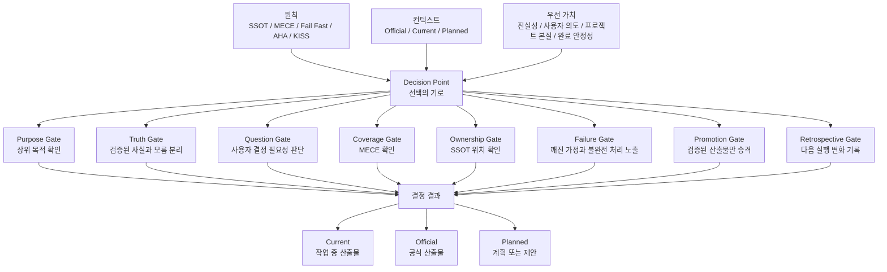

### 10. Stage 하네스의 두 축

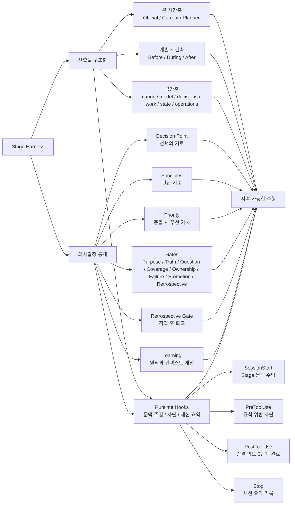

### 11. 첫 완성 단위

```mermaid
flowchart TB
  CompleteUnit["첫 완성 단위"]

  CompleteUnit --> Structure[".stage/ 산출물 구조"]
  CompleteUnit --> Routing["index.md 라우팅 규칙"]
  CompleteUnit --> ItemRecords["개별 산출물 파일\nitems / records / templates"]
  CompleteUnit --> ArtifactRules["operations/artifacts.md\n산출물 패밀리 규칙"]
  CompleteUnit --> Before["operations/before.md"]
  CompleteUnit --> During["operations/during.md"]
  CompleteUnit --> After["operations/after.md"]
  CompleteUnit --> Retrospective["operations/retrospective.md"]
  CompleteUnit --> Hooks["operations/hooks.md\nSessionStart / PreToolUse / Stop"]
  CompleteUnit --> Promotion["current -> official 승격 규칙"]
  CompleteUnit --> PlannedGuard["planned/proposals는 공식 진실이 아님"]
  CompleteUnit --> CompletionGate["부분 완료 금지\n첫 단위부터 닫힌 루프"]

  Structure --> ClosedLoop["닫힌 루프"]
  Routing --> ClosedLoop
  ItemRecords --> ClosedLoop
  ArtifactRules --> ClosedLoop
  Before --> ClosedLoop
  During --> ClosedLoop
  After --> ClosedLoop
  Retrospective --> ClosedLoop
  Hooks --> ClosedLoop
  Promotion --> ClosedLoop
  PlannedGuard --> ClosedLoop
  CompletionGate --> ClosedLoop
```

### 11-1. 산출물 패밀리 원칙

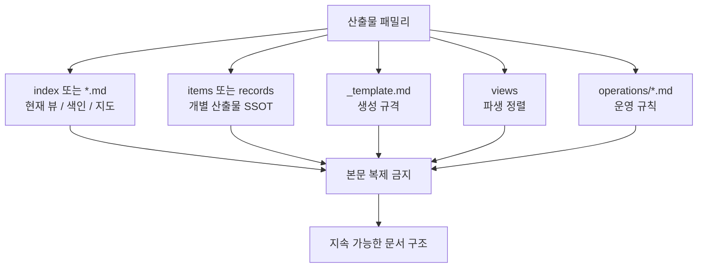

### 11-2. 끝난 기록이 사는 자리

**폴더가 상태다.** 살아 있는 서랍에 있으면 아직 유효하고, 보관함에 있으면 끝났다. 사람이 파일을
열지 않고 자리만 보고 판단한다. 상태를 말하는 frontmatter 칸은 따로 두지 않는다 — 자리와 칸이
둘 다 상태를 말하면 어긋난다(DE-00000057).

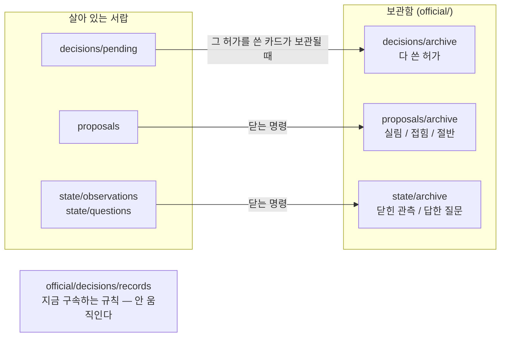

| 갈래 | 옮기는 주체 | 왜 그쪽인가 |
|---|---|---|
| 일회성 허가 | 카드를 보관하는 명령 | 효력이 카드 상태에서 계산된다. 사람이 판정할 것이 없다 |
| 제안 | 닫는 명령 | 실렸는지 접혔는지는 사람이 판정한다. 결과를 `accepted` / `rejected` / `partial` 로 남긴다 |
| 관측 / 질문 | 닫는 명령 | 해소됐는지는 사람이 판정한다. 근거는 본문에 남는다 |

**사람이 손으로 옮기는 길은 없다.** 손으로 옮기는 자리를 남기면 인덱스가 따로 낡는다. 되돌리는
길도 닫는 명령이 함께 가진다. 기록은 어느 경우에도 안 지운다.

### 12. 완성도와 회고 게이트

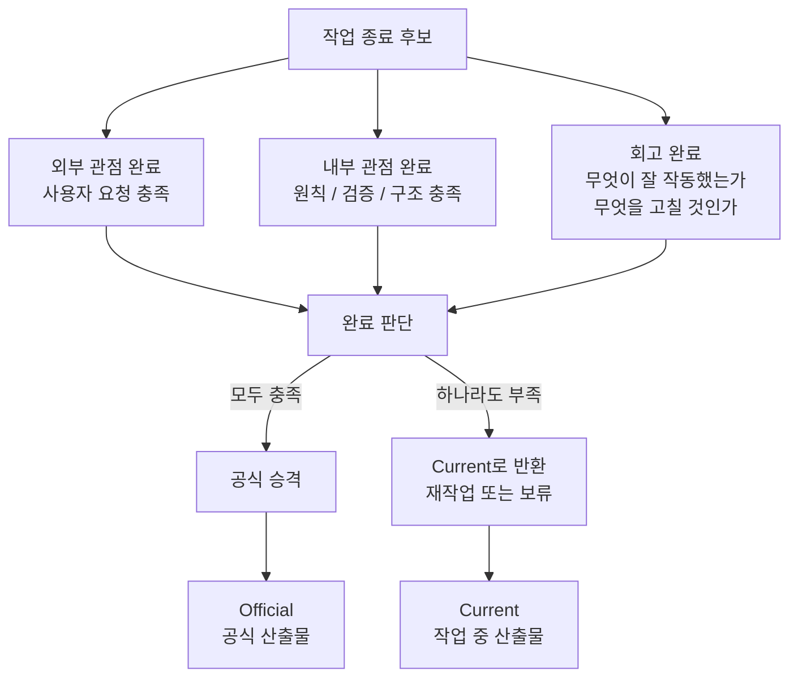

### 13. 호스트와 플랫폼 독립성

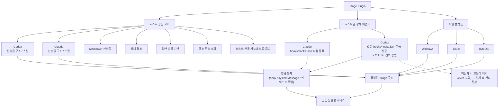

호스트 훅 계약(도구명 매핑 · 출력 규칙 · 신뢰 게이트)의 상세 정본은 `hooks/README.md` §Host contract.

### 14. 이식성 게이트

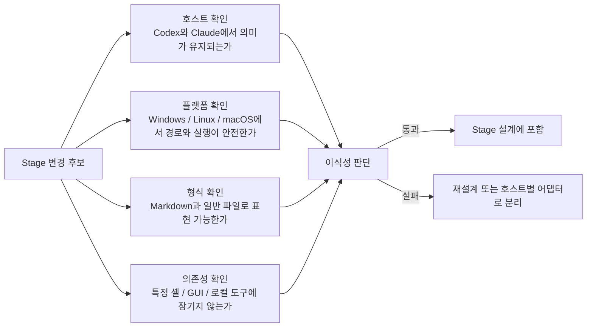

### 15. 훅 실행 게이트

```mermaid
flowchart TB
  Event["호스트 이벤트"]

  Event --> SessionStart["SessionStart"]
  Event --> PreToolUse["PreToolUse"]
  Event --> PostToolUse["PostToolUse"]
  Event --> Stop["Stop"]

  SessionStart --> Inject["Stage 문맥 주입\nplanned / current / official\n완료 게이트"]

  PreToolUse --> DeleteGate["삭제 게이트\n.stage 전체 삭제 차단\n등재 파일 삭제도 쓰기와 동일 게이트"]
  PreToolUse --> RegistrationGate["등재 게이트\n거버넌스 대상 수정 전 작업 항목 필요\n광역 기본 — 거의 모든 파일"]
  PreToolUse --> GovernanceGate["거버넌스 게이트\nsettings.json 파손 시 fail-closed"]
  PreToolUse --> HierarchyGate["계층 게이트\n부모 부재 / 자기 참조 /\n닫힌 부모 아래 자식 차단"]
  PreToolUse --> PromotionGate["승격 게이트\n대역 외 승격 의도 + promotes 바인딩\nrename 예약 (1단계)"]
  PreToolUse --> CommitGate["커밋 게이트\n열린 일 필요 / 목록 밖 통과+알림\n끝난 일의 미완결 파일 차단"]
  PreToolUse --> PortabilityGate["이식성 게이트\nOS 전용 스크립트 차단"]
  PreToolUse --> QuestionReminder["질문 게이트\n질문 전 목적·원칙 상기\n질문당 1회 리마인드"]

  PostToolUse --> IntentComplete["승격 의도 완료 (2단계)\nrename 예약을 확정, 차단 없음"]

  Audit["Audit CLI\n템플릿 / enum / 색인 / archive / 계층 / 계보 /\n결정 원칙 인용 / 거버넌스 / 정본 중복 /\n소유 경계 / 라우팅 검사"]

  Stop --> Summary["세션 요약 기록\n.stage/.runtime/sessions/세션별.md"]

  Inject --> Execution["일관된 수행"]
  DeleteGate --> Execution
  RegistrationGate --> Execution
  GovernanceGate --> Execution
  HierarchyGate --> Execution
  PromotionGate --> Execution
  CommitGate --> Execution
  PortabilityGate --> Execution
  QuestionReminder --> Execution
  IntentComplete --> Execution
  Audit --> Execution
  Summary --> Execution
```
